---
## Author
author:
  name: Цыкунова Екатерина Михайловна
  email: 1132246732@rudn.ru
  affiliation:
    - name: Российский университет дружбы народов
      country: Российская Федерация
      postal-code: 117198
      city: Москва
      address: ул. Миклухо-Маклая, д. 6

## Title
title: Лабораторная работа №8
subtitle: Настройка SMTP-сервера
license: CC BY
date: today
date-format: "YYYY-MM-DD"
---

# Цели и задачи работы

## Цель лабораторной работы

Целью данной работы является приобретение практических навыков установки и настройки почтового сервера Postfix, организации отправки и получения электронной почты по протоколу SMTP, настройки доменной почты с использованием DNS, а также автоматизации конфигурации с помощью Vagrant.

## Задачи лабораторной работы

- установить и запустить почтовый сервер `Postfix` на виртуальных машинах `server` и `client`;
- выполнить первоначальную настройку Postfix с помощью утилиты `postconf`;
- проверить отправку и получение электронных сообщений с сервера и клиента;
- настроить сетевые интерфейсы и доверенные сети для передачи почты;
- настроить DNS-записи для отправки сообщений на доменные адреса;

# Процесс выполнения лабораторной работы

## Устанавливаю Postfix и настраиваю межсетевой экран

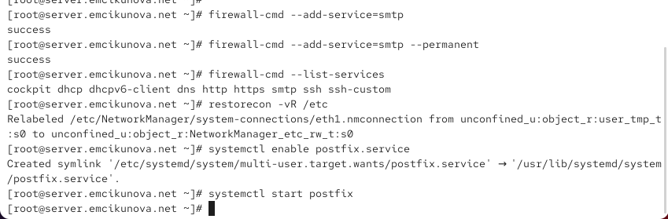{ #fig:001 width=70% height=70% }

## Просматриваю текущую конфигурацию Postfix

{ #fig:002 width=70% height=70% }

## Изменяю параметры myorigin и mydomain

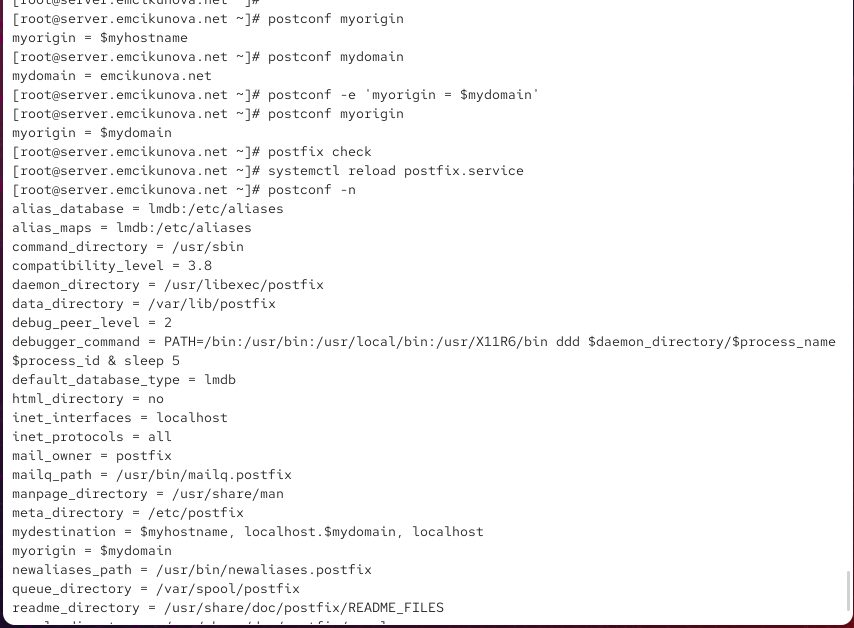{ #fig:003 width=70% height=70% }

## Настраиваю домен и отключаю IPv6

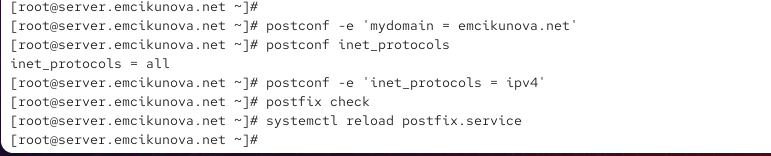{ #fig:004 width=70% height=70% }

## Отправляю тестовое письмо с сервера

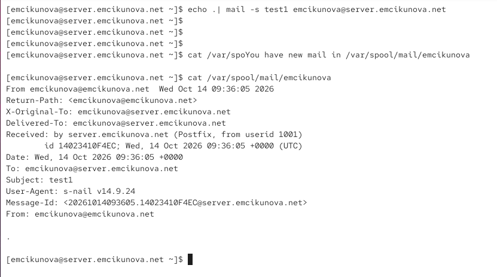{ #fig:005 width=70% height=70% }

## Проверяю доставку письма по журналу Postfix

{ #fig:006 width=70% height=70% }

## Устанавливаю и настраиваю Postfix на клиенте

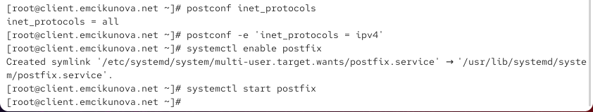{ #fig:007 width=70% height=70% }

## Выполняю первоначальную отправку письма с клиента

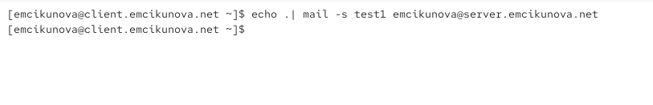{ #fig:008 width=70% height=70% }

## Настраиваю сетевые интерфейсы и доверенные сети

{ #fig:009 width=70% height=70% }

## Повторно отправляю письмо с клиента

{ #fig:010 width=70% height=70% }

## Проверяю получение письма от клиента

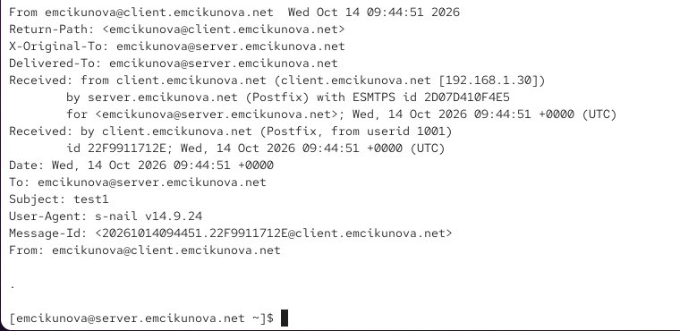{ #fig:011 width=70% height=70% }

## Подтверждаю успешную доставку по журналу

{ #fig:012 width=70% height=70% }

## Отправляю письмо на доменный адрес

{ #fig:013 width=70% height=70% }

## Анализирую ошибку доставки доменной почты

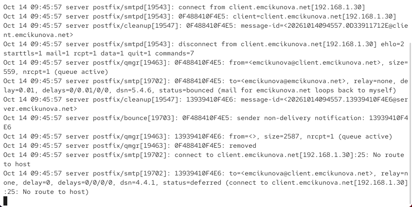{ #fig:014 width=70% height=70% }

## Добавляю MX-запись в прямую DNS-зону

{ #fig:015 width=70% height=70% }

## Настраиваю обратную DNS-зону

{ #fig:016 width=70% height=70% }

## Настраиваю локальную доставку доменной почты

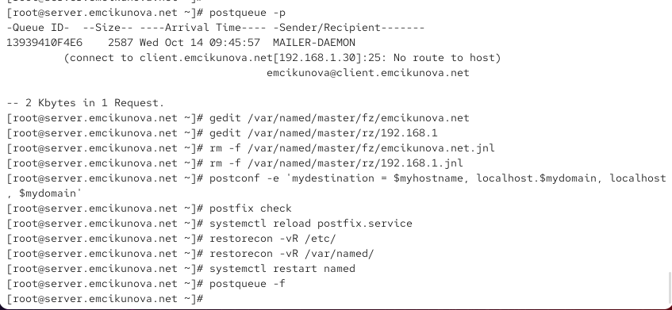{ #fig:017 width=70% height=70% }

## Повторно отправляю письмо на доменный адрес

{ #fig:018 width=70% height=70% }

## Проверяю получение доменного письма

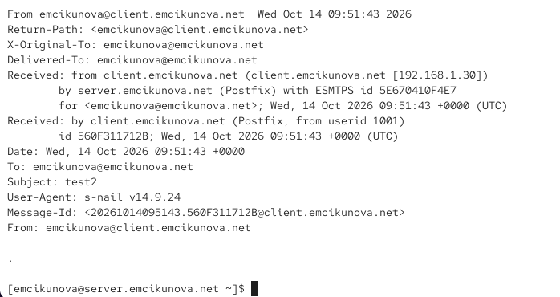{ #fig:019 width=70% height=70% }

## Проверяю успешную доставку по журналу Postfix

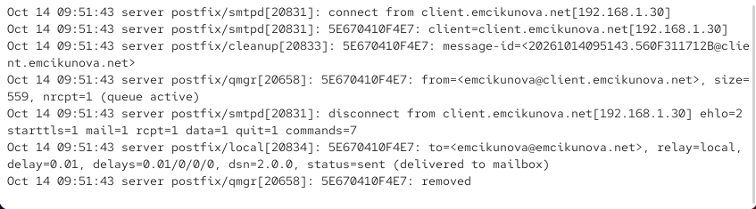{ #fig:020 width=70% height=70% }

## Сохраняю конфигурацию DNS для Vagrant

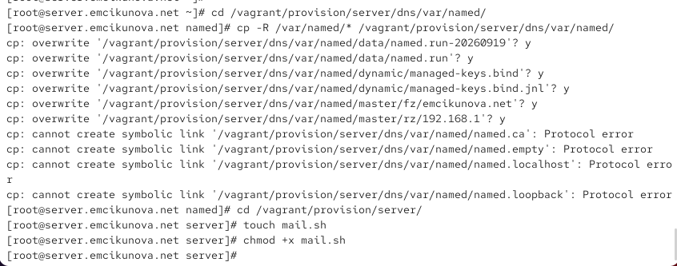{ #fig:021 width=70% height=70% }

## Создаю скрипт автоматической настройки Postfix на сервере

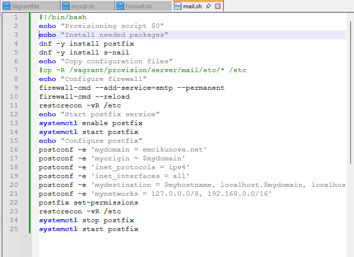{ #fig:022 width=70% height=70% }

## Создаю скрипт автоматической настройки на клиенте

{ #fig:023 width=70% height=70% }

## Настраиваю автоматическую установку Postfix на клиенте

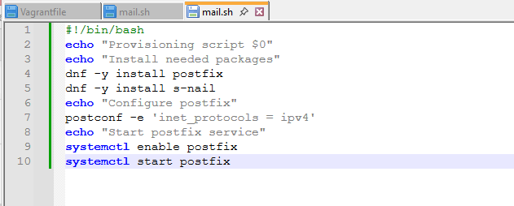{ #fig:024 width=70% height=70% }

# Результаты лабораторной работы

## Вывод

В ходе лабораторной работы я установила и настроила почтовый сервер `Postfix` на виртуальных машинах `server` и `client`.

С помощью утилиты `postconf` были настроены параметры домена, сетевых интерфейсов и доверенных сетей. Выполнена проверка отправки и получения электронной почты между виртуальными машинами.

Для организации доменной почты были добавлены записи `MX`, `A` и `PTR` в DNS, а также настроен параметр `mydestination`.

Работоспособность почтового сервера подтверждена успешной доставкой писем на адрес `emcikunova@emcikunova.net` и соответствующими записями в журнале Postfix.
