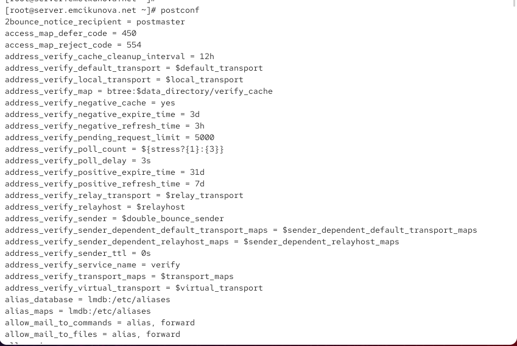
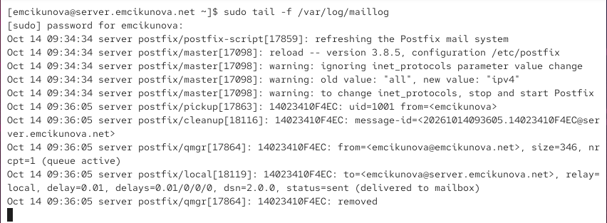
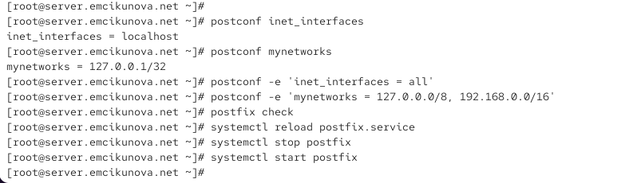
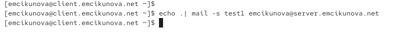
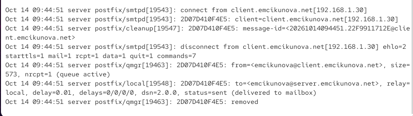
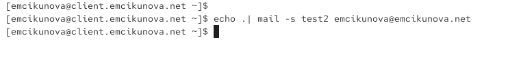
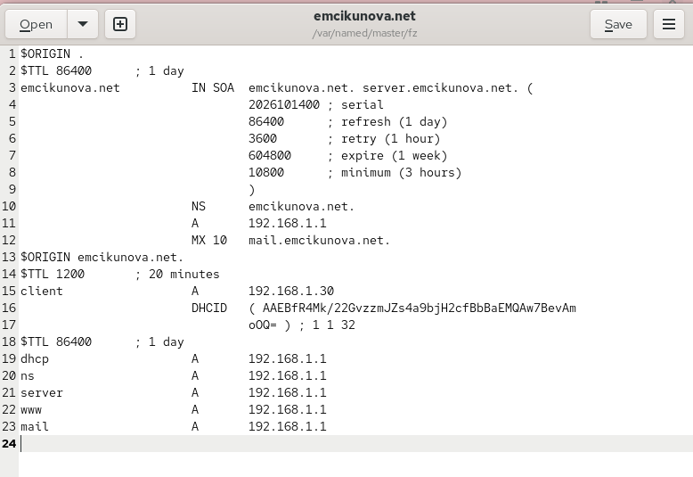
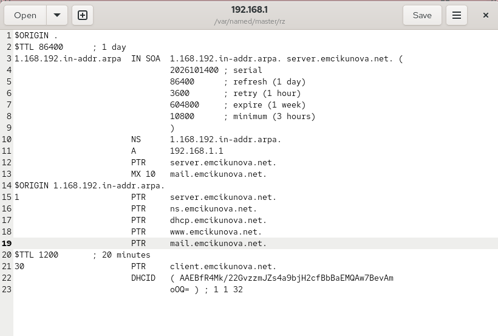
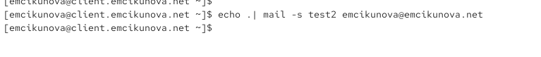
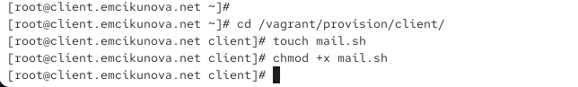

---
## Author
author:
  name: Цыкунова Екатерина Михайловна
  email: 1132246732@rudn.ru
  affiliation:
    - name: Российский университет дружбы народов
      country: Российская Федерация
      postal-code: 117198
      city: Москва
      address: ул. Миклухо-Маклая, д. 6

## Title
title: "Отчёт по лабораторной работе №8"
subtitle: "Настройка SMTP-сервера"
license: "CC BY"
---

# Цель работы

Приобретение практических навыков по установке и конфигурированию SMTP-сервера.

# Выполнение лабораторной работы

## Установка Postfix

На виртуальной машине `server.emcikunova.net` открываю терминал и перехожу в режим суперпользователя:

```bash
sudo -i
```

Устанавливаю почтовый сервер Postfix и утилиту `s-nail` для работы с электронной почтой:

```bash
dnf -y install postfix
dnf -y install s-nail
```

Разрешаю SMTP-соединения в межсетевом экране и проверяю список доступных служб:

```bash
firewall-cmd --add-service=smtp
firewall-cmd --add-service=smtp --permanent
firewall-cmd --list-services
```

После этого восстанавливаю контексты безопасности SELinux и запускаю Postfix:

```bash
restorecon -vR /etc
systemctl enable postfix
systemctl start postfix
```

Служба успешно запускается, а SMTP добавляется в список разрешённых служб FirewallD (см. рис. [@fig-001]).

{ #fig-001 width=70% }

## Первоначальная настройка Postfix

Для просмотра текущих параметров почтового сервера использую утилиту `postconf`:

```bash
postconf
```

Команда выводит список настроек Postfix, включая параметры сетевых интерфейсов, доменных имён и маршрутизации сообщений (см. рис. [@fig-002]).

{ #fig-002 width=70% }

Проверяю значения параметров `myorigin` и `mydomain`:

```bash
postconf myorigin
postconf mydomain
```

Первоначально параметр `myorigin` использует имя локального узла, а `mydomain` содержит значение `emcikunova.net`.

Изменяю параметр `myorigin`, чтобы письма отправлялись от имени домена:

```bash
postconf -e 'myorigin = $mydomain'
```

Проверяю корректность конфигурации и применяю изменения:

```bash
postconf myorigin
postfix check
systemctl reload postfix
postconf -n
```

В результате новое значение параметра сохраняется, а команда `postconf -n` отображает изменённые настройки почтовой службы (см. рис. [@fig-003]).

{ #fig-003 width=70% }

Далее явно указываю домен и отключаю IPv6, оставляя только IPv4:

```bash
postconf -e 'mydomain = emcikunova.net'
postconf inet_protocols
postconf -e 'inet_protocols = ipv4'
postfix check
systemctl reload postfix
```

После выполнения команд Postfix использует домен `emcikunova.net` и работает через IPv4 (см. рис. [@fig-004]).

{ #fig-004 width=70% }

## Проверка отправки почты с сервера

Для проверки работы Postfix отправляю тестовое письмо самой себе:

```bash
echo . | mail -s test1 emcikunova@server.emcikunova.net
```

Проверяю содержимое локального почтового ящика:

```bash
cat /var/spool/mail/emcikunova
```

В файле отображается письмо с темой `test1`, адресованное пользователю `emcikunova`. Это подтверждает успешную локальную доставку сообщения (см. рис. [@fig-005]).

{ #fig-005 width=70% }

Для дополнительной проверки просматриваю журнал почтовой службы:

```bash
tail -f /var/log/maillog
```

В журнале присутствует запись:

```text
status=sent (delivered to mailbox)
```

Она подтверждает успешную доставку письма. После обработки сообщение удаляется из очереди Postfix, о чём свидетельствует запись `removed` (см. рис. [@fig-006]).

{ #fig-006 width=70% }

## Настройка Postfix на клиенте

На виртуальной машине `client.emcikunova.net` перехожу в режим суперпользователя и устанавливаю необходимые пакеты:

```bash
sudo -i
dnf -y install postfix
dnf -y install s-nail
```

Отключаю IPv6 и запускаю почтовую службу:

```bash
postconf -e 'inet_protocols = ipv4'
systemctl enable postfix
systemctl start postfix
```

Postfix успешно устанавливается и запускается на клиентской виртуальной машине (см. рис. [@fig-007]).

{ #fig-007 width=70% }

Отправляю тестовое письмо с клиента на сервер:

```bash
echo . | mail -s test1 emcikunova@server.emcikunova.net
```

Команда выполняется без ошибок, однако для приёма сообщений от других узлов необходимо дополнительно настроить сетевые интерфейсы сервера (см. рис. [@fig-008]).

{ #fig-008 width=70% }

## Настройка приёма почты из сети

На сервере проверяю параметры `inet_interfaces` и `mynetworks`:

```bash
postconf inet_interfaces
postconf mynetworks
```

Параметр `inet_interfaces` первоначально имеет значение `localhost`, поэтому Postfix принимает SMTP-соединения только с локального узла.

Разрешаю приём соединений через все интерфейсы и добавляю внутреннюю сеть в список доверенных:

```bash
postconf -e 'inet_interfaces = all'
postconf -e 'mynetworks = 127.0.0.0/8, 192.168.0.0/16'
```

Проверяю конфигурацию и перезапускаю службу:

```bash
postfix check
systemctl reload postfix
systemctl stop postfix
systemctl start postfix
```

Изменения применяются успешно (см. рис. [@fig-009]).

{ #fig-009 width=70% }

На клиенте повторно отправляю письмо:

```bash
echo . | mail -s test1 emcikunova@server.emcikunova.net
```

Команда выполняется без сообщений об ошибках (см. рис. [@fig-010]).

{ #fig-010 width=70% }

На сервере просматриваю содержимое почтового ящика:

```bash
cat /var/spool/mail/emcikunova
```

В заголовках полученного сообщения указан отправитель `emcikunova@client.emcikunova.net` и адрес клиента `192.168.1.30`. Это подтверждает передачу письма по сети (см. рис. [@fig-011]).

{ #fig-011 width=70% }

Дополнительно проверяю журнал Postfix:

```bash
tail -f /var/log/maillog
```

В журнале отображаются подключение клиента и запись `status=sent (delivered to mailbox)`, подтверждающая успешную доставку сообщения (см. рис. [@fig-012]).

{ #fig-012 width=70% }

## Настройка Postfix для работы в домене

Для проверки отправки почты на доменный адрес выполняю на клиенте:

```bash
echo . | mail -s test2 emcikunova@emcikunova.net
```

Теперь получателем является адрес домена `emcikunova.net`, а не конкретного сервера (см. рис. [@fig-013]).

{ #fig-013 width=70% }

На сервере проверяю журнал почтовой службы:

```bash
tail -f /var/log/maillog
```

Обнаруживаю ошибку:

```text
status=bounced (mail for emcikunova.net loops back to myself)
```

Она означает, что Postfix определил собственный сервер как узел доставки, но домен ещё не включён в список локально обслуживаемых адресов.

Также появляется статус `deferred`, указывающий на отложенную отправку уведомления о недоставке. Следовательно, первоначальная отправка письма на доменный адрес завершилась неудачно (см. рис. [@fig-014]).

{ #fig-014 width=70% }

## Настройка DNS-записей почтового сервера

Для обеспечения доставки сообщений на доменный адрес редактирую файл прямой DNS-зоны:

```bash
gedit /var/named/master/fz/emcikunova.net
```

Добавляю MX-запись, определяющую почтовый сервер домена, и A-запись с его IP-адресом:

```dns
MX 10 mail.emcikunova.net.
mail A 192.168.1.1
```

MX-запись указывает сервер, принимающий почту для домена, а A-запись связывает его имя с адресом `192.168.1.1` (см. рис. [@fig-015]).

{ #fig-015 width=70% }

Затем открываю файл обратной DNS-зоны:

```bash
gedit /var/named/master/rz/192.168.1
```

Добавляю PTR-запись:

```dns
1 PTR mail.emcikunova.net.
```

Она позволяет определить имя почтового сервера по IP-адресу. После внесения изменений сохраняю файл (см. рис. [@fig-016]).

{ #fig-016 width=70% }

## Настройка локальной доставки доменной почты

Для приёма сообщений, адресованных домену `emcikunova.net`, изменяю параметр `mydestination`:

```bash
postconf -e 'mydestination = $myhostname, localhost.$mydomain, localhost, $mydomain'
```

Теперь Postfix рассматривает указанный домен как локальный и может доставлять сообщения его пользователям.

Проверяю конфигурацию, обновляю настройки и восстанавливаю контексты SELinux:

```bash
postfix check
systemctl reload postfix
restorecon -vR /etc
restorecon -vR /var/named
systemctl restart named
```

После этого проверяю очередь сообщений и запускаю повторную отправку:

```bash
postqueue -p
postqueue -f
```

В очереди присутствует уведомление о недоставке предыдущего сообщения. Команда `postqueue -f` инициирует повторную обработку отложенной почты (см. рис. [@fig-017]).

{ #fig-017 width=70% }

## Повторная проверка отправки почты на доменный адрес

На клиенте повторно отправляю тестовое сообщение:

```bash
echo . | mail -s test2 emcikunova@emcikunova.net
```

Команда выполняется без ошибок (см. рис. [@fig-018]).

{ #fig-018 width=70% }

На сервере проверяю содержимое почтового ящика:

```bash
cat /var/spool/mail/emcikunova
```

В полученном письме указан адрес доставки `emcikunova@emcikunova.net` и тема `test2`. Следовательно, сообщение успешно доставлено на доменный адрес (см. рис. [@fig-019]).

{ #fig-019 width=70% }

В журнале Postfix также присутствует запись:

```text
status=sent (delivered to mailbox)
```

Это подтверждает успешную доставку сообщения после настройки DNS и параметра `mydestination` (см. рис. [@fig-020]).

{ #fig-020 width=70% }

## Внесение изменений в настройки внутреннего окружения виртуальной машины

Для автоматизации настройки почтовой службы сохраняю обновлённые файлы DNS и создаю исполняемые скрипты `mail.sh` для виртуальных машин `server` и `client` (см. рис. [@fig-021]–[@fig-024]).

{ #fig-021 width=70% }

{ #fig-022 width=70% }

{ #fig-023 width=70% }

{ #fig-024 width=70% }

В конфигурацию `Vagrantfile` добавляю вызовы созданных скриптов, чтобы установка и настройка Postfix выполнялись автоматически при подготовке виртуальных машин.

# Вывод

В ходе лабораторной работы я установила и настроила почтовый сервер Postfix на виртуальных машинах `server` и `client`. Настроила параметры SMTP, сетевые интерфейсы, доверенные сети и DNS-записи для работы с доменной почтой.

Проверила отправку и получение электронных сообщений, убедилась в их успешной доставке по содержимому почтового ящика и журналу Postfix. Также подготовила скрипты для автоматизации настройки почтовой службы средствами Vagrant.

# Контрольные вопросы

*1. В каком каталоге и в каком файле следует смотреть конфигурацию Postfix?*

Основная конфигурация почтового сервера Postfix находится в каталоге `/etc/postfix/`. Главным конфигурационным файлом является `/etc/postfix/main.cf`, в котором задаются параметры домена, сетевых интерфейсов, маршрутизации и доставки электронной почты.

Для просмотра содержимого файла можно использовать команду:

```bash
cat /etc/postfix/main.cf
```

Также для просмотра действующих параметров применяется утилита `postconf`:

```bash
postconf
```

Чтобы вывести только параметры, отличающиеся от значений по умолчанию, используется команда:

```bash
postconf -n
```

Дополнительно в каталоге `/etc/postfix/` находится файл `master.cf`, определяющий работу служб и процессов Postfix, включая SMTP-сервер.

*2. Каким образом можно проверить корректность синтаксиса в конфигурационном файле Postfix?*

Для проверки конфигурации Postfix используется команда:

```bash
postfix check
```

Она проверяет основные параметры конфигурации, наличие необходимых файлов и каталогов, а также некоторые права доступа.

Если при выполнении проверки обнаружены ошибки, в терминале отображаются соответствующие диагностические сообщения. Отсутствие сообщений обычно свидетельствует о том, что проверяемые параметры не содержат обнаруженных ошибок.

После изменения конфигурации необходимо применить новые настройки:

```bash
systemctl reload postfix
```

Для просмотра действующих значений параметров можно дополнительно использовать:

```bash
postconf -n
```

Команда `postfix check` не гарантирует правильность всей логики маршрутизации почты, поэтому после настройки рекомендуется выполнить тестовую отправку сообщения и проверить журнал `/var/log/maillog`.

*3. В каких параметрах конфигурации Postfix требуется внести изменения в значениях для настройки возможности отправки писем не на локальный хост, а на доменные адреса?*

Для настройки работы Postfix с доменными адресами необходимо изменить несколько параметров конфигурации.

Параметр `mydomain` определяет основной домен почтового сервера:

```bash
postconf -e 'mydomain = emcikunova.net'
```

Параметр `myorigin` задаёт домен, который добавляется к локальным адресам отправителей:

```bash
postconf -e 'myorigin = $mydomain'
```

Параметр `mydestination` определяет домены, для которых Postfix выполняет локальную доставку электронной почты:

```bash
postconf -e 'mydestination = $myhostname, localhost.$mydomain, localhost, $mydomain'
```

Для приёма SMTP-соединений от других узлов сети необходимо изменить `inet_interfaces`:

```bash
postconf -e 'inet_interfaces = all'
```

Список доверенных сетей задаётся параметром `mynetworks`:

```bash
postconf -e 'mynetworks = 127.0.0.0/8, 192.168.0.0/16'
```

Дополнительно в DNS необходимо создать MX-запись, указывающую почтовый сервер домена, и A-запись для определения его IP-адреса:

```dns
MX 10 mail.emcikunova.net.
mail A 192.168.1.1
```

После внесения изменений проверяю конфигурацию и перезагружаю Postfix:

```bash
postfix check
systemctl reload postfix
```

В результате почтовый сервер может принимать сообщения для домена `emcikunova.net` и доставлять их локальным пользователям. MX-запись позволяет другим почтовым серверам определить, куда направлять письма для данного домена.

*4. Приведите примеры работы с утилитой mail по отправке письма, просмотру имеющихся писем, удалению письма.*

Утилита `mail`, входящая в пакет `s-nail`, позволяет отправлять, просматривать и удалять электронные сообщения через командную строку.

Для отправки письма с темой `test1` используется команда:

```bash
echo "Тестовое сообщение" | mail -s "test1" emcikunova@emcikunova.net
```

Команда `echo` формирует текст письма, а параметр `-s` задаёт его тему.

Для просмотра списка полученных сообщений необходимо выполнить:

```bash
mail
```

После запуска отображается список писем с указанием их номеров, отправителей и тем.

Для просмотра конкретного письма достаточно ввести его номер, например:

```text
1
```

Для удаления первого письма используется команда:

```text
d 1
```

Чтобы удалить несколько сообщений, можно указать их номера:

```text
d 1 2 3
```

После удаления необходимо завершить работу с утилитой командой:

```text
q
```

Команда `q` завершает сеанс и сохраняет изменения в почтовом ящике, включая удаление отмеченных сообщений.

*5. Приведите примеры работы с утилитой postqueue. Как посмотреть очередь сообщений? Как определить число сообщений в очереди? Как отправить все сообщения, находящиеся в очереди? Как удалить письмо из очереди?*

Утилита `postqueue` предназначена для просмотра очереди сообщений Postfix и управления повторными попытками их доставки.

Для просмотра текущей очереди используется команда:

```bash
postqueue -p
```

Она отображает список сообщений, ожидающих отправки, их идентификаторы, отправителей, получателей и возможные причины задержки доставки.

Для определения количества сообщений в очереди можно выполнить:

```bash
postqueue -j | wc -l
```

Команда `postqueue -j` выводит сведения о каждом сообщении в формате JSON, по одному сообщению в строке, а `wc -l` подсчитывает количество строк.

Для повторной отправки всех сообщений, находящихся в очереди, используется:

```bash
postqueue -f
```

Эта команда принудительно запускает повторную попытку доставки ожидающих сообщений. Если причина ошибки не устранена, письмо может остаться в очереди.

Для повторной отправки отдельного отложенного сообщения можно указать его идентификатор:

```bash
postqueue -i QUEUE_ID
```

Удаление сообщений выполняется не утилитой `postqueue`, а командой `postsuper`.

Для удаления конкретного письма необходимо выполнить:

```bash
postsuper -d QUEUE_ID
```

Здесь `QUEUE_ID` — идентификатор сообщения, который можно узнать с помощью `postqueue -p`.

Для удаления всех сообщений из очереди используется:

```bash
postsuper -d ALL
```

Данная команда безвозвратно удаляет все сообщения из очереди Postfix, поэтому применять её следует с осторожностью.

В лабораторной работе я использовала команды `postqueue -p` и `postqueue -f` для проверки отложенных сообщений и повторной попытки их доставки после исправления конфигурации DNS и Postfix.

# Список литературы

1. [Postfix. Basic Configuration — официальное руководство по первоначальной настройке почтового сервера Postfix](https://www.postfix.org/BASIC_CONFIGURATION_README.html).

2. [Postfix. Configuration Parameters — описание параметров конфигурационного файла main.cf](https://www.postfix.org/postconf.5.html).

3. [Postfix. Postconf — управление и изменение параметров конфигурации почтового сервера](https://www.postfix.org/postconf.1.html).

4. [Postfix. Postqueue — просмотр очереди почтовых сообщений и управление их отправкой](https://www.postfix.org/postqueue.1.html).

5. [Postfix. Postsuper — управление очередью Postfix и удаление сообщений](https://www.postfix.org/postsuper.1.html).

6. [Red Hat. Deploying and Configuring a Postfix SMTP Server — установка и настройка SMTP-сервера в Red Hat Enterprise Linux 9](https://docs.redhat.com/en/documentation/red_hat_enterprise_linux/9/html/deploying_mail_servers/assembly_mail-transport-agent_deploying-mail-servers).

7. [ISC. BIND 9 Administrator Reference Manual — настройка DNS-сервера, прямых и обратных зон, записей MX, A и PTR](https://bind9.readthedocs.io/en/latest/chapter3.html).

8. [Debian Manpages. S-nail — использование утилиты mail для отправки, просмотра и удаления электронных сообщений](https://manpages.debian.org/trixie/s-nail/s-nail.1.en.html).

9. [HashiCorp. Vagrant Shell Provisioner — автоматизация установки и настройки программного обеспечения с помощью Shell-скриптов](https://developer.hashicorp.com/vagrant/docs/provisioning/shell).

10. [Firewalld. Firewall-cmd — настройка межсетевого экрана и разрешение SMTP-соединений](https://firewalld.org/documentation/man-pages/firewall-cmd.html).