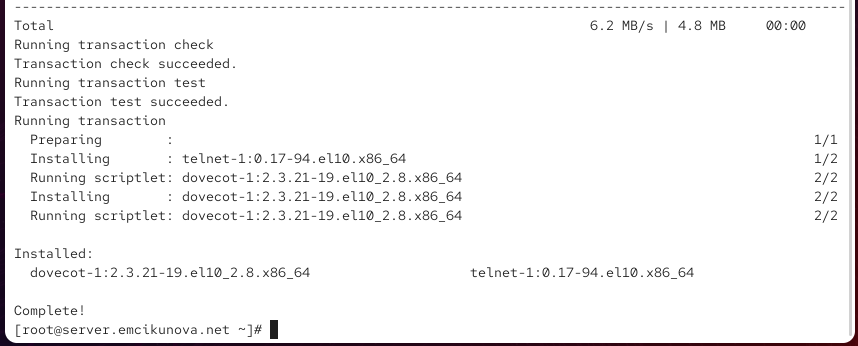
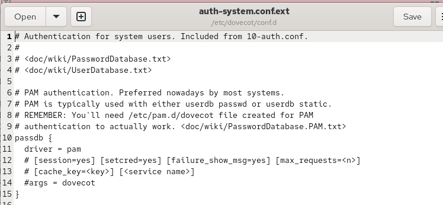
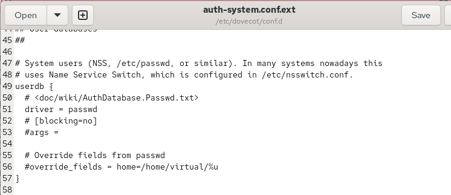
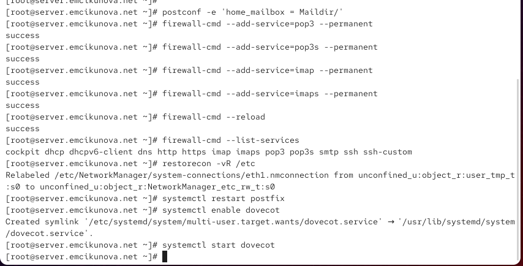
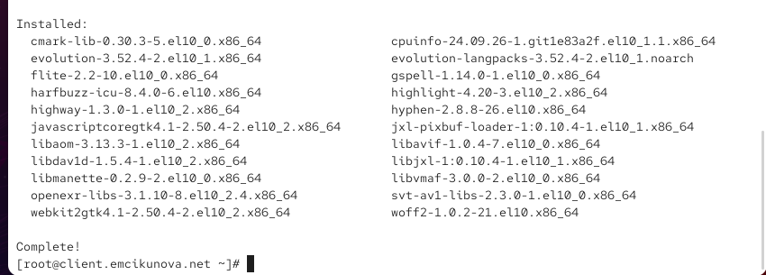
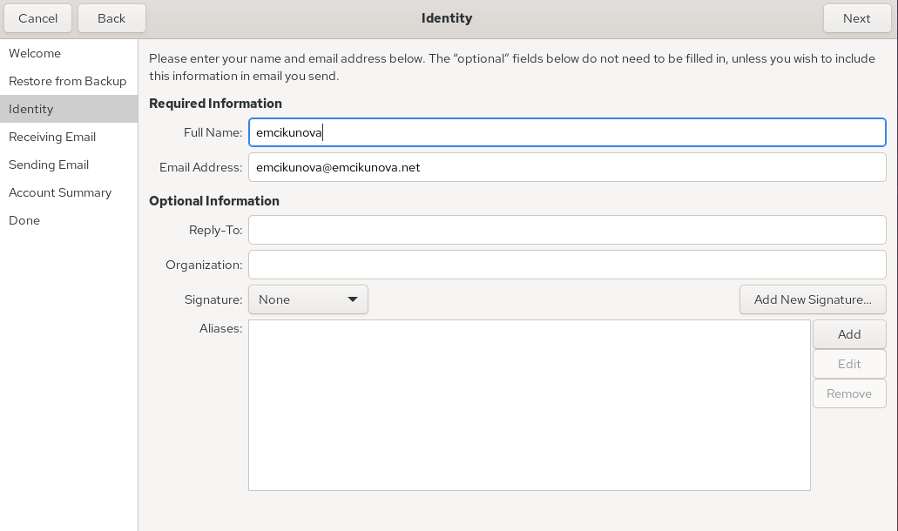
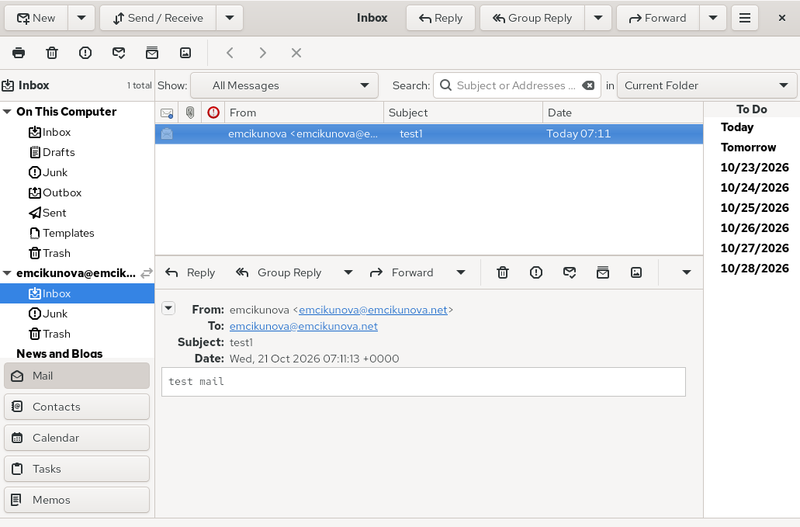

---
## Author
author:
  name: Цыкунова Екатерина Михайловна
  email: 1132246732@rudn.ru
  affiliation:
    - name: Российский университет дружбы народов
      country: Российская Федерация
      postal-code: 117198
      city: Москва
      address: ул. Миклухо-Маклая, д. 6

## Title
title: Лабораторная работа №9
subtitle: Настройка POP3/IMAP сервера
license: CC BY
date: today
date-format: "YYYY-MM-DD"
---

# Цели и задачи работы

## Цель лабораторной работы

Целью данной работы является приобретение практических навыков установки и настройки почтового сервера Dovecot, организации получения электронной почты по протоколам POP3 и IMAP, настройки почтового клиента Evolution, проверки работы почтовых служб и автоматизации конфигурации с помощью Vagrant.

## Задачи лабораторной работы

- установить Dovecot и Telnet на виртуальной машине `server`;
- настроить протоколы IMAP и POP3, аутентификацию пользователей и расположение почтовых ящиков;
- настроить взаимодействие Dovecot с Postfix и межсетевой экран;
- установить и настроить почтовый клиент Evolution на виртуальной машине `client`;
- проверить отправку и получение электронных сообщений;
- проверить работу почтовой службы с помощью Telnet, `mail` и `doveadm`;

# Процесс выполнения лабораторной работы

## Устанавливаю Dovecot и Telnet

{ #fig:001 width=70% height=70% }

## Настраиваю почтовые протоколы Dovecot

{ #fig:002 width=70% height=70% }

## Проверяю метод аутентификации пользователей

{ #fig:003 width=70% height=70% }

## Настраиваю проверку паролей через PAM

{ #fig:004 width=70% height=70% }

## Настраиваю системную базу пользователей

{ #fig:005 width=70% height=70% }

## Указываю расположение почтовых ящиков

{ #fig:006 width=70% height=70% }

## Настраиваю Postfix и межсетевой экран

{ #fig:007 width=70% height=70% }

## Устанавливаю почтовый клиент Evolution

{ #fig:008 width=70% height=70% }

## Создаю почтовую учётную запись Evolution

{ #fig:009 width=70% height=70% }

## Настраиваю получение почты по IMAP

{ #fig:010 width=70% height=70% }

## Настраиваю отправку почты по SMTP

{ #fig:011 width=70% height=70% }

## Отправляю тестовое письмо через Evolution

{ #fig:012 width=70% height=70% }

## Проверяю получение электронного письма

{ #fig:013 width=70% height=70% }

## Проверяю доставку по журналу почтовой службы

{ #fig:014 width=70% height=70% }

## Просматриваю почтовый ящик на сервере

{ #fig:015 width=70% height=70% }

## Проверяю работу протокола POP3 через Telnet

{ #fig:016 width=70% height=70% }

## Сохраняю конфигурацию Dovecot для Vagrant

{ #fig:017 width=70% height=70% }

## Обновляю скрипт настройки почтового сервера

{ #fig:018 width=70% height=70% }

## Обновляю скрипт настройки клиентской машины

{ #fig:019 width=70% height=70% }

# Результаты лабораторной работы

## Вывод

В ходе лабораторной работы я установила и настроила почтовый сервер `Dovecot` на виртуальной машине `server`, обеспечив работу протоколов IMAP и POP3.

Настроила взаимодействие Dovecot с Postfix, хранение почтовых сообщений в формате Maildir и необходимые правила межсетевого экрана.

На виртуальной машине `client` установила и настроила почтовый клиент Evolution. Проверила отправку и получение электронных писем, работу почтовых протоколов через Telnet, а также состояние почтовых ящиков с помощью утилит `mail` и `doveadm`.

Работоспособность почтового сервера подтверждена успешной доставкой сообщений на адрес `emcikunova@emcikunova.net` и соответствующими записями в журнале `maillog`.
