---
## Author
author:
  name: Цыкунова Екатерина Михайловна
  email: 1132246732@rudn.ru
  affiliation:
    - name: Российский университет дружбы народов
      country: Российская Федерация
      postal-code: 117198
      city: Москва
      address: ул. Миклухо-Маклая, д. 6

## Title
title: "Отчёт по лабораторной работе №9"
subtitle: "Настройка POP3/IMAP сервера"
license: "CC BY"
---

# Цель работы

Приобретение практических навыков по установке и простейшему конфигурированию POP3/IMAP-сервера.

# Выполнение лабораторной работы

## Установка Dovecot

На виртуальной машине `server.emcikunova.net` перехожу в режим суперпользователя и устанавливаю Dovecot и Telnet:

```bash
sudo -i
dnf -y install dovecot telnet
```

Установка необходимых пакетов завершается успешно (см. рис. [@fig-001]).

{ #fig-001 width=70% }

## Настройка Dovecot

В конфигурационном файле `/etc/dovecot/dovecot.conf` разрешаю использование протоколов IMAP и POP3:

```ini
protocols = imap pop3
```

Изменения сохраняю в конфигурационном файле (см. рис. [@fig-002]).

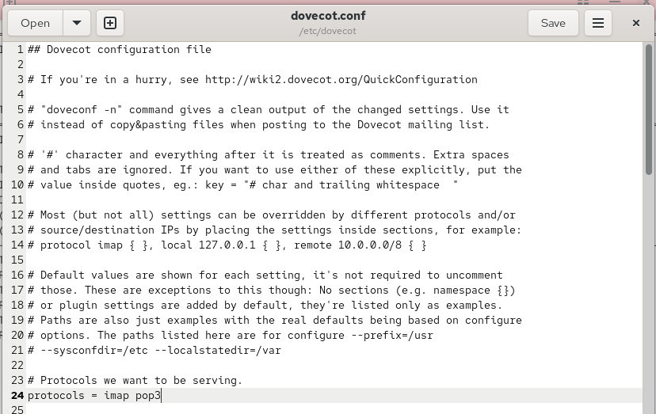{ #fig-002 width=70% }

В файле `/etc/dovecot/conf.d/10-auth.conf` проверяю метод аутентификации:

```ini
auth_mechanisms = plain
```

Данный параметр разрешает аутентификацию с использованием обычного пароля (см. рис. [@fig-003]).

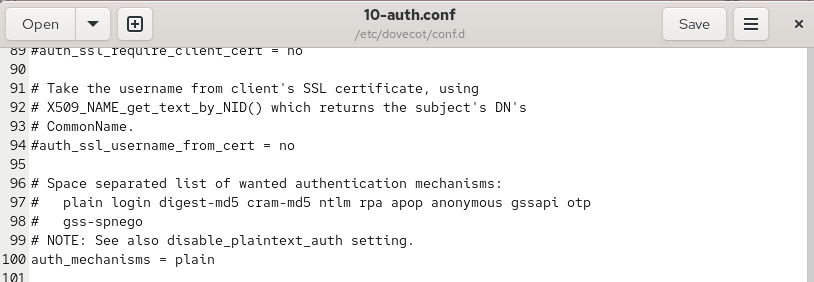{ #fig-003 width=70% }

В файле `/etc/dovecot/conf.d/auth-system.conf.ext` проверяю использование PAM для проверки паролей пользователей:

```ini
passdb {
    driver = pam
}
```

Настройка соответствует требованиям лабораторной работы (см. рис. [@fig-004]).

{ #fig-004 width=70% }

В этом же файле проверяю использование системной базы пользователей:

```ini
userdb {
    driver = passwd
}
```

Dovecot будет получать информацию о пользователях из системной базы (см. рис. [@fig-005]).

{ #fig-005 width=70% }

В файле `/etc/dovecot/conf.d/10-mail.conf` задаю расположение почтовых ящиков:

```ini
mail_location = maildir:~/Maildir
```

Сообщения будут храниться в каталоге `Maildir` домашнего каталога пользователя (см. рис. [@fig-006]).

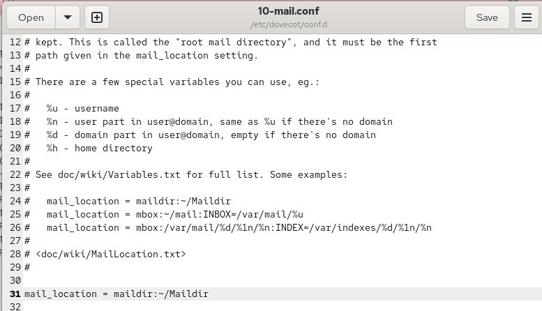{ #fig-006 width=70% }

Настраиваю Postfix для доставки сообщений в Maildir:

```bash
postconf -e 'home_mailbox = Maildir/'
```

Разрешаю почтовые протоколы в межсетевом экране:

```bash
firewall-cmd --add-service=pop3 --permanent
firewall-cmd --add-service=pop3s --permanent
firewall-cmd --add-service=imap --permanent
firewall-cmd --add-service=imaps --permanent
firewall-cmd --reload
firewall-cmd --list-services
```

Восстанавливаю контексты SELinux и запускаю почтовые службы:

```bash
restorecon -vR /etc
systemctl restart postfix
systemctl enable dovecot
systemctl start dovecot
```

Службы запускаются, а необходимые протоколы добавляются в список разрешённых (см. рис. [@fig-007]).

{ #fig-007 width=70% }

## Установка и настройка Evolution

На виртуальной машине `client.emcikunova.net` устанавливаю почтовый клиент Evolution:

```bash
sudo -i
dnf -y install evolution
```

Установка завершается успешно (см. рис. [@fig-008]).

{ #fig-008 width=70% }

Запускаю Evolution и создаю почтовую учётную запись пользователя `emcikunova`, указав адрес `emcikunova@emcikunova.net` (см. рис. [@fig-009]).

{ #fig-009 width=70% }

Для получения почты выбираю протокол IMAP и указываю сервер `mail.emcikunova.net`, порт `143`, метод шифрования STARTTLS и аутентификацию по паролю (см. рис. [@fig-010]).

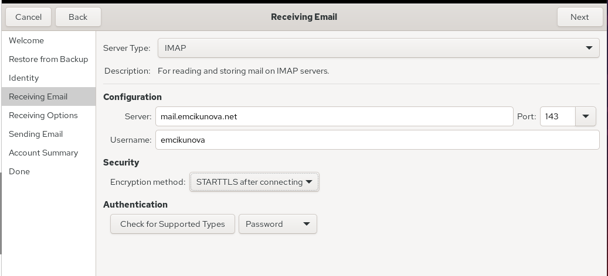{ #fig-010 width=70% }

Для отправки сообщений указываю SMTP-сервер `mail.emcikunova.net`, порт `25`, без шифрования и аутентификации (см. рис. [@fig-011]).

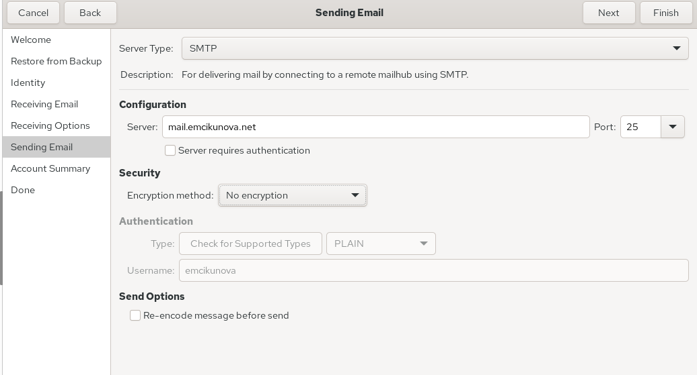{ #fig-011 width=70% }

## Проверка работы почтового сервера

В Evolution создаю тестовое письмо с темой `test1` и текстом `test mail`, отправляя его на собственный адрес `emcikunova@emcikunova.net` (см. рис. [@fig-012]).

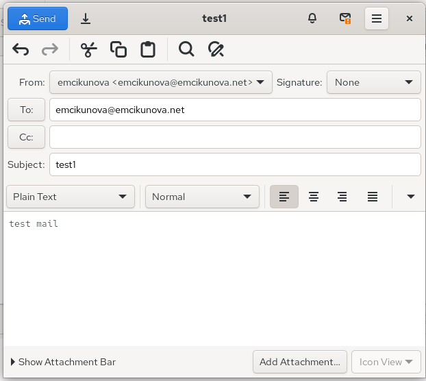{ #fig-012 width=70% }

После отправки проверяю папку входящих сообщений. Письмо успешно доставлено, его тема и содержимое отображаются корректно (см. рис. [@fig-013]).

{ #fig-013 width=70% }

На сервере запускаю мониторинг журнала почтовой службы:

```bash
tail -f /var/log/maillog
```

В журнале отображаются подключения к Postfix и Dovecot, а запись `status=sent (delivered to maildir)` подтверждает успешную доставку сообщения (см. рис. [@fig-014]).

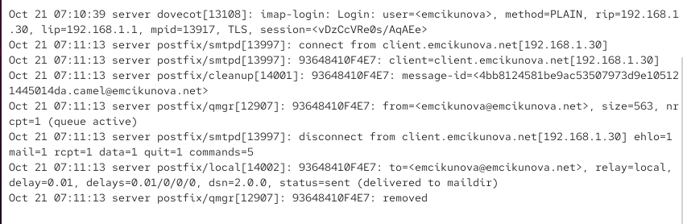{ #fig-014 width=70% }

Проверяю сообщения в почтовом ящике и список папок пользователя:

```bash
MAIL=~/Maildir mail
sudo doveadm mailbox list -u emcikunova
```

В почтовом ящике присутствуют тестовые письма, а Dovecot отображает папку `INBOX` (см. рис. [@fig-015]).

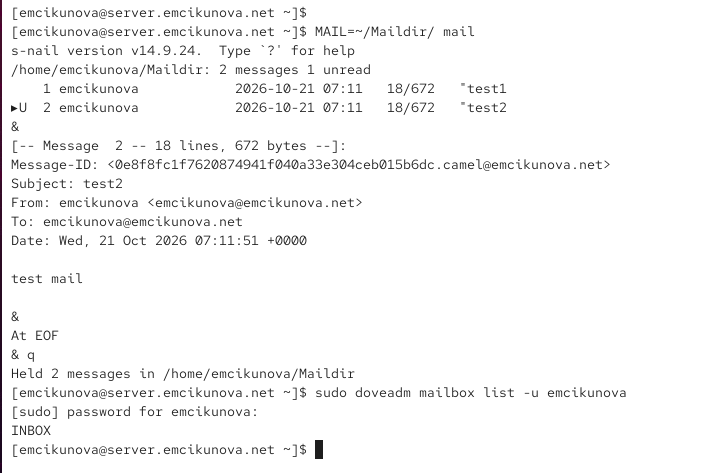{ #fig-015 width=70% }

## Проверка протокола POP3 через Telnet

Подключаюсь к почтовому серверу по протоколу POP3:

```bash
telnet mail.emcikunova.net 110
```

Ввожу имя пользователя и пароль:

```text
user emcikunova
pass <пароль>
```

После успешной авторизации проверяю список сообщений, читаю первое письмо и удаляю второе:

```text
list
retr 1
dele 2
quit
```

Сервер успешно обрабатывает команды, подтверждая корректную работу протокола POP3 (см. рис. [@fig-016]).

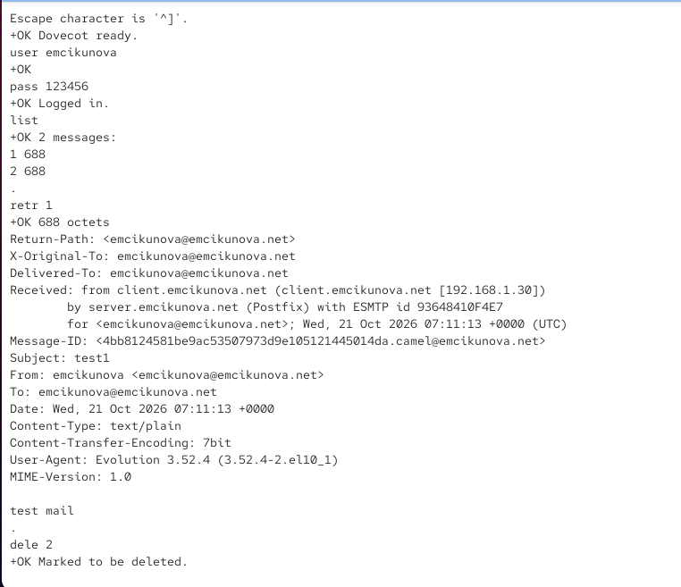{ #fig-016 width=70% }

## Внесение изменений в настройки внутреннего окружения виртуальной машины

На сервере сохраняю конфигурационные файлы Dovecot в каталоге `/vagrant/provision/server/mail/` для последующего автоматического развёртывания (см. рис. [@fig-017]).

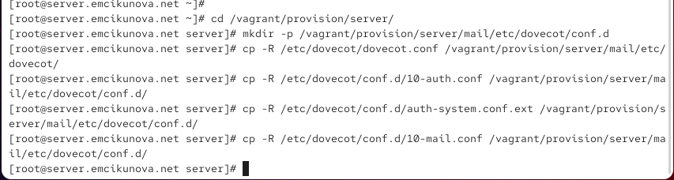{ #fig-017 width=70% }

Обновляю скрипт `/vagrant/provision/server/mail.sh`, добавляя установку Dovecot и Telnet, настройку межсетевого экрана и запуск служб (см. рис. [@fig-018]).

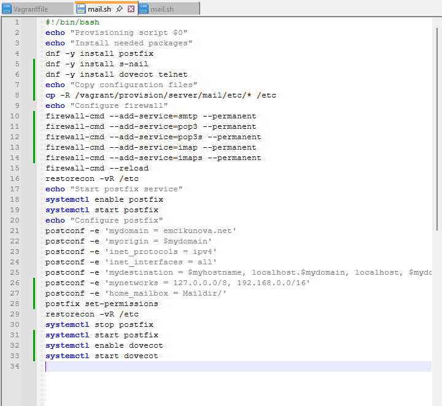{ #fig-018 width=70% }

На клиентской машине дополняю скрипт `/vagrant/provision/client/mail.sh` командой установки Evolution (см. рис. [@fig-019]).

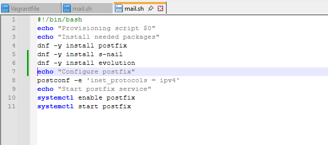{ #fig-019 width=70% }

# Вывод

В ходе лабораторной работы я установила и настроила почтовый сервер Dovecot на виртуальной машине `server`, обеспечив работу протоколов IMAP и POP3. Настроила взаимодействие Dovecot с Postfix, хранение почтовых сообщений в формате Maildir и необходимые правила межсетевого экрана.

На виртуальной машине `client` установила и настроила почтовый клиент Evolution. Проверила отправку и получение электронных писем, работу почтовых протоколов через Telnet, а также состояние почтовых ящиков с помощью утилит `mail` и `doveadm`. Убедилась в корректной работе почтовых служб по журналам сервера. Также обновила скрипты Vagrant для автоматизации установки и настройки Dovecot и Evolution.

# Контрольные вопросы

*1. За что отвечает протокол SMTP?*

SMTP (Simple Mail Transfer Protocol) — протокол, предназначенный для отправки электронной почты от клиента на почтовый сервер и передачи сообщений между почтовыми серверами.

Обычно SMTP использует порт `25` для передачи почты между серверами и порт `587` для отправки сообщений клиентами.

В лабораторной работе SMTP используется почтовым сервером Postfix для отправки и доставки сообщений.

*2. За что отвечает протокол IMAP?*

IMAP (Internet Message Access Protocol) — протокол, предназначенный для получения электронной почты и управления сообщениями, которые хранятся на почтовом сервере.

IMAP позволяет просматривать письма, создавать папки, удалять сообщения и синхронизировать состояние почтового ящика между несколькими устройствами.

Стандартный порт IMAP — `143`, защищённое соединение IMAPS обычно использует порт `993`.

В лабораторной работе IMAP используется почтовым клиентом Evolution для получения сообщений с сервера Dovecot.

*3. За что отвечает протокол POP3?*

POP3 (Post Office Protocol version 3) — протокол, предназначенный для получения электронных писем с почтового сервера.

В отличие от IMAP, POP3 ориентирован преимущественно на загрузку сообщений на локальное устройство. После получения письма могут оставаться на сервере или удаляться в зависимости от настроек клиента.

Стандартный порт POP3 — `110`, защищённый вариант POP3S использует порт `995`.

В лабораторной работе POP3 проверяется через Telnet с помощью команд `USER`, `PASS`, `LIST`, `RETR` и `DELE`.

*4. В чём назначение Dovecot?*

Dovecot — почтовый сервер, обеспечивающий доступ пользователей к электронной почте по протоколам IMAP и POP3.

Основные функции Dovecot включают аутентификацию пользователей, предоставление доступа к почтовым ящикам и управление сообщениями.

Dovecot может использовать разные форматы хранения почты, включая Maildir и mbox.

В лабораторной работе Dovecot работает совместно с Postfix: Postfix отвечает за приём и доставку писем, а Dovecot предоставляет пользователям доступ к полученным сообщениям.

*5. В каких файлах обычно находятся настройки работы Dovecot? За что отвечает каждый из файлов?*

Основные настройки Dovecot располагаются в каталоге `/etc/dovecot/`.

Наиболее важные конфигурационные файлы:

- `/etc/dovecot/dovecot.conf` — основной конфигурационный файл, определяющий общие параметры работы Dovecot и доступные почтовые протоколы.
- `/etc/dovecot/conf.d/10-auth.conf` — настройки аутентификации пользователей, включая разрешённые механизмы проверки паролей.
- `/etc/dovecot/conf.d/auth-system.conf.ext` — определяет источники информации о пользователях и их паролях, например PAM и системную базу passwd.
- `/etc/dovecot/conf.d/10-mail.conf` — настройки расположения и формата хранения почтовых ящиков.
- `/etc/dovecot/conf.d/10-ssl.conf` — параметры SSL/TLS, сертификатов и защищённых соединений.
- `/etc/dovecot/conf.d/10-master.conf` — настройки служб Dovecot, процессов и сетевых соединений.

Для просмотра действующей конфигурации используется команда:

```bash
doveconf -n
```

Она выводит параметры Dovecot, отличающиеся от значений по умолчанию.

*6. В чём назначение Postfix?*

Postfix — почтовый сервер, предназначенный для приёма, отправки, маршрутизации и доставки электронной почты по протоколу SMTP.

Postfix принимает сообщения от почтовых клиентов и других серверов, определяет получателей и выполняет доставку писем.

Основной конфигурационный файл Postfix находится по пути `/etc/postfix/main.cf`.

В лабораторной работе Postfix доставляет сообщения в каталоги Maildir пользователей, после чего Dovecot предоставляет к ним доступ через IMAP и POP3.

*7. Какие методы аутентификации пользователей можно использовать в Dovecot и в чём их отличие?*

Dovecot поддерживает несколько механизмов аутентификации пользователей:

- **PLAIN** — передаёт имя пользователя и пароль в открытом виде на уровне механизма аутентификации. Для защиты данных необходимо использовать TLS.
- **LOGIN** — передаёт учётные данные отдельными этапами. Как и PLAIN, требует защищённого соединения.
- **CRAM-MD5** — использует механизм запроса и ответа, позволяющий не передавать пароль напрямую. Считается устаревшим.
- **SCRAM-SHA-256** — использует криптографический механизм проверки пароля без его непосредственной передачи серверу.
- **GSSAPI** — позволяет выполнять аутентификацию с использованием Kerberos.

Также Dovecot поддерживает различные источники проверки учётных данных: PAM, LDAP, SQL и файлы паролей.

В лабораторной работе используется механизм `plain` с проверкой паролей через PAM:

```ini
auth_mechanisms = plain
```

```ini
passdb {
    driver = pam
}
```

PLAIN определяет способ передачи учётных данных, а PAM — способ их проверки на сервере.

*8. Приведите пример заголовка письма с пояснениями его полей.*

Пример заголовка электронного письма:

```text
From: emcikunova@emcikunova.net
To: user@emcikunova.net
Subject: Test message
Date: Wed, 21 Oct 2026 12:00:00 +0300
Message-ID: <12345@emcikunova.net>
MIME-Version: 1.0
Content-Type: text/plain; charset=UTF-8
```

Назначение основных полей:

- `From` — адрес отправителя сообщения.
- `To` — адрес получателя сообщения.
- `Subject` — тема электронного письма.
- `Date` — дата и время создания сообщения.
- `Message-ID` — уникальный идентификатор письма.
- `MIME-Version` — версия стандарта MIME, используемого для представления содержимого письма.
- `Content-Type` — тип содержимого сообщения и используемая кодировка.

Дополнительно в заголовках могут присутствовать поля `Received`, содержащие информацию о прохождении письма через почтовые серверы.

*9. Приведите примеры использования команд для работы с почтовыми протоколами через терминал (например, через telnet).*

Для проверки протокола POP3 подключаюсь к серверу по порту `110`:

```bash
telnet mail.emcikunova.net 110
```

После подключения выполняю команды:

```text
USER emcikunova
PASS <пароль>
LIST
RETR 1
DELE 2
QUIT
```

Назначение команд:

- `USER` — передаёт имя пользователя.
- `PASS` — передаёт пароль.
- `LIST` — показывает список сообщений.
- `RETR 1` — выводит содержимое первого письма.
- `DELE 2` — помечает второе письмо для удаления.
- `QUIT` — завершает соединение и подтверждает удаление помеченных писем.

Для проверки SMTP подключаюсь к порту `25`:

```bash
telnet mail.emcikunova.net 25
```

Пример отправки письма:

```text
EHLO emcikunova.net
MAIL FROM:<emcikunova@emcikunova.net>
RCPT TO:<emcikunova@emcikunova.net>
DATA
Subject: Test

Test message
.
QUIT
```

Команда `EHLO` устанавливает SMTP-сеанс, `MAIL FROM` указывает отправителя, `RCPT TO` — получателя, а `DATA` начинает передачу содержимого письма. Отдельная точка завершает ввод сообщения.

Для проверки IMAP с использованием STARTTLS можно подключиться через OpenSSL:

```bash
openssl s_client -connect mail.emcikunova.net:143 -starttls imap -quiet
```

После установления защищённого соединения выполняю команды:

```text
a1 LOGIN emcikunova <пароль>
a2 SELECT INBOX
a3 FETCH 1 BODY[HEADER]
a4 LOGOUT
```

Они позволяют авторизоваться, открыть папку входящих сообщений, получить заголовок первого письма и завершить сеанс.

Передача пароля через обычный Telnet без шифрования небезопасна, поэтому проверку POP3 в лабораторной работе следует выполнять только в изолированной учебной сети.

*10. Приведите примеры с пояснениями по работе с doveadm.*

`doveadm` — административная утилита Dovecot, предназначенная для управления почтовыми ящиками, проверки аутентификации и получения информации о сообщениях.

Для просмотра списка почтовых папок пользователя выполняю:

```bash
doveadm mailbox list -u emcikunova
```

Команда выводит доступные папки, например `INBOX`.

Для получения информации о количестве писем в папке выполняю:

```bash
doveadm mailbox status -u emcikunova messages INBOX
```

Команда показывает количество сообщений в папке `INBOX`.

Для проверки аутентификации пользователя использую:

```bash
doveadm auth test emcikunova
```

После ввода пароля утилита проверяет учётные данные и сообщает результат аутентификации.

Для просмотра активных подключений пользователей выполняю:

```bash
doveadm who
```

Команда отображает информацию о пользователях, подключённых к почтовому серверу.

Для поиска сообщений в папке входящих писем использую:

```bash
doveadm search -u emcikunova mailbox INBOX ALL
```

Команда выводит идентификаторы сообщений, соответствующих условию поиска.

Утилита `doveadm` позволяет администратору проверять состояние почтовых ящиков и диагностировать работу Dovecot без использования графического почтового клиента.

# Список литературы

1. [Red Hat. Configuring and Maintaining a Dovecot IMAP and POP3 Server — установка и настройка почтового сервера Dovecot в Red Hat Enterprise Linux 9](https://docs.redhat.com/en/documentation/red_hat_enterprise_linux/9/html/deploying_mail_servers/configuring-and-maintaining-a-dovecot-imap-and-pop3-server_deploying-mail-servers).

2. [Dovecot. Basic Configuration — официальное руководство по первоначальной настройке Dovecot и конфигурационных файлов](https://doc.dovecot.org/2.3/configuration_manual/basic_configuration/).

3. [Dovecot. Authentication — настройка механизмов аутентификации пользователей, PAM и системных баз паролей](https://doc.dovecot.org/2.3/configuration_manual/authentication/).

4. [Dovecot. Maildir Configuration — настройка расположения почтовых ящиков и хранения сообщений в формате Maildir](https://doc.dovecot.org/2.3/configuration_manual/mail_location/Maildir/).

5. [Dovecot. Doveadm Mailbox Commands — административные команды для просмотра, поиска и управления почтовыми ящиками](https://doc.dovecot.org/2.3/admin_manual/doveadm_mailbox_commands/).

6. [Dovecot. Testing Installation — проверка работоспособности почтовых протоколов IMAP и POP3 с помощью Telnet и OpenSSL](https://doc.dovecot.org/2.3/admin_manual/test_installation/).

7. [GNOME. Evolution Mail and Calendar — официальная документация по настройке почтовых учётных записей, отправке и получению сообщений](https://help.gnome.org/evolution/).

8. [Postfix. Basic Configuration — настройка SMTP-сервера, параметров доставки почты и взаимодействия с почтовыми ящиками](https://www.postfix.org/BASIC_CONFIGURATION_README.html).

9. [HashiCorp. Vagrant Shell Provisioner — автоматизация установки и настройки Postfix, Dovecot и Evolution с помощью Shell-скриптов](https://developer.hashicorp.com/vagrant/docs/provisioning/shell).