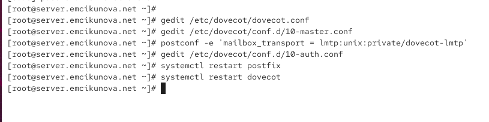
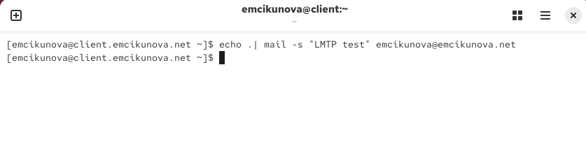
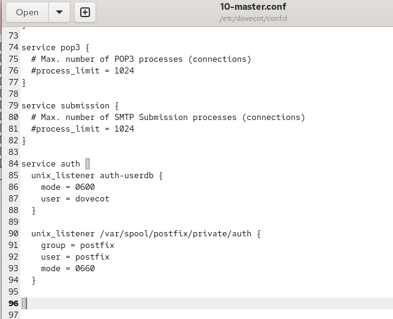
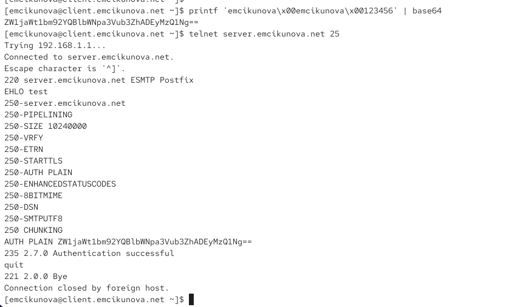
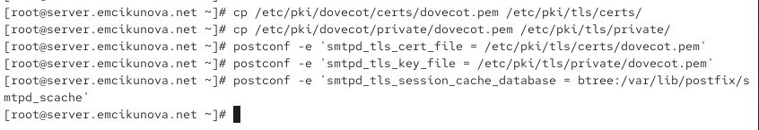
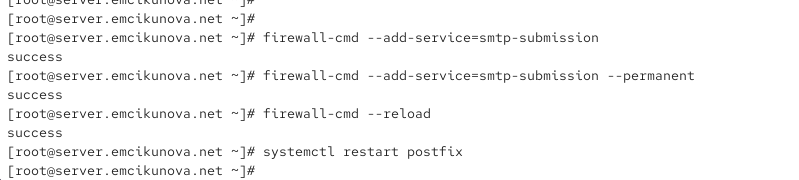
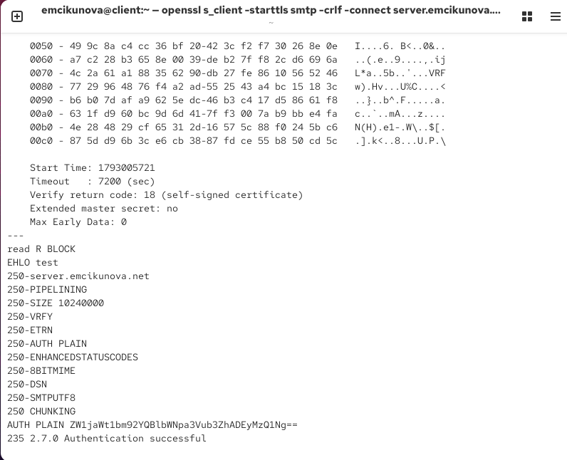
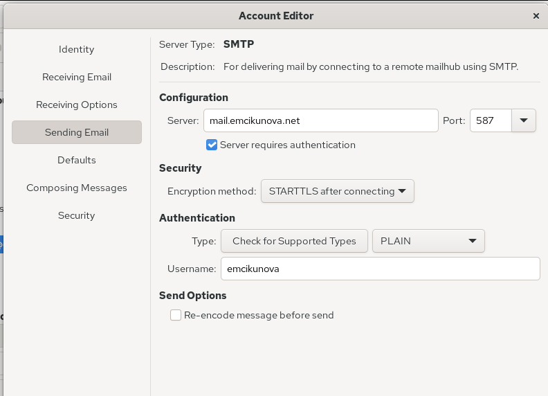
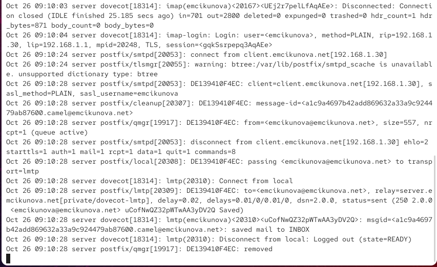
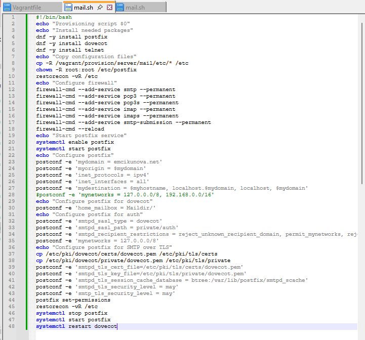

---
## Author
author:
  name: Цыкунова Екатерина Михайловна
  email: 1132246732@rudn.ru
  affiliation:
    - name: Российский университет дружбы народов
      country: Российская Федерация
      postal-code: 117198
      city: Москва
      address: ул. Миклухо-Маклая, д. 6

## Title
title: Лабораторная работа №10
subtitle: Расширенные настройки SMTP-сервера
license: CC BY
date: today
date-format: "YYYY-MM-DD"
---

# Цели и задачи работы

## Цель лабораторной работы

Целью данной работы является приобретение практических навыков расширенной настройки SMTP-сервера Postfix, организации доставки сообщений через LMTP, настройки SASL-аутентификации пользователей, обеспечения защищённого соединения с использованием TLS и автоматизации конфигурации почтовых служб с помощью Vagrant.

## Задачи лабораторной работы

- настроить протокол LMTP для взаимодействия Dovecot с Postfix;
- настроить SMTP-аутентификацию пользователей посредством SASL;
- настроить защищённую отправку почты через SMTP over TLS;
- проверить работу почтового сервера с помощью Telnet, OpenSSL и Evolution;
- проверить доставку сообщений и журналы почтовой службы;

# Процесс выполнения лабораторной работы

## Добавляю поддержку LMTP в Dovecot

{ #fig:001 width=70% height=70% }

## Настраиваю службу LMTP для Postfix

{ #fig:002 width=70% height=70% }

## Настраиваю формат имени пользователя

{ #fig:003 width=70% height=70% }

## Настраиваю передачу почты через LMTP

{ #fig:004 width=70% height=70% }

## Отправляю тестовое письмо через LMTP

{ #fig:005 width=70% height=70% }

## Проверяю доставку сообщения в журнале

{ #fig:006 width=70% height=70% }

## Проверяю полученное письмо на сервере

{ #fig:007 width=70% height=70% }

## Настраиваю службу SASL-аутентификации

{ #fig:008 width=70% height=70% }

## Настраиваю SASL и ограничения Postfix

{ #fig:009 width=70% height=70% }

## Включаю SMTP-аутентификацию на порту 25

{ #fig:010 width=70% height=70% }

## Проверяю SMTP-аутентификацию через Telnet

{ #fig:011 width=70% height=70% }

## Настраиваю TLS в Postfix

{ #fig:012 width=70% height=70% }

## Настраиваю SMTP Submission

{ #fig:013 width=70% height=70% }

## Настраиваю межсетевой экран

{ #fig:014 width=70% height=70% }

## Проверяю защищённое SMTP-соединение

{ #fig:015 width=70% height=70% }

## Настраиваю отправку почты в Evolution

{ #fig:016 width=70% height=70% }

## Проверяю отправку письма через Evolution

{ #fig:017 width=70% height=70% }

## Проверяю работу TLS и SASL в журнале

{ #fig:018 width=70% height=70% }

## Проверяю доставку сообщения на сервере

{ #fig:019 width=70% height=70% }

## Сохраняю конфигурацию почтовых служб

{ #fig:020 width=70% height=70% }

## Обновляю скрипт настройки сервера

{ #fig:021 width=70% height=70% }

## Обновляю скрипт настройки клиента

{ #fig:022 width=70% height=70% }

# Результаты лабораторной работы

## Вывод

В ходе лабораторной работы я настроила взаимодействие почтовых серверов `Postfix` и `Dovecot` через протокол LMTP, обеспечив доставку сообщений в локальные почтовые ящики пользователей.

Настроила SMTP-аутентификацию посредством SASL и защищённое соединение с использованием TLS на порту `587`. Проверила успешность аутентификации через Telnet и OpenSSL.

На виртуальной машине `client` настроила отправку почты через Evolution с использованием STARTTLS. Работоспособность почтового сервера подтверждена успешной доставкой тестовых сообщений и записями в журнале `maillog`.
