---
## Author
author:
  name: Цыкунова Екатерина Михайловна
  email: 1132246732@rudn.ru
  affiliation:
    - name: Российский университет дружбы народов
      country: Российская Федерация
      postal-code: 117198
      city: Москва
      address: ул. Миклухо-Маклая, д. 6

## Title
title: "Отчёт по лабораторной работе №10"
subtitle: "Расширенные настройки SMTP-сервера"
license: "CC BY"
---

# Цель работы

Приобретение практических навыков по конфигурированию SMTP-сервера в части настройки аутентификации.

# Выполнение лабораторной работы

## Настройка LMTP в Dovecot

На виртуальной машине `server.emcikunova.net` перехожу в режим суперпользователя и запускаю мониторинг почтовой службы:

```bash
sudo -i
tail -f /var/log/maillog
```

В файле `/etc/dovecot/dovecot.conf` добавляю поддержку протокола LMTP:

```ini
protocols = imap pop3 lmtp
```

Изменения представлены на рисунке (см. рис. [@fig-001]).

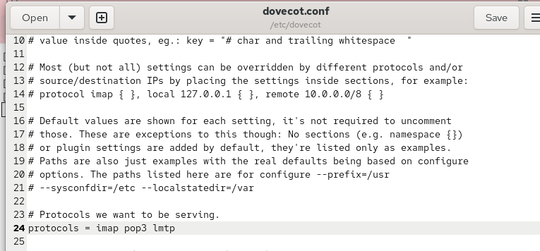{ #fig-001 width=70% }

В файле `/etc/dovecot/conf.d/10-master.conf` настраиваю службу LMTP для взаимодействия с Postfix:

```ini
service lmtp {
    unix_listener /var/spool/postfix/private/dovecot-lmtp {
        group = postfix
        user = postfix
        mode = 0600
    }
}
```

Unix-сокет обеспечивает передачу сообщений от Postfix к Dovecot (см. рис. [@fig-002]).

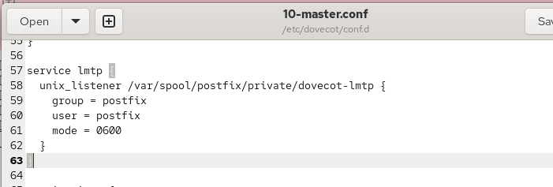{ #fig-002 width=70% }

В файле `/etc/dovecot/conf.d/10-auth.conf` задаю формат имени пользователя без доменной части:

```ini
auth_username_format = %Ln
```

Параметр позволяет использовать для аутентификации локальное имя пользователя (см. рис. [@fig-003]).

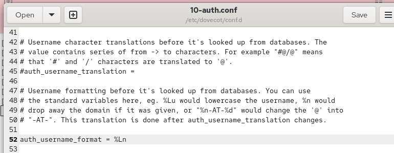{ #fig-003 width=70% }

Настраиваю Postfix для доставки сообщений через LMTP и перезапускаю службы:

```bash
postconf -e 'mailbox_transport = lmtp:unix:private/dovecot-lmtp'
systemctl restart postfix
systemctl restart dovecot
```

Настройка применяется успешно (см. рис. [@fig-004]).

{ #fig-004 width=70% }

На клиентской виртуальной машине отправляю тестовое письмо:

```bash
echo . | mail -s "LMTP test" emcikunova@emcikunova.net
```

Команда выполняется без ошибок (см. рис. [@fig-005]).

{ #fig-005 width=70% }

Проверяю журнал `/var/log/maillog`. В нём отображается получение сообщения Postfix, передача через LMTP и сохранение в почтовом ящике Dovecot. Записи `saved mail to INBOX` и `status=sent (250 2.0.0)` подтверждают успешную доставку (см. рис. [@fig-006]).

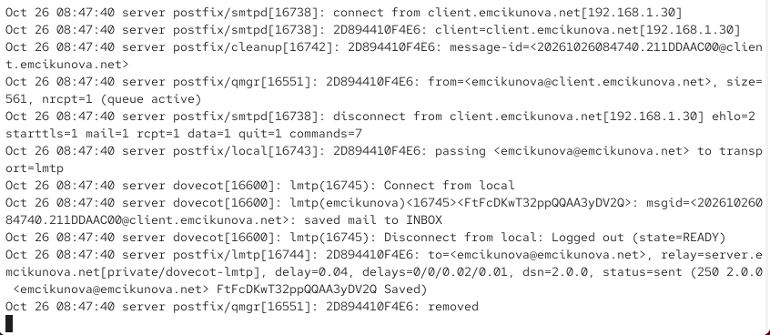{ #fig-006 width=70% }

На сервере открываю почтовый ящик пользователя:

```bash
MAIL=~/Maildir/ mail
```

В списке сообщений присутствует письмо `LMTP test`, что подтверждает корректную работу LMTP (см. рис. [@fig-007]).

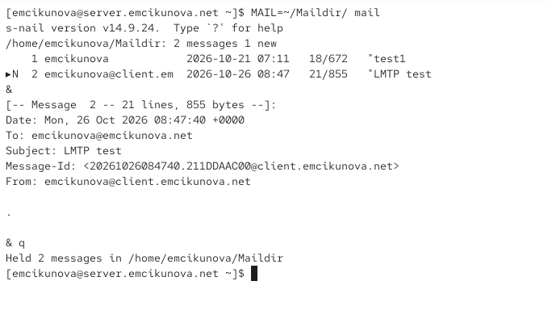{ #fig-007 width=70% }

## Настройка SMTP-аутентификации

В файле `/etc/dovecot/conf.d/10-master.conf` настраиваю службу SASL-аутентификации:

```ini
service auth {
    unix_listener auth-userdb {
        mode = 0600
        user = dovecot
    }

    unix_listener /var/spool/postfix/private/auth {
        group = postfix
        user = postfix
        mode = 0660
    }
}
```

Служба `auth` выполняет проверку пользователей. Сокет `auth-userdb` используется Dovecot, а `/var/spool/postfix/private/auth` обеспечивает взаимодействие с Postfix. Параметры `user` и `group` определяют владельца и группу, `mode` — права доступа (см. рис. [@fig-008]).

{ #fig-008 width=70% }

Настраиваю Postfix для использования Dovecot в качестве механизма SASL:

```bash
postconf -e 'smtpd_sasl_type = dovecot'
postconf -e 'smtpd_sasl_path = private/auth'
postconf -e 'smtpd_recipient_restrictions = reject_unknown_recipient_domain, permit_mynetworks, reject_non_fqdn_recipient, reject_unauth_destination, reject_unverified_recipient, permit'
postconf -e 'mynetworks = 127.0.0.0/8'
```

Ограничения проверяют существование домена получателя, корректность адреса, доступность получателя и разрешение на пересылку почты. Доверенной остаётся только локальная сеть `127.0.0.0/8` (см. рис. [@fig-009]).

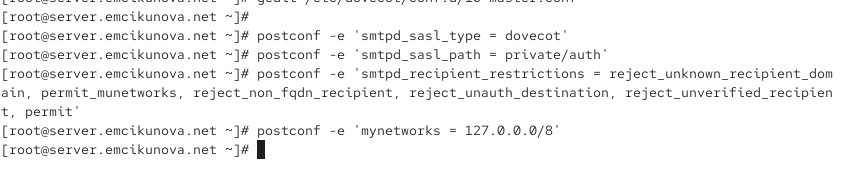{ #fig-009 width=70% }

В файле `/etc/postfix/master.cf` временно разрешаю аутентификацию на SMTP-порту `25`:

```ini
smtp inet n - n - - smtpd
  -o smtpd_sasl_auth_enable=yes
  -o smtpd_recipient_restrictions=reject_non_fqdn_recipient,reject_unknown_recipient_domain,permit_sasl_authenticated,reject
```

Параметр `permit_sasl_authenticated` разрешает отправку почты пользователям после успешной аутентификации (см. рис. [@fig-010]).

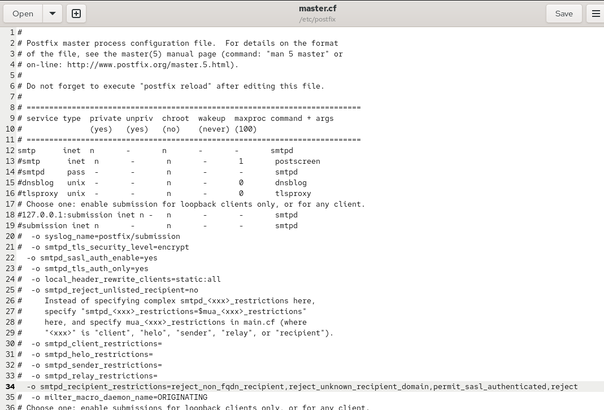{ #fig-010 width=70% }

Перезапускаю Postfix и Dovecot:

```bash
systemctl restart postfix
systemctl restart dovecot
```

На клиенте устанавливаю Telnet и формирую строку аутентификации Base64:

```bash
dnf -y install telnet
printf 'emcikunova\x00emcikunova\x00<пароль>' | base64
```

Подключаюсь к SMTP-серверу:

```bash
telnet server.emcikunova.net 25
```

Выполняю команды:

```text
EHLO test
AUTH PLAIN <строка Base64>
```

Сервер возвращает `235 2.7.0 Authentication successful`, подтверждая успешную SASL-аутентификацию (см. рис. [@fig-011]).

{ #fig-011 width=70% }

## Настройка SMTP over TLS

Для защищённого SMTP-соединения копирую сертификат и ключ Dovecot в каталоги TLS:

```bash
cp /etc/pki/dovecot/certs/dovecot.pem /etc/pki/tls/certs/
cp /etc/pki/dovecot/private/dovecot.pem /etc/pki/tls/private/
```

Настраиваю Postfix:

```bash
postconf -e 'smtpd_tls_cert_file=/etc/pki/tls/certs/dovecot.pem'
postconf -e 'smtpd_tls_key_file=/etc/pki/tls/private/dovecot.pem'
postconf -e 'smtpd_tls_session_cache_database = btree:/var/lib/postfix/smtpd_scache'
postconf -e 'smtpd_tls_security_level = may'
postconf -e 'smtp_tls_security_level = may'
```

Параметры задают сертификат, ключ, кэш TLS-сессий и разрешают использование TLS (см. рис. [@fig-012]).

{ #fig-012 width=70% }

В файле `/etc/postfix/master.cf` возвращаю стандартную конфигурацию SMTP на порту `25` и настраиваю службу `submission` на порту `587`:

```ini
smtp inet n - n - - smtpd

submission inet n - n - - smtpd
  -o smtpd_tls_security_level=encrypt
  -o smtpd_sasl_auth_enable=yes
  -o smtpd_recipient_restrictions=reject_non_fqdn_recipient,reject_unknown_recipient_domain,permit_sasl_authenticated,reject
```

Для службы `submission` включаю обязательное TLS-шифрование и SASL-аутентификацию (см. рис. [@fig-013]).

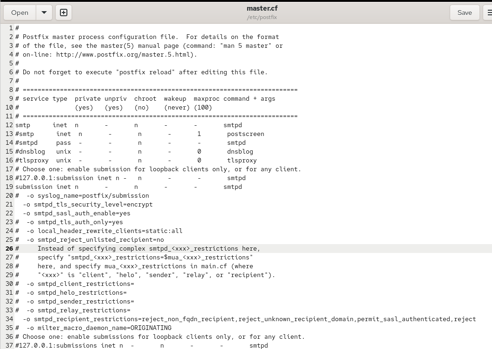{ #fig-013 width=70% }

Разрешаю работу SMTP Submission в межсетевом экране и перезапускаю Postfix:

```bash
firewall-cmd --add-service=smtp-submission
firewall-cmd --add-service=smtp-submission --permanent
firewall-cmd --reload
systemctl restart postfix
```

Настройки применяются успешно (см. рис. [@fig-014]).

{ #fig-014 width=70% }

На клиенте проверяю защищённое соединение:

```bash
openssl s_client -starttls smtp -crlf -connect server.emcikunova.net:587
```

После подключения выполняю:

```text
EHLO test
AUTH PLAIN <строка Base64>
```

Получаю ответ `235 2.7.0 Authentication successful`. Предупреждение `Verify return code: 18` связано с использованием самоподписанного сертификата Dovecot и не препятствует установлению соединения (см. рис. [@fig-015]).

{ #fig-015 width=70% }

## Проверка работы почты через Evolution

На клиентской виртуальной машине открываю настройки Evolution и задаю параметры исходящей почты:

- SMTP-сервер — `mail.emcikunova.net`.
- Порт — `587`.
- Шифрование — `STARTTLS after connecting`.
- Аутентификация — `PLAIN`.
- Имя пользователя — `emcikunova`.

Настройки учётной записи представлены на рисунке (см. рис. [@fig-016]).

{ #fig-016 width=70% }

Отправляю тестовое письмо с темой `test2`. Сообщение появляется во входящих письмах, что подтверждает успешную отправку и доставку (см. рис. [@fig-017]).

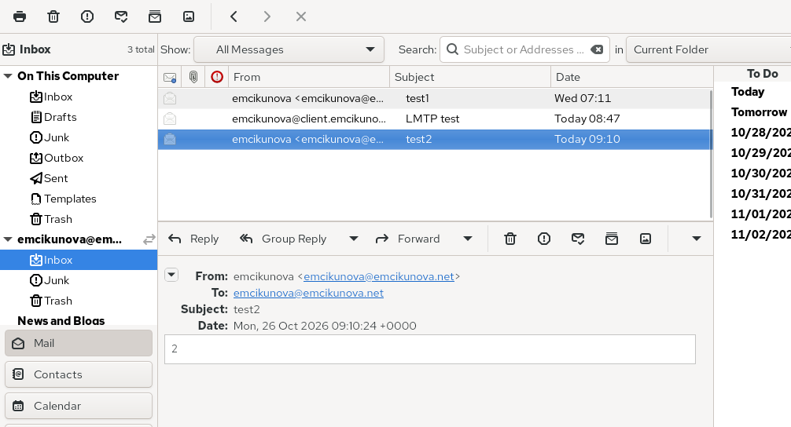{ #fig-017 width=70% }

На сервере просматриваю журнал почтовой службы:

```bash
tail -f /var/log/maillog
```

Записи `starttls=1`, `auth=1` и `sasl_username=emcikunova` подтверждают использование TLS и успешную аутентификацию. Сообщения `saved mail to INBOX` и `status=sent` свидетельствуют об успешной доставке.

Также наблюдаю предупреждение о недоступности базы `btree` для кэширования TLS-сессий, которое не помешало доставке сообщения (см. рис. [@fig-018]).

{ #fig-018 width=70% }

Дополнительно открываю почтовый ящик непосредственно на сервере:

```bash
MAIL=~/Maildir/ mail
```

В списке присутствует сообщение `test2`, отправленное через Evolution. Доставка почты работает корректно (см. рис. [@fig-019]).

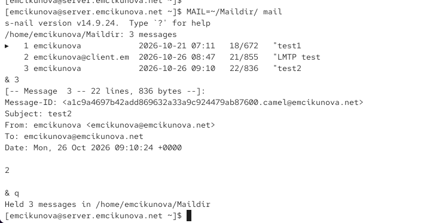{ #fig-019 width=70% }

## Внесение изменений в настройки внутреннего окружения виртуальной машины

Для сохранения настроек копирую изменённые конфигурационные файлы Dovecot и Postfix в каталог `/vagrant/provision/server/mail/` (см. рис. [@fig-020]).

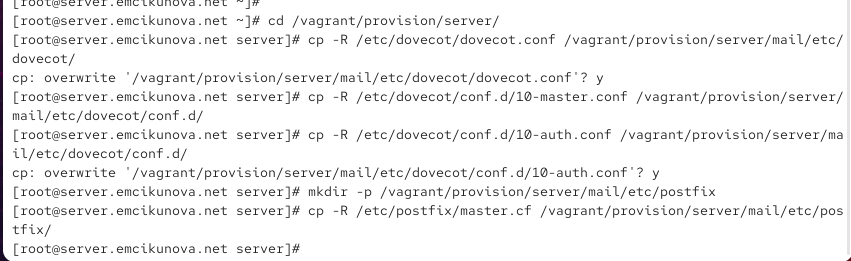{ #fig-020 width=70% }

Корректирую скрипт `/vagrant/provision/server/mail.sh`, добавляя расширенную настройку SMTP, SASL и TLS (см. рис. [@fig-021]). В скрипт `/vagrant/provision/client/mail.sh` добавляю установку Telnet (см. рис. [@fig-022]).

{ #fig-021 width=70% }

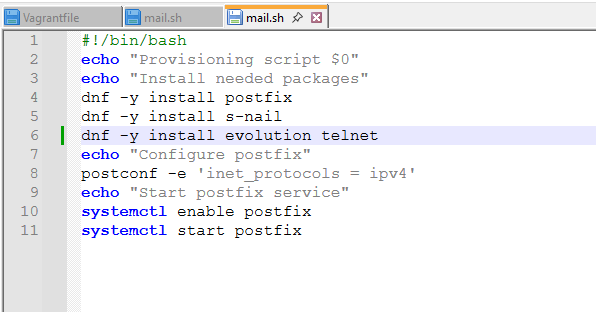{ #fig-022 width=70% }

# Вывод

В ходе лабораторной работы настроена доставка почтовых сообщений через LMTP, реализована SASL-аутентификация и включена поддержка SMTP over TLS на порту `587`. Проверена отправка и доставка писем через Telnet, OpenSSL и Evolution. Также обновлены скрипты Vagrant для сохранения конфигурации почтового сервера.

# Контрольные вопросы

*1. Приведите пример задания формата аутентификации пользователя в Dovecot в форме логина с указанием домена.*

Для аутентификации пользователя с указанием домена в файле `/etc/dovecot/conf.d/10-auth.conf` можно задать параметр:

```ini
auth_username_format = %Lu
```

Параметр `%Lu` сохраняет полное имя пользователя вместе с доменом и преобразует его в нижний регистр.

Например, пользователь может проходить аутентификацию с логином `emcikunova@emcikunova.net`.

*2. Какие функции выполняет почтовый Relay-сервер?*

Почтовый Relay-сервер — это SMTP-сервер, предназначенный для промежуточной передачи электронной почты между почтовыми серверами.

Основные функции Relay-сервера:

- Приём почтовых сообщений от клиентов и других серверов.
- Пересылка сообщений на серверы получателей.
- Маршрутизация почты между различными доменами.
- Фильтрация спама и проверка сообщений.
- Временное хранение писем в очереди при недоступности сервера получателя.

Relay-сервер позволяет организовать централизованную отправку и пересылку электронной почты.

*3. Какие угрозы безопасности могут возникнуть в случае настройки почтового сервера как Relay-сервера?*

При неправильной настройке Relay-сервер может превратиться в открытый почтовый ретранслятор (Open Relay), позволяющий пересылать сообщения без авторизации.

Основные угрозы безопасности:

- **Рассылка спама** — злоумышленники могут использовать сервер для массовой отправки нежелательных сообщений.
- **Фишинг** — сервер может применяться для распространения мошеннических писем.
- **Попадание IP-адреса в чёрные списки** — другие почтовые серверы могут блокировать сообщения с данного адреса.
- **Перегрузка сервера** — массовые рассылки увеличивают нагрузку на процессор, сеть и дисковую подсистему.
- **Распространение вредоносного ПО** — через сервер могут пересылаться письма с вредоносными вложениями.

Для предотвращения угроз необходимо использовать SASL-аутентификацию, TLS-шифрование и ограничения ретрансляции в Postfix, например `reject_unauth_destination`.

# Список литературы

1. [Red Hat. Deploying Mail Servers — руководство по развёртыванию и настройке почтовых серверов Postfix и Dovecot в Red Hat Enterprise Linux 9](https://docs.redhat.com/en/documentation/red_hat_enterprise_linux/9/html-single/deploying_mail_servers/index).

2. [Dovecot. Postfix and Dovecot LMTP — настройка протокола LMTP для доставки почтовых сообщений из Postfix в Dovecot через Unix-сокет](https://doc.dovecot.org/2.3/configuration_manual/howto/postfix_dovecot_lmtp/).

3. [Dovecot. Core Settings — параметры конфигурации Dovecot, настройка формата имени пользователя и механизмов аутентификации](https://doc.dovecot.org/2.3/settings/core/).

4. [Postfix. SASL Authentication — официальное руководство по настройке SMTP-аутентификации SASL с использованием Dovecot](https://www.postfix.org/SASL_README.html).

5. [Postfix. TLS Support — настройка шифрования SMTP-соединений с использованием TLS, сертификатов и протокола STARTTLS](https://www.postfix.org/TLS_README.html).

6. [Postfix. Configuration Parameters — описание параметров Postfix, ограничений SMTP-ретрансляции и правил безопасности почтового сервера](https://www.postfix.org/postconf.5.html).

7. [HashiCorp. Vagrant Shell Provisioner — автоматизация установки пакетов, настройки служб и применения конфигурационных файлов с помощью shell-скриптов Vagrant](https://developer.hashicorp.com/vagrant/docs/provisioning/shell).

