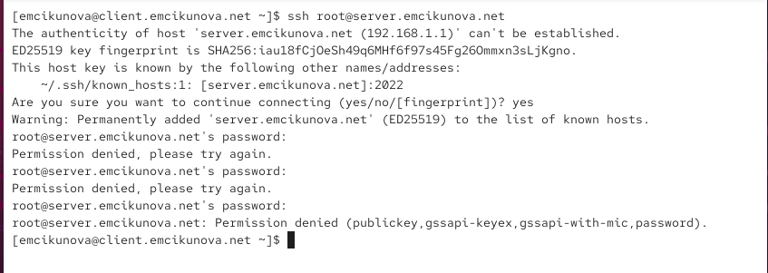
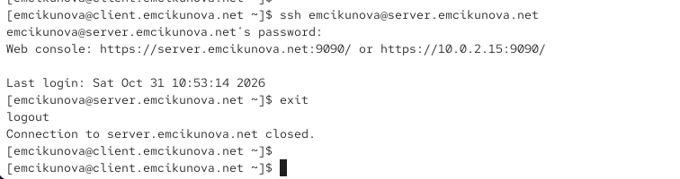
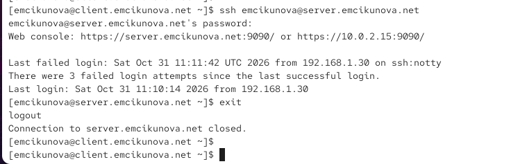
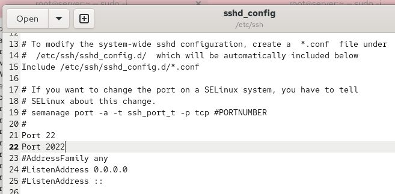
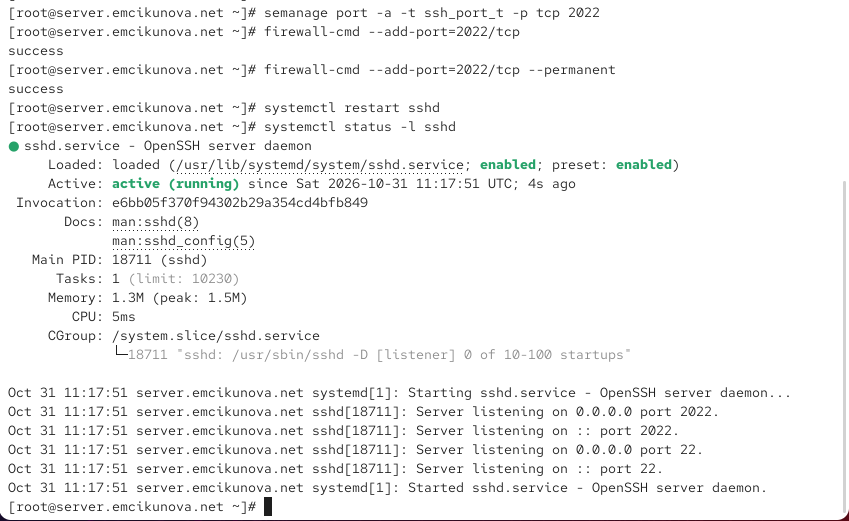
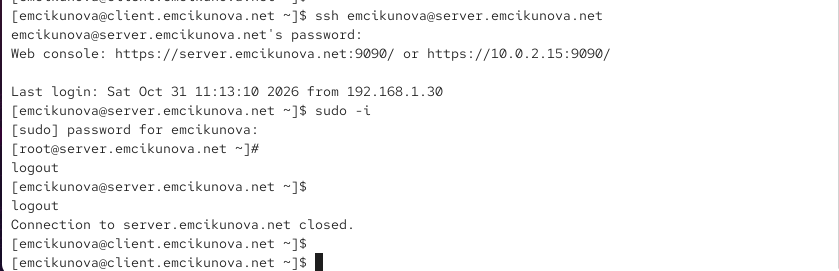
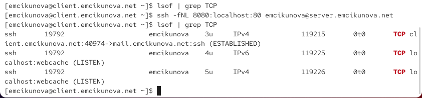
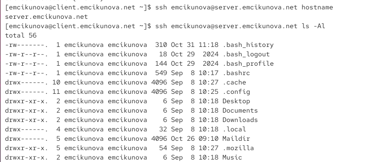
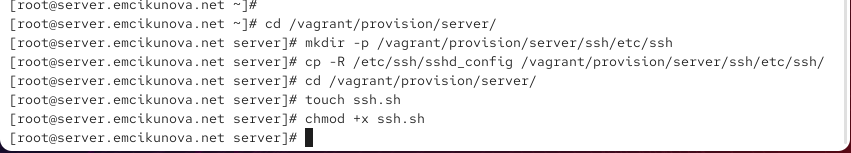

---
## Author
author:
  name: Цыкунова Екатерина Михайловна
  email: 1132246732@rudn.ru
  affiliation:
    - name: Российский университет дружбы народов
      country: Российская Федерация
      postal-code: 117198
      city: Москва
      address: ул. Миклухо-Маклая, д. 6

## Title
title: Лабораторная работа №11
subtitle: Настройка безопасного удалённого доступа по протоколу SSH
license: CC BY
date: today
date-format: "YYYY-MM-DD"
---

# Цели и задачи работы

## Цель лабораторной работы

Целью данной работы является приобретение практических навыков настройки безопасного удалённого доступа к серверу по протоколу SSH, управления правами пользователей, настройки дополнительных портов, аутентификации по ключу, организации SSH-туннелей и автоматизации конфигурации SSH-сервера с помощью Vagrant.

## Задачи лабораторной работы

- ограничить удалённый доступ пользователями vagrant и emcikunova;
- настроить подключение по SSH через дополнительный порт 2022;
- настроить аутентификацию по SSH-ключу;
- организовать SSH-туннель с перенаправлением TCP-портов;
- настроить перенаправление графического интерфейса X11;

# Процесс выполнения лабораторной работы

## Проверяю подключение по SSH от имени root

{ #fig:001 width=70% height=70% }

## Запрещаю удалённый доступ пользователю root

{ #fig:002 width=70% height=70% }

## Проверяю запрет подключения пользователя root

{ #fig:003 width=70% height=70% }

## Проверяю подключение пользователя emcikunova

{ #fig:004 width=70% height=70% }

## Ограничиваю список пользователей SSH

{ #fig:005 width=70% height=70% }

## Проверяю ограничение удалённого доступа

{ #fig:006 width=70% height=70% }

## Разрешаю SSH-доступ пользователю emcikunova

{ #fig:007 width=70% height=70% }

## Проверяю подключение после изменения AllowUsers

{ #fig:008 width=70% height=70% }

## Настраиваю дополнительные порты SSH

{ #fig:009 width=70% height=70% }

## Проверяю работу SSH на порту 2022

{ #fig:010 width=70% height=70% }

## Анализирую сообщения SELinux

{ #fig:011 width=70% height=70% }

## Разрешаю порт 2022 в SELinux и межсетевом экране

{ #fig:012 width=70% height=70% }

## Проверяю SSH-соединение через порт 22

{ #fig:013 width=70% height=70% }

## Проверяю SSH-соединение через порт 2022

{ #fig:014 width=70% height=70% }

## Разрешаю аутентификацию по SSH-ключу

{ #fig:015 width=70% height=70% }

## Генерирую пару SSH-ключей на клиенте

{ #fig:016 width=70% height=70% }

## Копирую открытый ключ на сервер

{ #fig:017 width=70% height=70% }

## Создаю SSH-туннель

{ #fig:018 width=70% height=70% }

## Проверяю работу SSH-туннеля в браузере

{ #fig:019 width=70% height=70% }

## Выполняю удалённые консольные команды

{ #fig:020 width=70% height=70% }

## Просматриваю почтовый ящик через SSH

{ #fig:021 width=70% height=70% }

## Настраиваю перенаправление X11

{ #fig:022 width=70% height=70% }

## Проверяю запуск графического приложения через SSH

{ #fig:023 width=70% height=70% }

## Подготавливаю конфигурацию SSH для Vagrant

{ #fig:024 width=70% height=70% }

## Создаю скрипт автоматической настройки SSH

{ #fig:025 width=70% height=70% }

# Результаты лабораторной работы

## Вывод

В ходе лабораторной работы я настроила безопасный удалённый доступ к серверу `server.emcikunova.net` по протоколу SSH. Запретила подключение пользователю `root` и ограничила доступ пользователями `vagrant` и `emcikunova`.

Настроила работу SSH-сервера через порты `22` и `2022`, разрешила дополнительный порт в SELinux и межсетевом экране. Настроила аутентификацию по SSH-ключу и проверила подключение без ввода пароля.

Организовала SSH-туннель с перенаправлением TCP-портов и проверила удалённое выполнение консольных команд. Включила поддержку X11Forwarding, однако запуск графического приложения завершился ошибкой из-за отсутствия настроенного дисплея.

Создала исполняемый скрипт `ssh.sh` для автоматизации настройки SSH-сервера во внутреннем окружении виртуальной машины Vagrant.