---
## Author
author:
  name: Цыкунова Екатерина Михайловна
  email: 1132246732@rudn.ru
  affiliation:
    - name: Российский университет дружбы народов
      country: Российская Федерация
      postal-code: 117198
      city: Москва
      address: ул. Миклухо-Маклая, д. 6

## Title
title: "Отчёт по лабораторной работе №11"
subtitle: "Настройка безопасного удалённого доступа по протоколу SSH"
license: "CC BY"
---

# Цель работы

Приобретение практических навыков по настройке удалённого доступа к серверу с помощью SSH.

# Выполнение лабораторной работы

## Запрет удалённого доступа по SSH для пользователя root

На виртуальной машине `server.emcikunova.net` перехожу в режим суперпользователя и при необходимости задаю пароль для пользователя `root`:

```bash
sudo -i
passwd root
```

Для мониторинга системных событий в дополнительном терминале запускаю команду:

```bash
journalctl -x -f
```

На виртуальной машине `client.emcikunova.net` выполняю попытку подключения к серверу по SSH от имени пользователя `root`:

```bash
ssh root@server.emcikunova.net
```

При первом подключении система запрашивает подтверждение подлинности сервера и добавляет его ключ в файл `known_hosts`. После трёх попыток ввода пароля соединение завершается сообщением `Permission denied`. Это означает, что аутентификация пользователя `root` не прошла (см. рис. [@fig-001]).

{ #fig-001 width=70% }

На сервере открываю конфигурационный файл SSH-сервера `/etc/ssh/sshd_config` и устанавливаю параметр:

```ini
PermitRootLogin no
```

Данный параметр запрещает удалённое подключение по SSH непосредственно от имени пользователя `root` (см. рис. [@fig-002]).

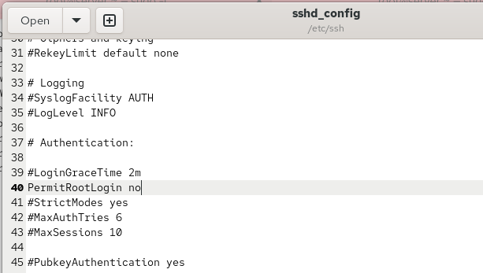{ #fig-002 width=70% }

Для применения изменений перезапускаю службу SSH:

```bash
systemctl restart sshd
```

Повторно пытаюсь подключиться к серверу от имени `root`:

```bash
ssh root@server.emcikunova.net
```

Сервер снова отклоняет попытки аутентификации и выводит сообщение `Permission denied`. Теперь в конфигурации явно установлен запрет удалённого входа для пользователя `root` (см. рис. [@fig-003]).

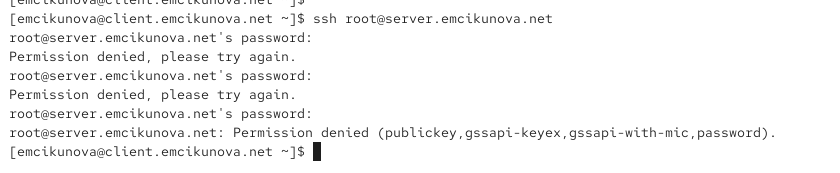{ #fig-003 width=70% }

## Ограничение списка пользователей для удалённого доступа по SSH

На клиенте проверяю возможность подключения к серверу от имени пользователя `emcikunova`:

```bash
ssh emcikunova@server.emcikunova.net
```

После ввода пароля подключение успешно устанавливается. На экране появляется приглашение командной строки пользователя на сервере. Завершаю сеанс командой `exit` (см. рис. [@fig-004]).

{ #fig-004 width=70% }

На сервере открываю файл `/etc/ssh/sshd_config` и добавляю директиву:

```ini
AllowUsers vagrant
```

Параметр `AllowUsers` ограничивает список пользователей, которым разрешено подключаться по SSH. В данном случае доступ предоставляется только пользователю `vagrant` (см. рис. [@fig-005]).

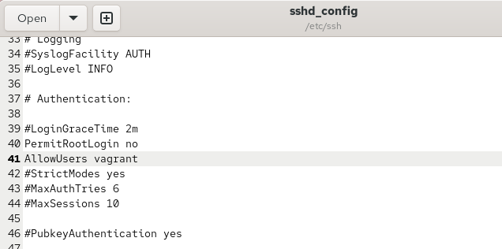{ #fig-005 width=70% }

Перезапускаю службу SSH:

```bash
systemctl restart sshd
```

С клиентской машины повторно выполняю подключение:

```bash
ssh emcikunova@server.emcikunova.net
```

После ввода пароля сервер отклоняет подключение с сообщением `Permission denied`, поскольку пользователь `emcikunova` отсутствует в списке разрешённых пользователей (см. рис. [@fig-006]).

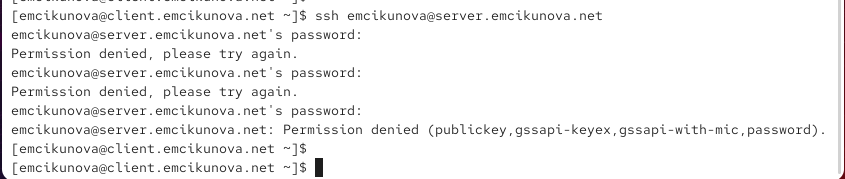{ #fig-006 width=70% }

Для предоставления доступа пользователю `emcikunova` изменяю директиву в конфигурационном файле `/etc/ssh/sshd_config`:

```ini
AllowUsers vagrant emcikunova
```

Теперь подключение по SSH разрешено пользователям `vagrant` и `emcikunova`, а остальные пользователи не входят в список разрешённых (см. рис. [@fig-007]).

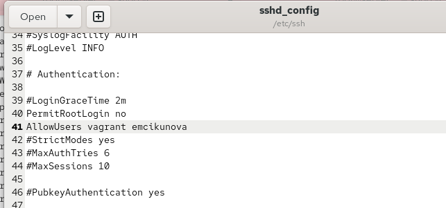{ #fig-007 width=70% }

Перезапускаю службу:

```bash
systemctl restart sshd
```

Повторно подключаюсь к серверу:

```bash
ssh emcikunova@server.emcikunova.net
```

Подключение проходит успешно. При входе система сообщает о предыдущих неудачных попытках аутентификации. После проверки завершаю SSH-сеанс командой `exit` (см. рис. [@fig-008]).

{ #fig-008 width=70% }

## Настройка дополнительных портов для удалённого доступа по SSH

На сервере открываю файл `/etc/ssh/sshd_config` и добавляю настройки для использования двух TCP-портов:

```ini
Port 22
Port 2022
```

Порт `22` используется для стандартных SSH-соединений, а порт `2022` добавляется в качестве альтернативного. Сохранение стандартного порта позволяет продолжить подключение при возникновении проблем с дополнительным портом (см. рис. [@fig-009]).

{ #fig-009 width=70% }

Перезапускаю службу SSH и проверяю её расширенный статус:

```bash
systemctl restart sshd
systemctl status -l sshd
```

В выводе команда `systemctl status` показывает, что служба `sshd` находится в состоянии `active (running)`. Однако при попытке прослушивания порта `2022` появляется ошибка `Bind to port 2022 ... failed: Permission denied`.

При этом порт `22` продолжает прослушиваться, поэтому SSH-сервер остаётся доступным через стандартный порт (см. рис. [@fig-010]).

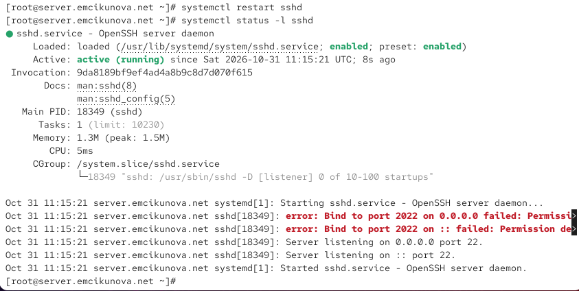{ #fig-010 width=70% }

В терминале с мониторингом системных событий изучаю сообщения SELinux.

В журнале появляется сообщение о том, что SELinux блокирует процессу `/usr/sbin/sshd` операцию `name_bind` для TCP-порта `2022`. Это происходит потому, что данный порт ещё не разрешён политикой SELinux для службы SSH (см. рис. [@fig-011]).

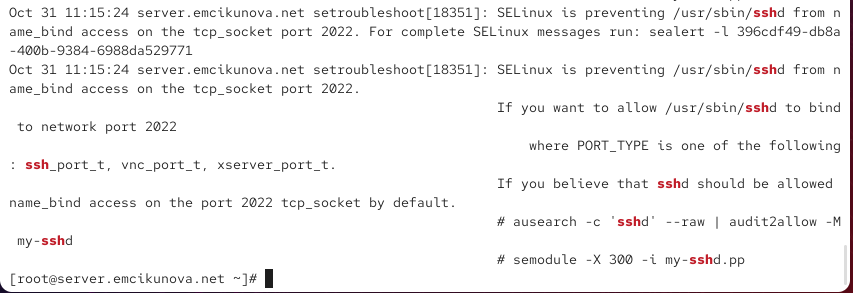{ #fig-011 width=70% }

Для разрешения использования порта `2022` службой SSH добавляю его в политику SELinux с типом `ssh_port_t`:

```bash
semanage port -a -t ssh_port_t -p tcp 2022
```

Затем открываю TCP-порт `2022` в межсетевом экране для текущей и постоянной конфигурации:

```bash
firewall-cmd --add-port=2022/tcp
firewall-cmd --add-port=2022/tcp --permanent
```

Обе команды завершаются сообщением `success`.

После изменения настроек перезапускаю SSH-сервер и проверяю состояние службы:

```bash
systemctl restart sshd
systemctl status -l sshd
```

Теперь служба успешно запускается и прослушивает оба TCP-порта: `22` и `2022`. Это подтверждается сообщениями `Server listening on ... port 2022` и `Server listening on ... port 22` (см. рис. [@fig-012]).

{ #fig-012 width=70% }

С клиентской машины проверяю подключение через стандартный порт `22`:

```bash
ssh emcikunova@server.emcikunova.net
```

После успешного подключения получаю права суперпользователя:

```bash
sudo -i
```

Приглашение командной строки изменяется на `root@server.emcikunova.net`, что подтверждает получение административных прав.

Завершаю сеансы пользователя `root` и пользователя `emcikunova`:

```bash
logout
logout
```

Подключение через стандартный SSH-порт работает корректно (см. рис. [@fig-013]).

{ #fig-013 width=70% }

Далее проверяю возможность подключения через дополнительный порт `2022`:

```bash
ssh -p 2022 emcikunova@server.emcikunova.net
```

Соединение устанавливается успешно. Получаю права суперпользователя командой:

```bash
sudo -i
```

После проверки завершаю оба сеанса:

```bash
logout
logout
```

Успешное подключение подтверждает, что дополнительный порт `2022` разрешён политикой SELinux, открыт в межсетевом экране и прослушивается службой `sshd` (см. рис. [@fig-014]).

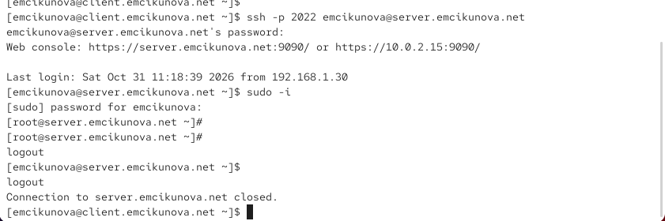{ #fig-014 width=70% }

## Настройка удалённого доступа по SSH по ключу

На сервере открываю конфигурационный файл `/etc/ssh/sshd_config` и включаю аутентификацию по открытому ключу:

```ini
PubkeyAuthentication yes
```

Параметр разрешает пользователям проходить аутентификацию с помощью криптографической пары ключей вместо ввода пароля учётной записи (см. рис. [@fig-015]).

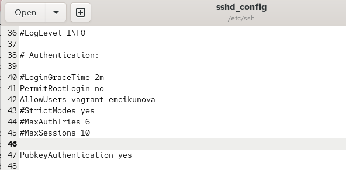{ #fig-015 width=70% }

После сохранения изменений перезапускаю SSH-сервер:

```bash
systemctl restart sshd
```

На виртуальной машине `client.emcikunova.net` от имени пользователя `emcikunova` создаю пару SSH-ключей:

```bash
ssh-keygen
```

При создании ключей принимаю стандартный путь сохранения и оставляю кодовую фразу пустой.

В результате создаётся пара ключей алгоритма ED25519:

- `~/.ssh/id_ed25519` — закрытый ключ;
- `~/.ssh/id_ed25519.pub` — открытый ключ.

Команда также выводит отпечаток открытого ключа и его графическое представление `randomart` (см. рис. [@fig-016]).

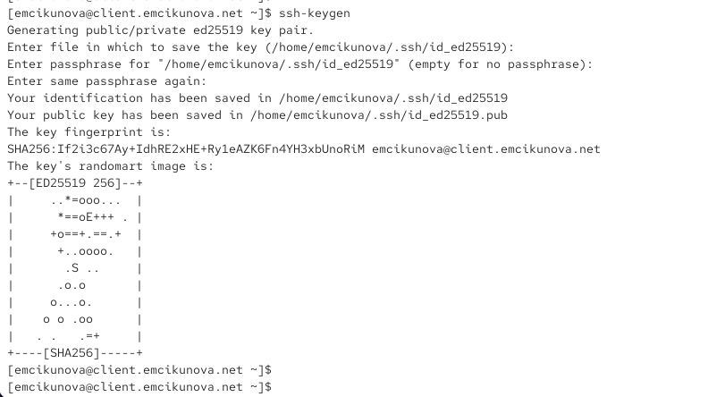{ #fig-016 width=70% }

Копирую открытый ключ с клиента на сервер:

```bash
ssh-copy-id emcikunova@server.emcikunova.net
```

При выполнении команды ввожу пароль пользователя `emcikunova` на сервере. Утилита сообщает об успешном добавлении одного ключа в список разрешённых ключей удалённой учётной записи.

После этого проверяю подключение:

```bash
ssh emcikunova@server.emcikunova.net
```

Соединение устанавливается без запроса пароля пользователя. Это подтверждает успешную настройку аутентификации по SSH-ключу.

Завершаю подключение командой `logout` (см. рис. [@fig-017]).

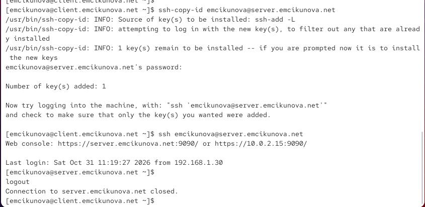{ #fig-017 width=70% }

## Организация SSH-туннеля и перенаправление TCP-портов

На клиентской машине проверяю существующие TCP-соединения:

```bash
lsof | grep TCP
```

Затем создаю SSH-туннель, перенаправляющий подключения к локальному TCP-порту `8080` на порт `80` удалённого сервера:

```bash
ssh -fNL 8080:localhost:80 emcikunova@server.emcikunova.net
```

В данной команде:

- `-f` — переводит процесс SSH в фоновый режим;
- `-N` — запрещает выполнение удалённой команды;
- `-L` — настраивает локальное перенаправление TCP-порта;
- `8080:localhost:80` — связывает локальный порт `8080` с портом `80` на удалённой стороне SSH-соединения.

После создания туннеля повторно проверяю TCP-соединения:

```bash
lsof | grep TCP
```

В выводе появляются процессы `ssh`, использующие локальный адрес `localhost` и состояние `LISTEN`. Это означает, что SSH-клиент ожидает подключения к локальному перенаправленному порту.

Также отображается установленное SSH-соединение между клиентской и серверной машинами (см. рис. [@fig-018]).

{ #fig-018 width=70% }

На клиенте открываю браузер Firefox и перехожу по адресу:

```text
http://localhost:8080
```

В браузере отображается страница с сообщением:

```text
Welcome to the server.emcikunova.net server.
```

Появление страницы подтверждает, что HTTP-запросы с локального порта `8080` успешно передаются через SSH-туннель на TCP-порт `80` удалённого сервера (см. рис. [@fig-019]).

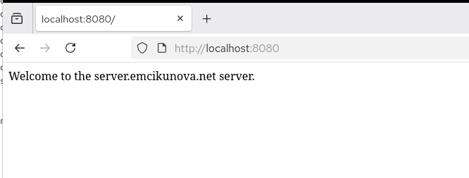{ #fig-019 width=70% }

## Запуск консольных приложений через SSH

На клиентской машине открываю терминал от имени пользователя `emcikunova`.

Для выполнения команд на удалённом сервере использую SSH без открытия интерактивной командной оболочки.

Сначала получаю имя удалённого узла:

```bash
ssh emcikunova@server.emcikunova.net hostname
```

Команда возвращает:

```text
server.emcikunova.net
```

Затем запрашиваю подробный список файлов домашнего каталога пользователя на сервере:

```bash
ssh emcikunova@server.emcikunova.net ls -Al
```

В терминале отображается список файлов и каталогов с их правами доступа, владельцами, размерами и датами изменения.

Среди отображаемых объектов присутствуют `.bash_history`, `.bash_profile`, `.bashrc`, `.config`, `Documents`, `Downloads` и другие каталоги (см. рис. [@fig-020]).

{ #fig-020 width=70% }

Для просмотра почтового ящика на сервере запускаю консольную почтовую программу `mail` через SSH:

```bash
ssh emcikunova@server.emcikunova.net MAIL=~/Maildir mail
```

В выводе отображается почтовый ящик `/home/emcikunova/Maildir`, содержащий три сообщения, включая письма с темами `test1`, `LMTP test` и `test2`.

После просмотра списка сообщений завершаю работу почтовой программы командой `q`.

Полученные результаты подтверждают возможность удалённого запуска консольных приложений и получения их вывода через SSH (см. рис. [@fig-021]).

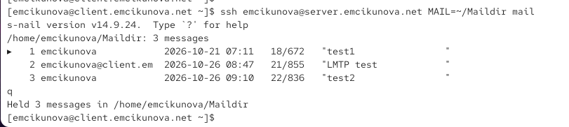{ #fig-021 width=70% }

## Запуск графических приложений через SSH (X11Forwarding)

На сервере открываю конфигурационный файл `/etc/ssh/sshd_config` и разрешаю перенаправление графического интерфейса X11:

```ini
X11Forwarding yes
```

Данный параметр позволяет передавать графический интерфейс приложения, запущенного на удалённом сервере, на клиентскую машину при наличии настроенной графической среды и поддержки X11 (см. рис. [@fig-022]).

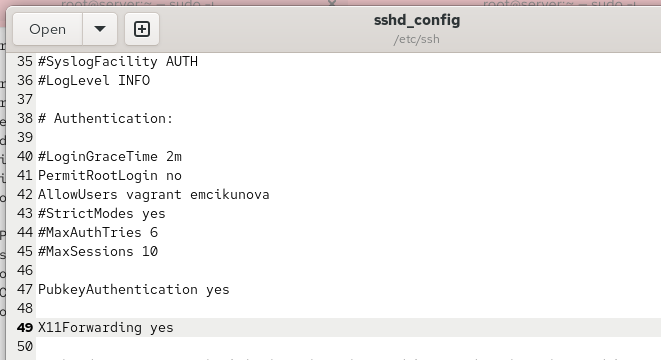{ #fig-022 width=70% }

Перезапускаю службу SSH:

```bash
systemctl restart sshd
```

На клиенте пытаюсь запустить браузер Firefox на удалённом сервере с перенаправлением X11:

```bash
ssh -YC emcikunova@server.emcikunova.net firefox
```

В результате выполнения команды появляются сообщения:

```text
Warning: No xauth data; using fake authentication data for X11 forwarding.
X11 forwarding requested but failed on channel 0
Error: no DISPLAY environment variable specified
```

Сообщения указывают на неудачную настройку графического перенаправления. Переменная окружения `DISPLAY` не задана, поэтому Firefox не может подключиться к графическому дисплею.

Несмотря на включённый параметр `X11Forwarding yes` на сервере, запуск графического приложения не состоялся. Для успешной работы необходимо дополнительно проверить доступность графического X11-дисплея на клиенте и настройки X11-аутентификации (см. рис. [@fig-023]).

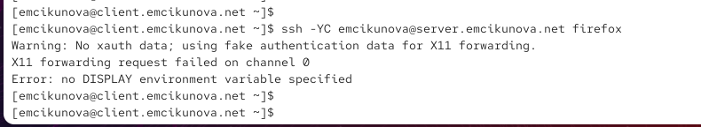{ #fig-023 width=70% }

## Внесение изменений в настройки внутреннего окружения виртуальной машины

На виртуальной машине `server.emcikunova.net` создаю каталог для хранения конфигурации SSH и исполняемый скрипт `ssh.sh`, который будет использоваться для автоматической настройки сервера (см. рис. [@fig-024]).

{ #fig-024 width=70% }

В скрипте `ssh.sh` прописываю команды копирования конфигурационных файлов, настройки межсетевого экрана и SELinux, а также перезапуска службы `sshd` (см. рис. [@fig-025]).

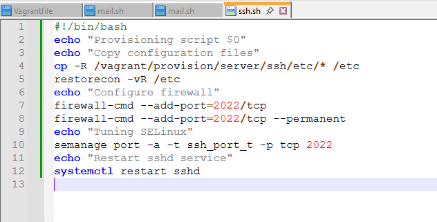{ #fig-025 width=70% }

# Вывод

В ходе лабораторной работы выполнена настройка удалённого доступа к серверу `server.emcikunova.net` посредством SSH.

Запрещён непосредственный SSH-доступ для пользователя `root`, ограничен список разрешённых пользователей учётными записями `vagrant` и `emcikunova`. Настроена работа SSH-сервера через стандартный порт `22` и дополнительный порт `2022` с учётом правил SELinux и межсетевого экрана.

Настроена аутентификация по открытому SSH-ключу, позволяющая пользователю подключаться к серверу без ввода пароля учётной записи. Проверено перенаправление TCP-портов через SSH-туннель и удалённое выполнение консольных команд.

Также включена поддержка X11Forwarding, однако запуск графического приложения не удался из-за проблемы с настройкой графического дисплея. Создан скрипт для автоматизации конфигурации SSH-сервера средствами Vagrant.

# Контрольные вопросы

*1. Вы хотите запретить удалённый доступ по SSH на сервер пользователю root и разрешить доступ пользователю alice. Как это сделать?*

Для ограничения удалённого доступа необходимо открыть конфигурационный файл `/etc/ssh/sshd_config` и установить параметры:

```ini
PermitRootLogin no
AllowUsers alice
```

Параметр `PermitRootLogin no` запрещает подключение по SSH пользователю `root`, а `AllowUsers alice` разрешает доступ только пользователю `alice`.

После сохранения изменений необходимо перезапустить службу SSH:

```bash
systemctl restart sshd
```

*2. Как настроить удалённый доступ по SSH через несколько портов? Для чего это может потребоваться?*

Для настройки SSH через несколько портов необходимо в файле `/etc/ssh/sshd_config` указать:

```ini
Port 22
Port 2022
```

После этого необходимо разрешить дополнительный порт в SELinux и межсетевом экране, а затем перезапустить службу `sshd`.

Использование нескольких портов позволяет организовать альтернативные способы подключения к серверу, сохранить доступ при изменении конфигурации и разделить подключения для разных сетевых условий.

*3. Какие параметры используются для создания туннеля SSH, когда команда ssh устанавливает фоновое соединение и не ожидает какой-либо конкретной команды?*

Для создания SSH-туннеля используются параметры:

- `-f` — переводит SSH-соединение в фоновый режим.
- `-N` — запрещает выполнение удалённой команды.
- `-L` — задаёт локальное перенаправление TCP-порта.

Пример команды:

```bash
ssh -fNL 8080:localhost:80 user@server.example.com
```

Команда создаёт фоновое SSH-соединение и перенаправляет подключения с локального порта `8080` на порт `80` удалённого сервера.

*4. Как настроить локальную переадресацию с локального порта 5555 на порт 80 сервера server2.example.com?*

Для настройки локальной переадресации необходимо выполнить команду:

```bash
ssh -fNL 5555:localhost:80 user@server2.example.com
```

После установки SSH-соединения обращения к локальному адресу `localhost:5555` будут перенаправляться на порт `80` сервера `server2.example.com`.

Для проверки можно открыть в браузере адрес:

```text
http://localhost:5555
```

*5. Как настроить SELinux, чтобы позволить SSH связываться с портом 2022?*

Для разрешения использования порта `2022` службой SSH необходимо выполнить команду:

```bash
semanage port -a -t ssh_port_t -p tcp 2022
```

Параметр `-a` добавляет порт, `-t ssh_port_t` задаёт тип SELinux для SSH, а `-p tcp` указывает протокол TCP.

После изменения политики SELinux необходимо перезапустить службу:

```bash
systemctl restart sshd
```

Это позволит SSH-серверу прослушивать порт `2022`, если он указан в конфигурации `sshd`.

*6. Как настроить межсетевой экран на сервере, чтобы разрешить входящие подключения по SSH через порт 2022?*

Для разрешения входящих TCP-соединений через порт `2022` необходимо выполнить команды:

```bash
firewall-cmd --add-port=2022/tcp
firewall-cmd --add-port=2022/tcp --permanent
```

Первая команда открывает порт в текущей конфигурации межсетевого экрана, а вторая сохраняет правило для последующих запусков системы.

Проверить открытые порты можно командой:

```bash
firewall-cmd --list-ports
```

После настройки межсетевого экрана и SSH-сервера подключение через дополнительный порт выполняется командой:

```bash
ssh -p 2022 user@server.example.com
```

# Список литературы

1. [OpenSSH. sshd_config — официальное руководство по настройке SSH-сервера, ограничению доступа пользователей, запрету входа root и настройке дополнительных портов](https://man.openbsd.org/sshd_config).

2. [OpenSSH. ssh — руководство по использованию SSH-клиента, удалённому выполнению команд, перенаправлению TCP-портов и запуску графических приложений через X11Forwarding](https://man.openbsd.org/ssh).

3. [OpenSSH. ssh-keygen — официальная документация по генерации криптографических ключей и настройке аутентификации SSH с использованием открытого и закрытого ключей](https://man.openbsd.org/ssh-keygen).

4. [Red Hat. Securing Networks — руководство по настройке безопасного удалённого доступа через OpenSSH, управлению портами SSH и настройке политик SELinux в Red Hat Enterprise Linux 9](https://docs.redhat.com/en/documentation/red_hat_enterprise_linux/9/html/securing_networks/assembly_using-secure-communications-between-two-systems-with-openssh_securing-networks).

5. [firewalld. Open a Port or Service — официальное руководство по открытию TCP-портов, настройке правил межсетевого экрана и сохранению постоянной конфигурации с помощью firewall-cmd](https://firewalld.org/documentation/howto/open-a-port-or-service).

6. [HashiCorp. Vagrant Shell Provisioner — автоматизация настройки SSH-сервера, выполнения shell-скриптов и применения конфигурационных файлов в виртуальных машинах Vagrant](https://developer.hashicorp.com/vagrant/docs/provisioning/shell).