---
## Author
author:
  name: Цыкунова Екатерина Михайловна
  email: 1132246732@rudn.ru
  affiliation:
    - name: Российский университет дружбы народов
      country: Российская Федерация
      postal-code: 117198
      city: Москва
      address: ул. Миклухо-Маклая, д. 6

## Title
title: Лабораторная работа №12
subtitle: Синхронизация времени
license: CC BY
date: today
date-format: "YYYY-MM-DD"
---

# Цели и задачи работы

## Цель лабораторной работы

Целью данной работы является приобретение практических навыков настройки системного и аппаратного времени, организации синхронизации времени по протоколу NTP с использованием службы chronyd и автоматизации настройки NTP-сервера и клиента средствами Vagrant.

## Задачи лабораторной работы

- изучить команды управления системным и аппаратным временем;
- проверить параметры синхронизации времени на сервере и клиенте;
- настроить сервер в качестве NTP-сервера локальной сети;
- настроить клиент для синхронизации времени с локальным сервером;

# Процесс выполнения лабораторной работы

## Проверяю параметры времени на сервере

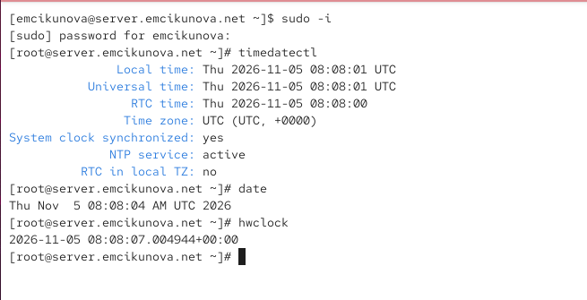{ #fig:001 width=70% height=70% }

## Проверяю параметры времени на клиенте

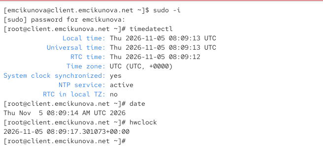{ #fig:002 width=70% height=70% }

## Проверяю источники синхронизации на сервере

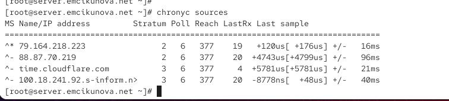{ #fig:003 width=70% height=70% }

## Проверяю источники синхронизации на клиенте

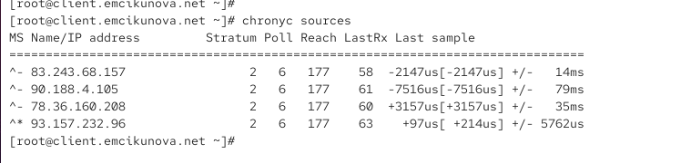{ #fig:004 width=70% height=70% }

## Настраиваю сервер синхронизации времени

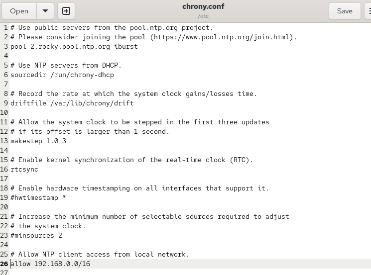{ #fig:005 width=70% height=70% }

## Настраиваю клиент для синхронизации с сервером

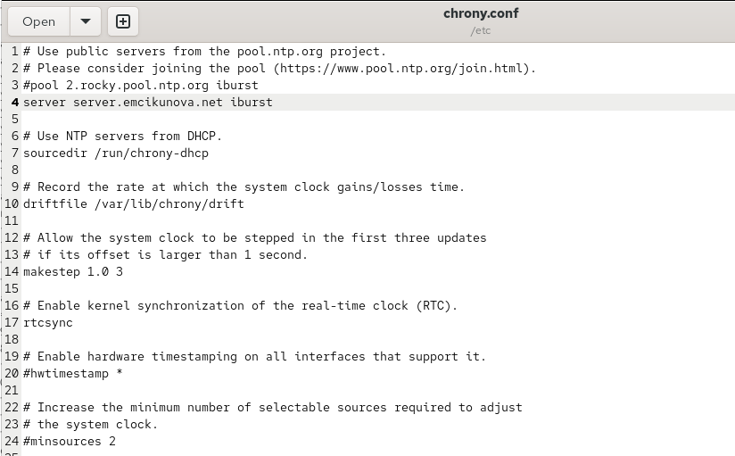{ #fig:006 width=70% height=70% }

## Проверяю синхронизацию времени на клиенте

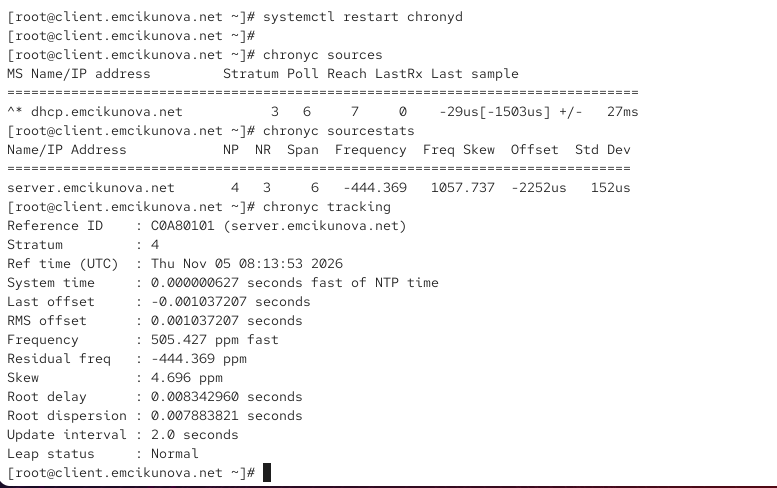{ #fig:007 width=70% height=70% }

## Проверяю синхронизацию времени на сервере

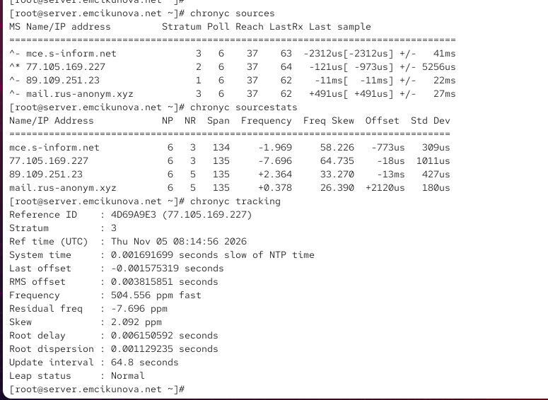{ #fig:008 width=70% height=70% }

## Подготавливаю конфигурацию NTP-сервера для Vagrant

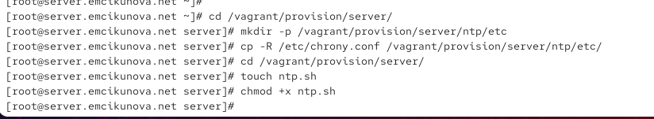{ #fig:009 width=70% height=70% }

## Создаю скрипт автоматической настройки NTP-сервера

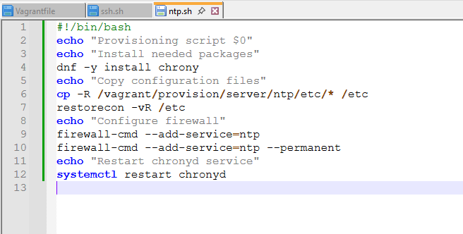{ #fig:010 width=70% height=70% }

## Создаю скрипт автоматической настройки NTP-клиента

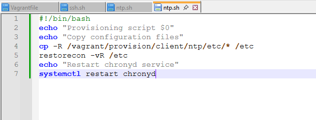{ #fig:011 width=70% height=70% }

# Результаты лабораторной работы

## Вывод

В ходе лабораторной работы я изучила команды управления системным и аппаратным временем `timedatectl`, `date` и `hwclock`. Проверила часовые пояса и состояние синхронизации времени на виртуальных машинах `server.emcikunova.net` и `client.emcikunova.net`.

Настроила сервер для получения времени от внешних NTP-источников и предоставления его клиентам локальной сети. Настроила клиент для синхронизации времени с сервером `server.emcikunova.net`.

Проверила источники времени и состояние синхронизации с помощью команд `chronyc sources`, `chronyc sourcestats` и `chronyc tracking`. Убедилась в корректной работе службы `chronyd` и синхронизации времени между виртуальными машинами.
