---
## Author
author:
  name: Цыкунова Екатерина Михайловна
  email: 1132246732@rudn.ru
  affiliation:
    - name: Российский университет дружбы народов
      country: Российская Федерация
      postal-code: 117198
      city: Москва
      address: ул. Миклухо-Маклая, д. 6

## Title
title: "Отчёт по лабораторной работе №12"
subtitle: "Синхронизация времени"
license: "CC BY"
---

# Цель работы

Получение навыков по управлению системным временем и настройке синхронизации времени.

# Выполнение лабораторной работы

## Настройка параметров времени

На виртуальной машине `server.emcikunova.net` перехожу в режим суперпользователя и проверяю параметры системного и аппаратного времени:

```bash
sudo -i
timedatectl
date
hwclock
```

Команда `timedatectl` показывает часовой пояс `UTC`, активную службу NTP и состояние синхронизации `yes`. Команда `date` выводит системное время, а `hwclock` — аппаратное. Время на сервере синхронизировано (см. рис. [@fig-001]).

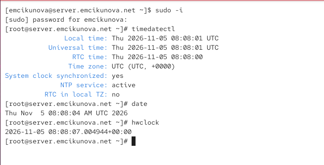{ #fig-001 width=70% }

На виртуальной машине `client.emcikunova.net` выполняю аналогичные команды:

```bash
timedatectl
date
hwclock
```

На клиенте также используется часовой пояс `UTC`, служба NTP активна, системные часы синхронизированы. Системное и аппаратное время имеют близкие значения (см. рис. [@fig-002]).

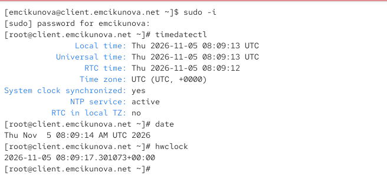{ #fig-002 width=70% }

## Управление синхронизацией времени

На сервере проверяю наличие пакета `chrony` и просматриваю источники синхронизации:

```bash
dnf -y install chrony
chronyc sources
```

Команда `chronyc sources` выводит доступные NTP-серверы. Символ `^*` обозначает выбранный источник времени, а `^-` — источник, который в данный момент не используется. Параметр `Stratum` показывает уровень источника, `Reach` — его доступность, `Last sample` — последнее измеренное отклонение времени. На сервере выбран источник `79.164.218.223` (см. рис. [@fig-003]).

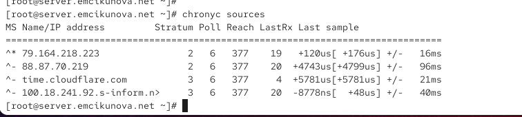{ #fig-003 width=70% }

На клиенте также выполняю:

```bash
chronyc sources
```

В результате отображаются внешние NTP-серверы. Основным источником выбран `93.157.232.96`, отмеченный символом `^*` (см. рис. [@fig-004]).

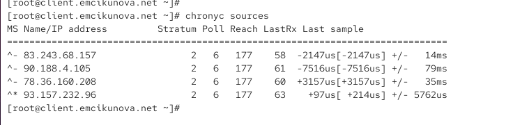{ #fig-004 width=70% }

На сервере открываю файл `/etc/chrony.conf` и добавляю строку:

```ini
allow 192.168.0.0/16
```

Данная директива разрешает клиентам локальной сети `192.168.0.0/16` синхронизировать время с сервером. Для получения точного времени сервер использует внешний пул `2.rocky.pool.ntp.org` (см. рис. [@fig-005]).

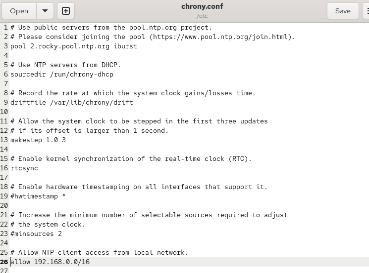{ #fig-005 width=70% }

Перезапускаю службу и разрешаю NTP-трафик в межсетевом экране:

```bash
systemctl restart chronyd
firewall-cmd --add-service=ntp --permanent
firewall-cmd --reload
```

На клиенте открываю `/etc/chrony.conf`, отключаю использование внешнего пула и указываю локальный сервер:

```ini
#pool 2.rocky.pool.ntp.org iburst
server server.emcikunova.net iburst
```

Параметр `iburst` ускоряет первоначальную синхронизацию времени. Теперь клиент должен использовать сервер `server.emcikunova.net` (см. рис. [@fig-006]).

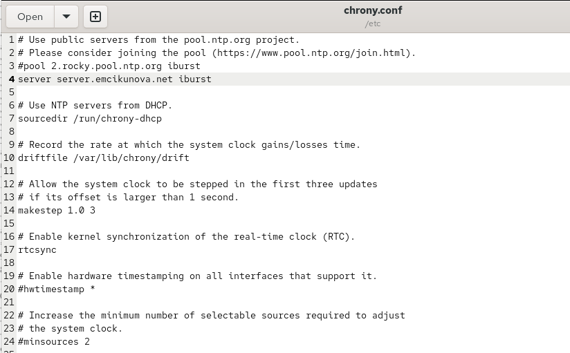{ #fig-006 width=70% }

Перезапускаю службу на клиенте и проверяю синхронизацию:

```bash
systemctl restart chronyd
chronyc sources
chronyc sourcestats
chronyc tracking
```

Команда `chronyc sourcestats` показывает статистику измерений и отклонений времени, а `chronyc tracking` — подробное состояние синхронизации.

В выводе `tracking` указан сервер `server.emcikunova.net`, значение `Stratum: 4` и состояние `Leap status: Normal`. Это подтверждает успешную синхронизацию клиента с локальным NTP-сервером (см. рис. [@fig-007]).

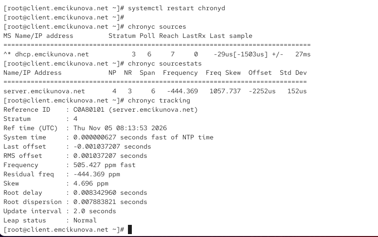{ #fig-007 width=70% }

На сервере выполняю аналогичную проверку:

```bash
chronyc sources
chronyc sourcestats
chronyc tracking
```

В качестве основного источника времени используется `77.105.169.227`. Значение `Stratum: 3` указывает на третий уровень иерархии NTP, а `Leap status: Normal` подтверждает нормальное состояние синхронизации. Сервер получает время от внешнего источника и передаёт его клиенту (см. рис. [@fig-008]).

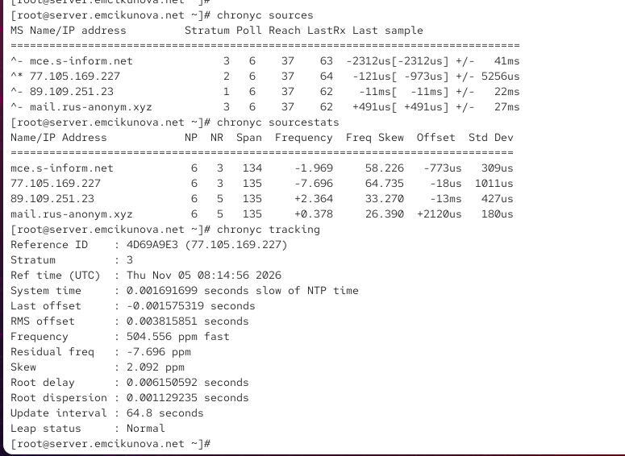{ #fig-008 width=70% }

## Внесение изменений в настройки внутреннего окружения виртуальных машин

На сервере создаю каталог `/vagrant/provision/server/ntp/etc`, копирую в него настроенный файл `chrony.conf` и создаю исполняемый скрипт `ntp.sh` для автоматической настройки NTP-сервера (см. рис. [@fig-009]).

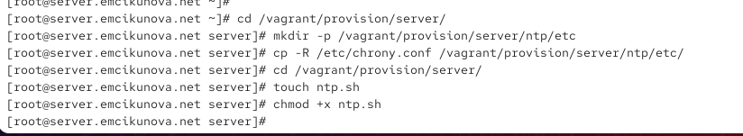{ #fig-009 width=70% }

В скрипте предусматриваю установку `chrony`, копирование конфигурации, настройку межсетевого экрана и перезапуск службы `chronyd` (см. рис. [@fig-010]).

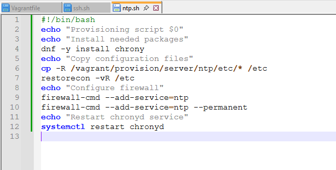{ #fig-010 width=70% }

На клиенте аналогично сохраняю конфигурацию и создаю скрипт `ntp.sh`, который восстанавливает настройки и перезапускает службу `chronyd`; для автоматического выполнения скриптов предусматриваю их подключение в `Vagrantfile` (см. рис. [@fig-011]).

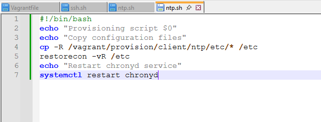{ #fig-011 width=70% }

# Вывод

В ходе лабораторной работы изучены команды управления системным и аппаратным временем `timedatectl`, `date` и `hwclock`. Проверены параметры времени и состояние синхронизации на виртуальных машинах `server.emcikunova.net` и `client.emcikunova.net`.

С помощью службы `chronyd` настроена синхронизация времени в локальной сети. Сервер получает время от внешних NTP-источников и предоставляет его клиенту. Проверены источники и параметры синхронизации командами `chronyc sources`, `chronyc sourcestats` и `chronyc tracking`.

Созданы скрипты `ntp.sh` для автоматизации настройки NTP-сервера и клиента средствами Vagrant.

# Контрольные вопросы

*1. Почему важна точная синхронизация времени для служб баз данных?*

Точная синхронизация времени необходима для правильного ведения журналов транзакций, согласованной работы репликации, корректной обработки временных меток и восстановления данных. Расхождение времени между серверами может привести к ошибкам при обработке транзакций и нарушению последовательности событий.

*2. Почему служба проверки подлинности Kerberos сильно зависит от правильной синхронизации времени?*

Kerberos использует временные метки для проверки подлинности и защиты от повторного использования перехваченных запросов. Если время клиента и сервера отличается более чем на допустимый интервал, обычно 5 минут, аутентификация отклоняется.

*3. Какая служба используется по умолчанию для синхронизации времени на RHEL 7?*

В RHEL 7 по умолчанию используется служба `chronyd`, входящая в пакет `chrony`. Она обеспечивает синхронизацию системного времени по протоколу NTP.

Для проверки состояния службы используется команда:

```bash
systemctl status chronyd
```

*4. Какова страта по умолчанию для локальных часов?*

В `chrony` для локального источника времени по умолчанию используется страта `10`. Этот уровень применяется при включении режима локального источника директивой `local`.

*5. Какой порт брандмауэра должен быть открыт, если вы настраиваете свой сервер как одноранговый узел NTP?*

Для обмена данными по протоколу NTP необходимо разрешить UDP-порт `123`.

В `firewalld` это можно сделать командой:

```bash
firewall-cmd --add-service=ntp --permanent
firewall-cmd --reload
```

*6. Какую строку вам нужно включить в конфигурационный файл chrony, если вы хотите быть сервером времени, даже если внешние серверы NTP недоступны?*

В файл `/etc/chrony.conf` необходимо добавить строку:

```ini
local stratum 10
```

Директива позволяет серверу использовать собственные системные часы в качестве локального источника времени при отсутствии синхронизации с внешними NTP-серверами.

*7. Какую страту имеет хост, если нет текущей синхронизации времени NTP?*

Несинхронизированному узлу в протоколе NTP соответствует страта `16`. Это значение означает, что узел не имеет действующего источника точного времени и не должен использоваться для синхронизации других устройств.

*8. Какую команду вы бы использовали на сервере с chrony, чтобы узнать, с какими серверами он синхронизируется?*

Для просмотра источников синхронизации используется команда:

```bash
chronyc sources
```

Она отображает список NTP-серверов, их доступность и состояние. Символ `^*` указывает на источник, выбранный для текущей синхронизации времени.

*9. Как вы можете получить подробную статистику текущих настроек времени для процесса chrony вашего сервера?*

Для просмотра подробной информации о синхронизации используется команда:

```bash
chronyc tracking
```

Она показывает текущий источник времени, страту, отклонение системных часов, частотную коррекцию и состояние синхронизации.

Для получения статистики измерений по отдельным источникам используется команда:

```bash
chronyc sourcestats
```

# Список литературы

1. [Red Hat. Configuring the Date and Time — официальное руководство по настройке системного и аппаратного времени в Linux с использованием команд timedatectl, date и hwclock](https://docs.redhat.com/en/documentation/red_hat_enterprise_linux/7/html/system_administrators_guide/chap-configuring_the_date_and_time).

2. [Red Hat. Configuring NTP Using the chrony Suite — руководство по установке и настройке службы chronyd, организации NTP-сервера и синхронизации времени в локальной сети](https://docs.redhat.com/en/documentation/red_hat_enterprise_linux/7/html/system_administrators_guide/ch-configuring_ntp_using_the_chrony_suite).

3. [Chrony. chrony.conf — официальная документация по конфигурационному файлу chrony, настройке источников времени и директивам server, pool, allow и local](https://chrony-project.org/doc/4.8/chrony.conf.html).

4. [Chrony. chronyc — руководство по управлению службой синхронизации времени, проверке источников NTP и анализу статистики командами sources, sourcestats и tracking](https://chrony-project.org/doc/4.8/chronyc.html).

5. [HashiCorp. Vagrant Shell Provisioner — официальное руководство по автоматизации настройки виртуальных машин с помощью shell-скриптов и конфигурационного файла Vagrantfile](https://developer.hashicorp.com/vagrant/docs/provisioning/shell).