---
## Author
author:
  name: Цыкунова Екатерина Михайловна
  email: 1132246732@rudn.ru
  affiliation:
    - name: Российский университет дружбы народов
      country: Российская Федерация
      postal-code: 117198
      city: Москва
      address: ул. Миклухо-Маклая, д. 6

## Title
title: Лабораторная работа №13
subtitle: Настройка NFS
license: CC BY
date: today
date-format: "YYYY-MM-DD"
---

---
## Author
author:
  name: Цыкунова Екатерина Михайловна
  email: 1132246732@rudn.ru
  affiliation:
    - name: Российский университет дружбы народов
      country: Российская Федерация
      postal-code: 117198
      city: Москва
      address: ул. Миклухо-Маклая, д. 6

## Title
title: Лабораторная работа №13
subtitle: Настройка NFS
license: CC BY
date: today
date-format: "YYYY-MM-DD"
---

# Цели и задачи работы

## Цель лабораторной работы

Целью данной работы является приобретение практических навыков установки и настройки сервера NFSv4, организации доступа к общим сетевым ресурсам, подключения каталогов веб-сервера и пользователей к дереву NFS, а также автоматизации настройки NFS-сервера и клиента средствами Vagrant.

## Задачи лабораторной работы

- установить и настроить сервер NFSv4;
- настроить межсетевой экран и права доступа к общим ресурсам;
- подключить удалённый ресурс NFS на клиенте;
- подключить каталог веб-сервера к дереву NFS;
- организовать удалённый доступ к пользовательскому каталогу;

# Процесс выполнения лабораторной работы

## Устанавливаю NFS и создаю общий каталог на сервере

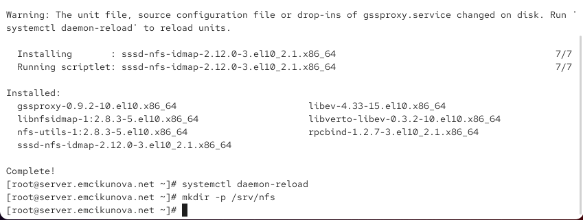{ #fig:001 width=70% height=70% }

## Настраиваю экспорт корневого каталога NFS

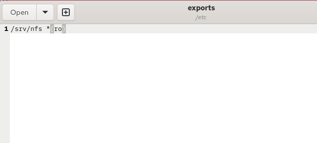{ #fig:002 width=70% height=70% }

## Настраиваю SELinux и запускаю NFS-сервер

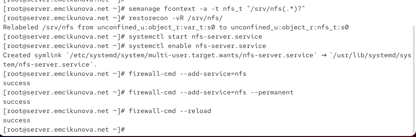{ #fig:003 width=70% height=70% }

## Устанавливаю NFS на клиенте и проверяю подключение

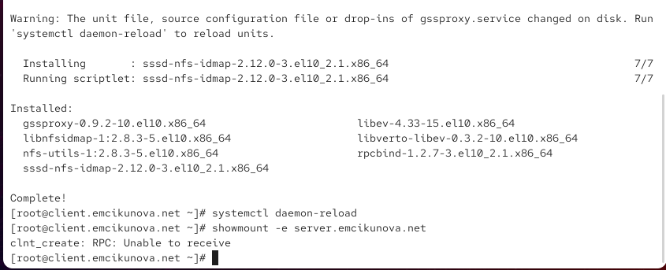{ #fig:004 width=70% height=70% }

## Проверяю TCP-соединения служб RPC

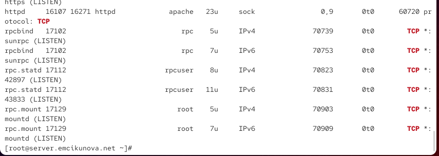{ #fig:005 width=70% height=70% }

## Проверяю UDP-соединения служб RPC

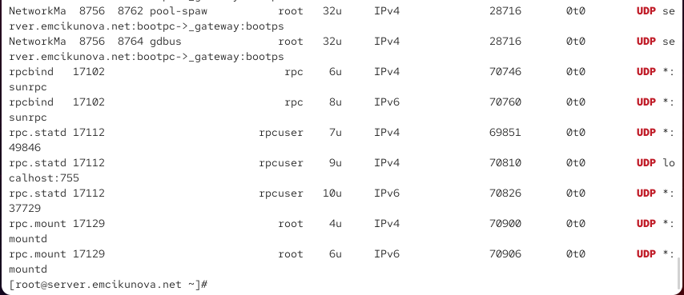{ #fig:006 width=70% height=70% }

## Настраиваю межсетевой экран для работы RPC

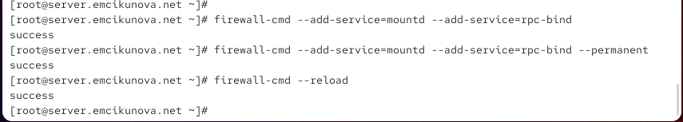{ #fig:007 width=70% height=70% }

## Проверяю доступность экспортируемых ресурсов NFS

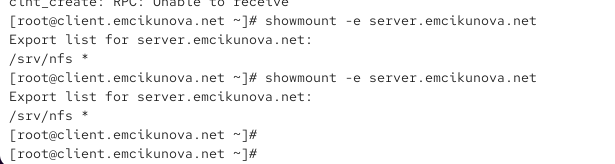{ #fig:008 width=70% height=70% }

## Настраиваю автоматическое монтирование NFS на клиенте

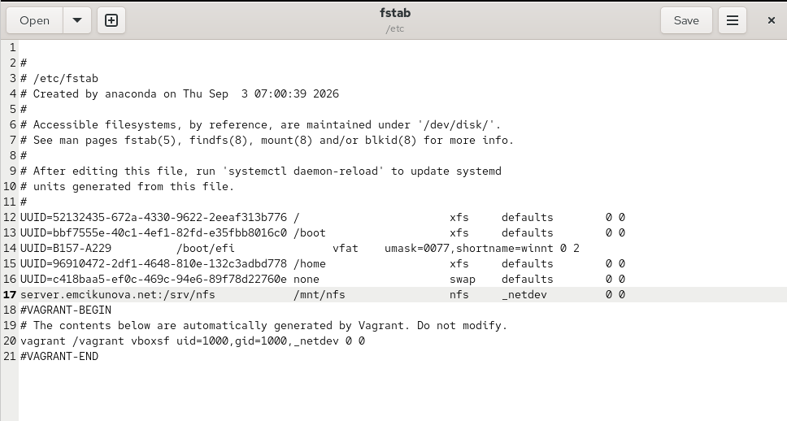{ #fig:009 width=70% height=70% }

## Проверяю подключение NFSv4 на клиенте

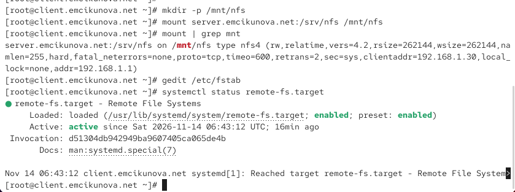{ #fig:010 width=70% height=70% }

## Повторно проверяю монтирование удалённого ресурса

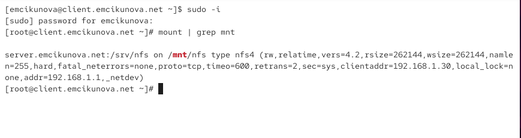{ #fig:011 width=70% height=70% }

## Подключаю каталог веб-сервера к дереву NFS

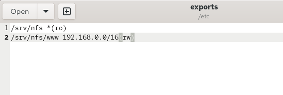{ #fig:012 width=70% height=70% }

## Настраиваю постоянное монтирование каталога веб-сервера

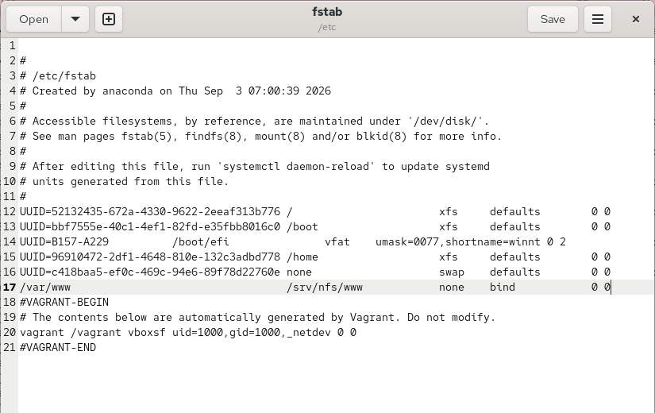{ #fig:013 width=70% height=70% }

## Применяю настройки экспорта каталога веб-сервера

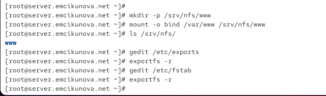{ #fig:014 width=70% height=70% }

## Проверяю доступность веб-каталога на клиенте

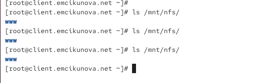{ #fig:015 width=70% height=70% }

## Создаю пользовательский каталог для удалённой работы

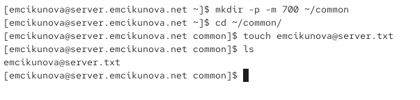{ #fig:016 width=70% height=70% }

## Подключаю пользовательский каталог к дереву NFS

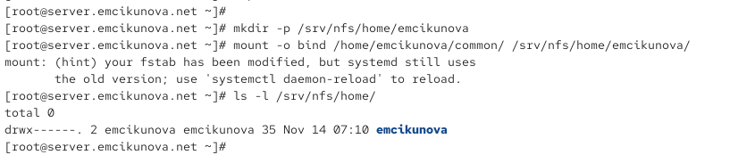{ #fig:017 width=70% height=70% }

## Настраиваю экспорт пользовательского каталога

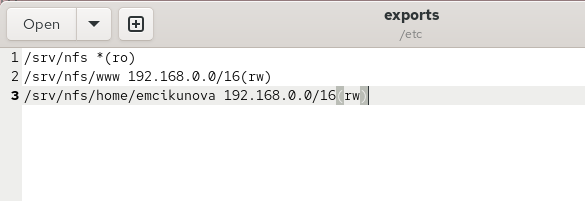{ #fig:018 width=70% height=70% }

## Настраиваю постоянное монтирование пользовательского каталога

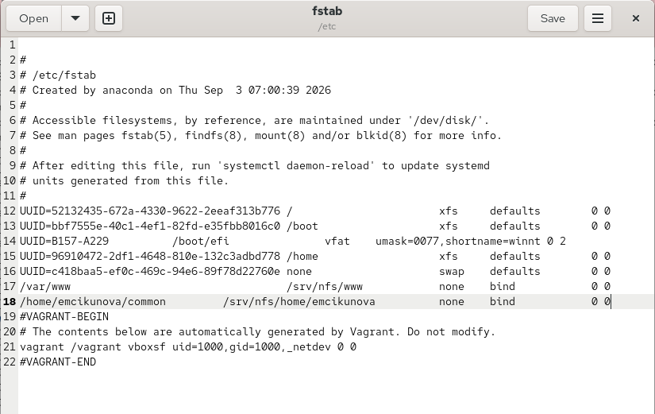{ #fig:019 width=70% height=70% }

## Проверяю права доступа к пользовательскому каталогу

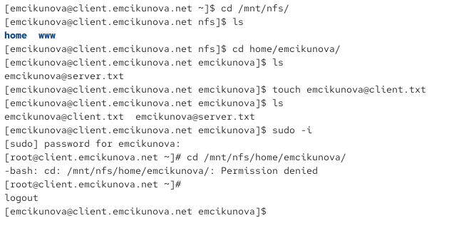{ #fig:020 width=70% height=70% }

## Проверяю изменения пользовательского каталога на сервере

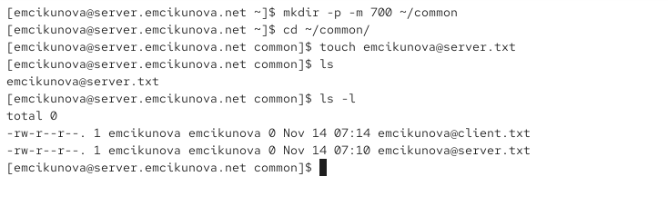{ #fig:021 width=70% height=70% }

## Подготавливаю конфигурацию NFS-сервера для Vagrant

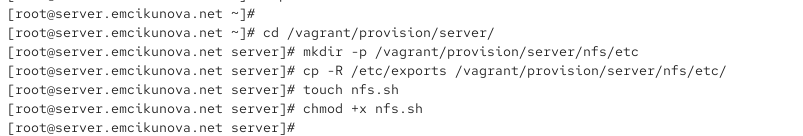{ #fig:022 width=70% height=70% }

## Создаю скрипт автоматической настройки NFS-сервера

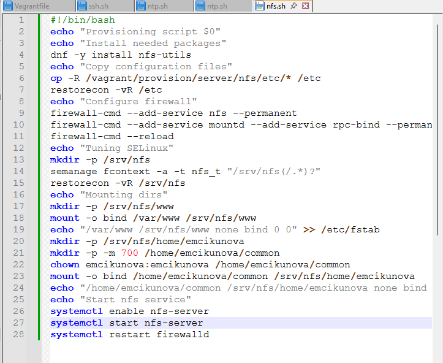{ #fig:023 width=70% height=70% }

## Создаю исполняемый скрипт настройки NFS-клиента

{ #fig:024 width=70% height=70% }

## Настраиваю автоматическое подключение NFS на клиенте

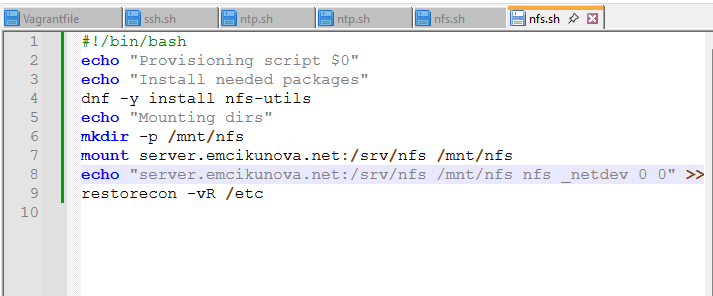{ #fig:025 width=70% height=70% }

# Результаты лабораторной работы

## Вывод

В ходе лабораторной работы я установила и настроила сервер NFSv4 на виртуальной машине `server.emcikunova.net`. Создала общий каталог `/srv/nfs`, настроила экспорт сетевых ресурсов, права доступа, контексты безопасности SELinux и правила межсетевого экрана.

На виртуальной машине `client.emcikunova.net` подключила удалённый ресурс NFS и настроила его автоматическое монтирование через `/etc/fstab`. Проверила доступность общих каталогов и работу протокола NFSv4.2.

Подключила к дереву NFS каталог веб-сервера `/var/www` и пользовательский каталог `/home/emcikunova/common`. Проверила возможность создания файлов с клиентской машины и ограничения доступа для удалённого суперпользователя.

Создала скрипты `nfs.sh` для автоматизации настройки NFS-сервера и клиента средствами Vagrant.