---
## Author
author:
  name: Цыкунова Екатерина Михайловна
  email: 1132246732@rudn.ru
  affiliation:
    - name: Российский университет дружбы народов
      country: Российская Федерация
      postal-code: 117198
      city: Москва
      address: ул. Миклухо-Маклая, д. 6

## Title
title: "Отчёт по лабораторной работе №13"
subtitle: "Настройка NFS"
license: "CC BY"
---

# Цель работы

Приобретение навыков настройки сервера NFS для удалённого доступа к ресурсам.

# Выполнение лабораторной работы

## Настройка сервера NFSv4

На виртуальной машине `server.emcikunova.net` устанавливаю необходимые пакеты и создаю корневой каталог NFS:

```bash
sudo -i
dnf -y install nfs-utils
systemctl daemon-reload
mkdir -p /srv/nfs
```

Установка завершается успешно, каталог `/srv/nfs` создан (см. рис. [@fig-001]).

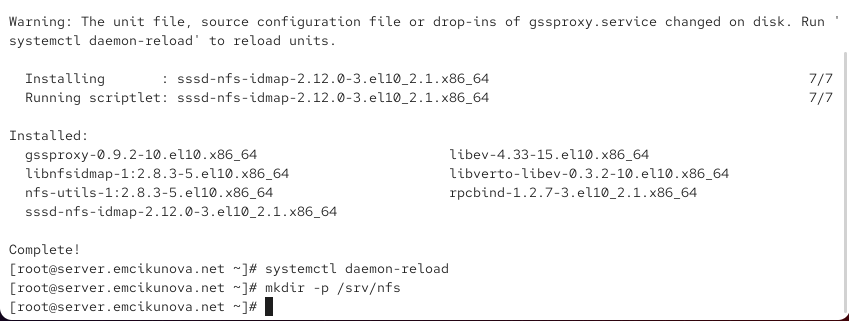{ #fig-001 width=70% }

Открываю файл `/etc/exports` и добавляю запись:

```text
/srv/nfs *(ro)
```

Данная запись разрешает всем клиентам доступ к каталогу `/srv/nfs` только для чтения (см. рис. [@fig-002]).

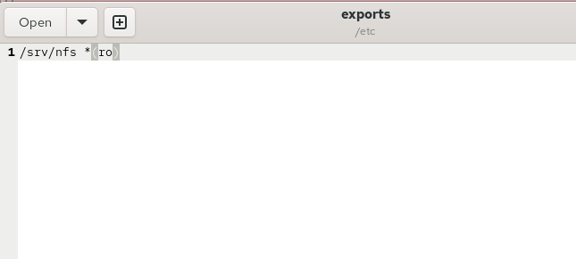{ #fig-002 width=70% }

Настраиваю контекст SELinux, запускаю службу NFS и разрешаю её работу через межсетевой экран:

```bash
semanage fcontext -a -t nfs_t "/srv/nfs(/.*)?"
restorecon -vR /srv/nfs
systemctl start nfs-server.service
systemctl enable nfs-server.service
firewall-cmd --add-service=nfs
firewall-cmd --add-service=nfs --permanent
firewall-cmd --reload
```

Каталог получает контекст `nfs_t`, служба NFS запускается, а настройки межсетевого экрана успешно применяются (см. рис. [@fig-003]).

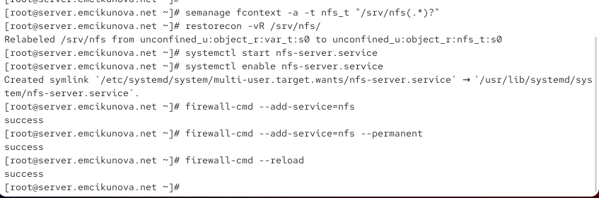{ #fig-003 width=70% }

На клиенте устанавливаю пакет `nfs-utils` и проверяю доступные ресурсы сервера:

```bash
dnf -y install nfs-utils
showmount -e server.emcikunova.net
```

Команда `showmount` завершается ошибкой `RPC: Unable to receive`. Причина заключается в недоступности необходимых RPC-служб через межсетевой экран сервера (см. рис. [@fig-004]).

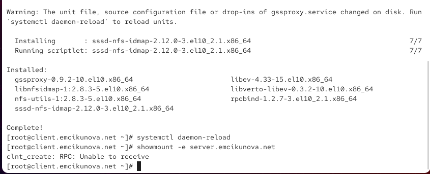{ #fig-004 width=70% }

Для проверки влияния межсетевого экрана временно останавливаю его на сервере, повторяю проверку с клиента и затем снова запускаю:

```bash
systemctl stop firewalld.service
systemctl start firewalld
```

На сервере просматриваю используемые TCP-соединения:

```bash
lsof | grep TCP
```

В выводе отображаются процессы `rpcbind`, `rpc.statd` и `rpc.mountd`, обеспечивающие работу служб RPC (см. рис. [@fig-005]).

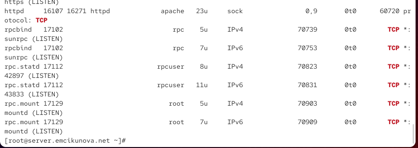{ #fig-005 width=70% }

Аналогично проверяю UDP-соединения:

```bash
lsof | grep UDP
```

Вывод подтверждает использование UDP службами RPC (см. рис. [@fig-006]).

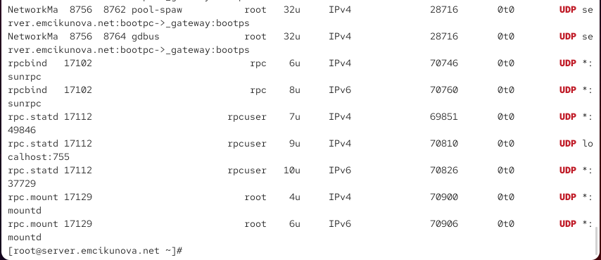{ #fig-006 width=70% }

Добавляю службы `mountd` и `rpc-bind` в настройки межсетевого экрана:

```bash
firewall-cmd --get-services
firewall-cmd --add-service=mountd --add-service=rpc-bind
firewall-cmd --add-service=mountd --add-service=rpc-bind --permanent
firewall-cmd --reload
```

Команды выполняются успешно, необходимые RPC-службы становятся доступными через межсетевой экран (см. рис. [@fig-007]).

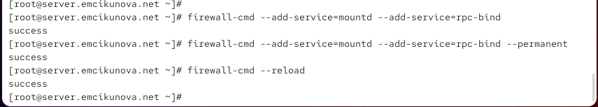{ #fig-007 width=70% }

На клиенте повторно выполняю:

```bash
showmount -e server.emcikunova.net
```

Теперь отображается экспортируемый каталог `/srv/nfs`, доступный всем клиентам. Ошибка подключения устранена (см. рис. [@fig-008]).

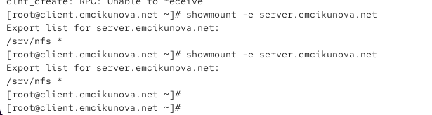{ #fig-008 width=70% }

## Монтирование NFS на клиенте

На клиенте создаю точку монтирования и подключаю удалённый ресурс:

```bash
mkdir -p /mnt/nfs
mount server.emcikunova.net:/srv/nfs /mnt/nfs
```

Для автоматического подключения редактирую файл `/etc/fstab`, добавляя запись:

```fstab
server.emcikunova.net:/srv/nfs /mnt/nfs nfs _netdev 0 0
```

Здесь указан адрес удалённого ресурса, точка монтирования `/mnt/nfs`, тип файловой системы `nfs` и параметр `_netdev`, обеспечивающий учёт сетевого подключения при монтировании. Последние два нуля отключают использование `dump` и проверку `fsck` (см. рис. [@fig-009]).

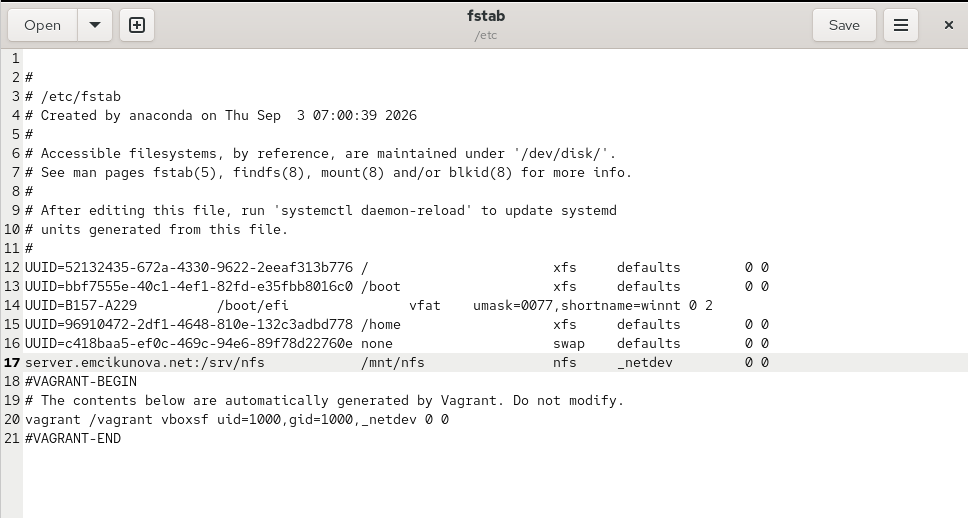{ #fig-009 width=70% }

Проверяю подключение ресурса и состояние службы удалённых файловых систем:

```bash
mount | grep mnt
systemctl status remote-fs.target
```

В выводе отображается ресурс `server.emcikunova.net:/srv/nfs`, подключённый к `/mnt/nfs` по протоколу NFSv4.2. Состояние `remote-fs.target` — `active`, что подтверждает активность системной цели удалённых файловых систем (см. рис. [@fig-010]).

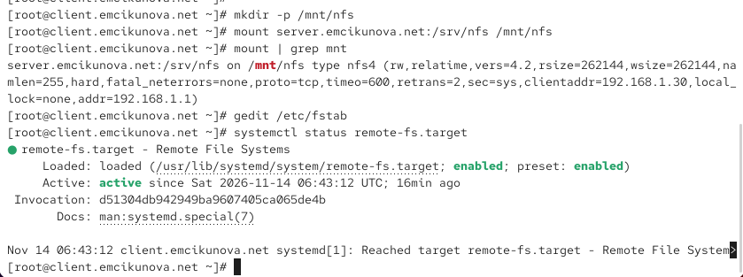{ #fig-010 width=70% }

Повторно проверяю список смонтированных файловых систем:

```bash
mount | grep mnt
```

Удалённый ресурс по-прежнему подключён к `/mnt/nfs`, параметры монтирования соответствуют NFSv4.2 (см. рис. [@fig-011]).

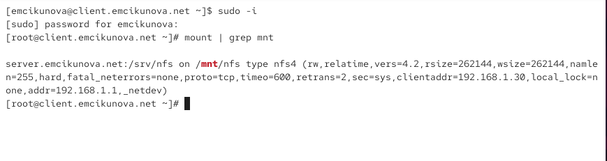{ #fig-011 width=70% }

## Подключение каталогов к дереву NFS

На сервере создаю каталог для содержимого веб-сервера и выполняю bind-монтирование:

```bash
mkdir -p /srv/nfs/www
mount -o bind /var/www /srv/nfs/www
ls /srv/nfs/
```

В каталоге `/srv/nfs` появляется директория `www`. Добавляю в `/etc/exports` запись:

```text
/srv/nfs/www 192.168.0.0/16(rw)
```

Она разрешает клиентам локальной сети доступ к каталогу веб-сервера в режиме чтения и записи с учётом файловых разрешений (см. рис. [@fig-012]).

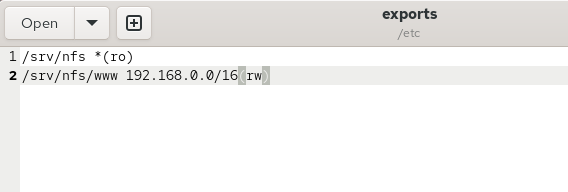{ #fig-012 width=70% }

Для автоматического bind-монтирования добавляю в `/etc/fstab` строку:

```fstab
/var/www /srv/nfs/www none bind 0 0
```

Запись обеспечивает подключение каталога `/var/www` к дереву NFS при загрузке системы (см. рис. [@fig-013]).

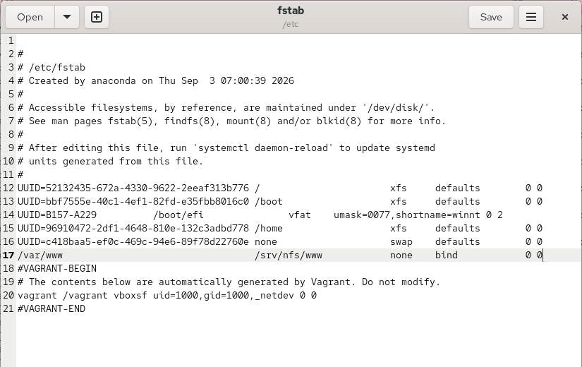{ #fig-013 width=70% }

Применяю изменения конфигурации экспорта:

```bash
exportfs -r
```

Команда обновляет список экспортируемых каталогов. Все действия выполняются без ошибок (см. рис. [@fig-014]).

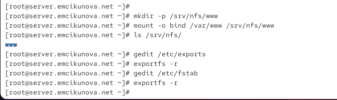{ #fig-014 width=70% }

На клиенте проверяю содержимое общего каталога:

```bash
ls /mnt/nfs/
```

В выводе отображается директория `www`, что подтверждает доступность подключённого каталога веб-сервера через NFS (см. рис. [@fig-015]).

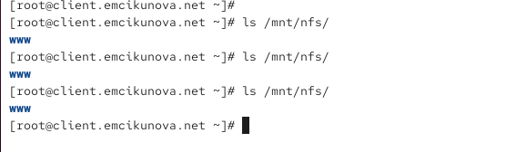{ #fig-015 width=70% }

## Подключение каталогов для работы пользователей

На сервере под пользователем `emcikunova` создаю каталог `common` и тестовый файл:

```bash
mkdir -p -m 700 ~/common
cd ~/common
touch emcikunova@server.txt
ls
```

Каталог создаётся с правами `700`, разрешающими полный доступ только владельцу. Внутри находится файл `emcikunova@server.txt` (см. рис. [@fig-016]).

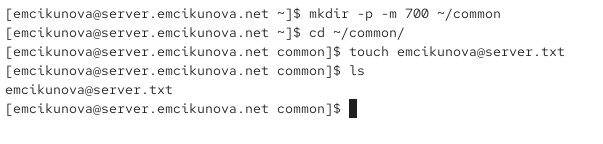{ #fig-016 width=70% }

Под суперпользователем создаю точку монтирования и подключаю пользовательский каталог к дереву NFS:

```bash
mkdir -p /srv/nfs/home/emcikunova
mount -o bind /home/emcikunova/common /srv/nfs/home/emcikunova
ls -l /srv/nfs/home/
```

Каталог принадлежит пользователю `emcikunova` и имеет права `drwx------`, соответствующие режиму `700` (см. рис. [@fig-017]).

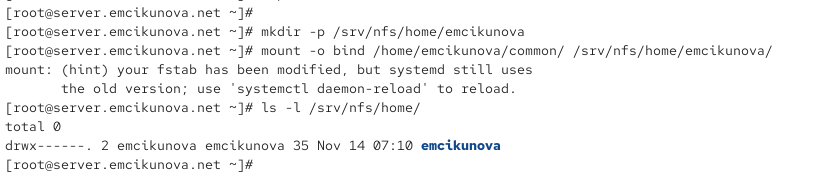{ #fig-017 width=70% }

В файл `/etc/exports` добавляю экспорт пользовательского каталога:

```text
/srv/nfs/home/emcikunova 192.168.0.0/16(rw)
```

Теперь клиенты сети `192.168.0.0/16` могут обращаться к пользовательскому каталогу с учётом установленных прав доступа (см. рис. [@fig-018]).

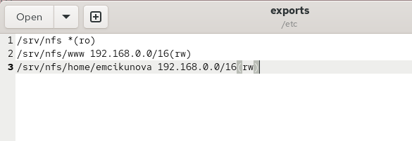{ #fig-018 width=70% }

Для постоянного монтирования добавляю в `/etc/fstab` запись:

```fstab
/home/emcikunova/common /srv/nfs/home/emcikunova none bind 0 0
```

После сохранения файла повторно экспортирую каталоги:

```bash
exportfs -r
```

Настройки монтирования и экспорта обновлены (см. рис. [@fig-019]).

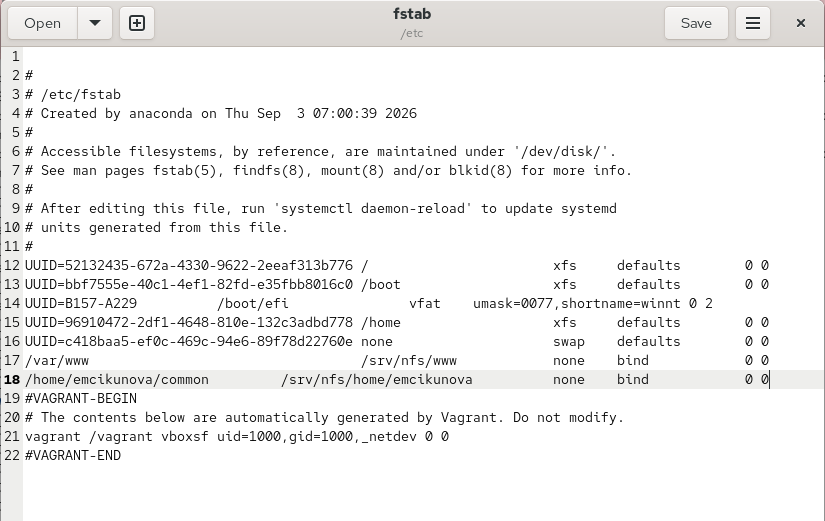{ #fig-019 width=70% }

На клиенте под пользователем `emcikunova` проверяю содержимое каталога и создаю новый файл:

```bash
cd /mnt/nfs/home/emcikunova
ls
touch emcikunova@client.txt
ls
```

Создание файла проходит успешно. При попытке перейти в каталог под пользователем `root` возникает ошибка `Permission denied`. Это связано с механизмом `root_squash`, ограничивающим привилегии удалённого суперпользователя, и правами каталога `700` (см. рис. [@fig-020]).

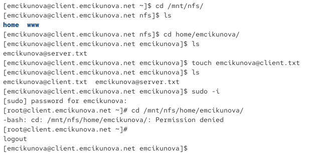{ #fig-020 width=70% }

На сервере проверяю исходный каталог пользователя:

```bash
cd ~/common
ls -l
```

В результате отображаются файлы `emcikunova@server.txt` и `emcikunova@client.txt`. Файл, созданный на клиенте, появился на сервере, что подтверждает корректную работу общего пользовательского каталога NFS (см. рис. [@fig-021]).

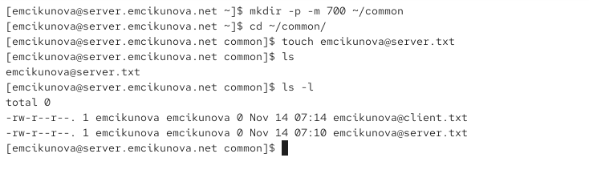{ #fig-021 width=70% }

## Внесение изменений в настройки внутреннего окружения виртуальных машин

На сервере создаю каталог `/vagrant/provision/server/nfs/etc`, копирую в него файл `/etc/exports` и создаю исполняемый скрипт `nfs.sh` для автоматической настройки NFS (см. рис. [@fig-022]).

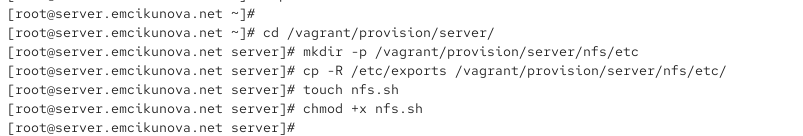{ #fig-022 width=70% }

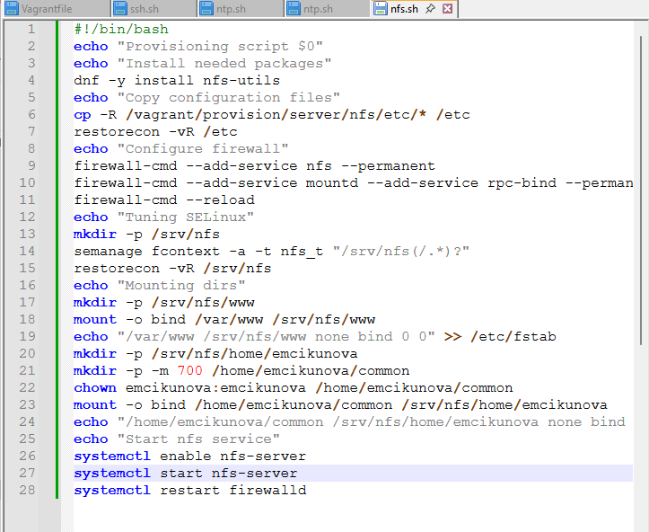{ #fig-023 width=70% }

На клиенте создаю скрипт `/vagrant/provision/client/nfs.sh`, который устанавливает необходимые пакеты и подключает удалённый ресурс, а для автоматического выполнения скриптов в соответствующие разделы `Vagrantfile` добавляются настройки provisioning (см. рис. [@fig-024] и [@fig-025]).

{ #fig-024 width=70% }

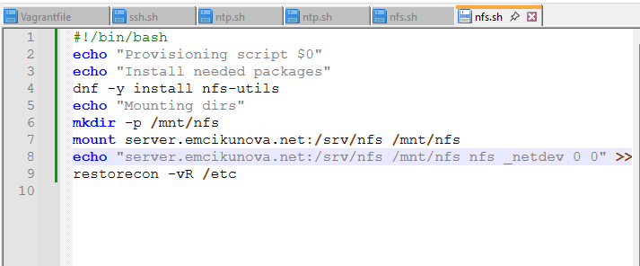{ #fig-025 width=70% }

# Вывод

В ходе лабораторной работы изучены принципы настройки и использования сетевой файловой системы NFSv4. На виртуальной машине `server.emcikunova.net` установлен и настроен NFS-сервер, создан общий каталог `/srv/nfs`, настроены права доступа, контексты SELinux и правила межсетевого экрана.

На виртуальной машине `client.emcikunova.net` выполнено подключение удалённого ресурса NFS и настроено его автоматическое монтирование через `/etc/fstab`. К дереву NFS подключены каталог веб-сервера `/var/www` и пользовательский каталог `/home/emcikunova/common`. Проверены доступность общих ресурсов, права пользователей и возможность создания файлов с клиентской машины.

Созданы скрипты `nfs.sh` для автоматизации установки и настройки NFS-сервера и клиента средствами Vagrant.

# Контрольные вопросы

*1. Как называется файл конфигурации, содержащий общие ресурсы NFS?*

Файл `/etc/exports` содержит список каталогов, предоставляемых сервером NFS для удалённого доступа. В нём указываются пути к экспортируемым ресурсам, разрешённые клиентские узлы или сети и параметры доступа, например `ro` (только чтение) и `rw` (чтение и запись).

*2. Какие порты должны быть открыты в брандмауэре, чтобы обеспечить полный доступ к серверу NFS?*

Для работы NFSv4 необходимо открыть порт `2049/TCP`. Для поддержки RPC-служб и команды `showmount` дополнительно используются порт `111/TCP и UDP` для `rpcbind` и порт службы `mountd`, который может быть динамическим. При использовании NFSv3 могут потребоваться дополнительные порты RPC-служб.

В `firewalld` необходимые разрешения настраиваются добавлением служб `nfs`, `rpc-bind` и `mountd`.

*3. Какую опцию следует использовать в /etc/fstab, чтобы убедиться, что общие ресурсы NFS могут быть установлены автоматически при перезагрузке?*

Следует использовать опцию `_netdev`, которая указывает системе, что для монтирования ресурса необходимо сетевое подключение. Она позволяет учитывать зависимость монтирования NFS от доступности сети при загрузке операционной системы.

Пример записи в `/etc/fstab`:

```fstab
server.emcikunova.net:/srv/nfs /mnt/nfs nfs _netdev 0 0
```

# Список литературы

1. [Red Hat. Deploying an NFS Server — официальное руководство по установке и настройке NFS-сервера, экспорту каталогов через /etc/exports и настройке межсетевого экрана](https://docs.redhat.com/en/documentation/red_hat_enterprise_linux/9/html/configuring_and_using_network_file_services/deploying-an-nfs-server_configuring-and-using-network-file-services).

2. [Red Hat. Mounting NFS Shares — руководство по подключению удалённых ресурсов NFS на клиенте и настройке монтирования сетевых файловых систем](https://docs.redhat.com/en/documentation/red_hat_enterprise_linux/9/htmlsingle/managing_file_systems/index).

3. [Linux man-pages. exports(5) — справочное руководство по синтаксису файла /etc/exports, параметрам ro, rw, root_squash и управлению доступом к общим ресурсам NFS](https://man7.org/linux/man-pages/man5/exports.5.html).

4. [Red Hat. Configuring and Using Network File Services — документация по протоколам NFSv3 и NFSv4, службам RPC, настройке сетевого доступа и проверке работы NFS](https://docs.redhat.com/en/documentation/red_hat_enterprise_linux/9/html-single/configuring_and_using_network_file_services/configuring_and_using_network_file_services).

5. [Red Hat. Using SELinux — руководство по настройке контекстов безопасности файлов и каталогов с использованием команд semanage fcontext и restorecon](https://docs.redhat.com/en/documentation/red_hat_enterprise_linux/9/html-single/using_selinux/using_selinux).

6. [HashiCorp. Vagrant Shell Provisioner — официальная документация по автоматизации настройки виртуальных машин с помощью shell-скриптов и конфигурационного файла Vagrantfile](https://developer.hashicorp.com/vagrant/docs/provisioning/shell).

