---
## Author
author:
  name: Цыкунова Екатерина Михайловна
  email: 1132246732@rudn.ru
  affiliation:
    - name: Российский университет дружбы народов
      country: Российская Федерация
      postal-code: 117198
      city: Москва
      address: ул. Миклухо-Маклая, д. 6

## Title
title: Лабораторная работа №14
subtitle: Настройка файловых служб Samba
license: CC BY
date: today
date-format: "YYYY-MM-DD"
---

# Цели и задачи работы

## Цель лабораторной работы

Целью данной работы является приобретение практических навыков установки и настройки сервера Samba, организации доступа к общим сетевым ресурсам по протоколу SMB/CIFS, настройки прав доступа пользователей, а также автоматизации настройки Samba-сервера и клиента средствами Vagrant.

## Задачи лабораторной работы

- создать общий каталог и настроить права доступа;
- настроить межсетевой экран и SELinux;
- подключить разделяемый ресурс Samba на клиенте;
- проверить возможность чтения и записи файлов;

# Процесс выполнения лабораторной работы

## Устанавливаю Samba и создаю общий каталог на сервере

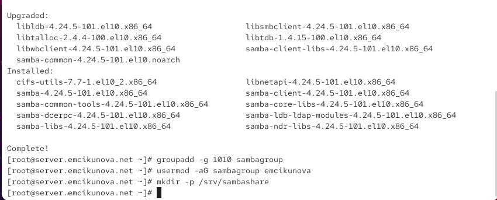{ #fig:001 width=70% height=70% }

## Настраиваю рабочую группу Samba

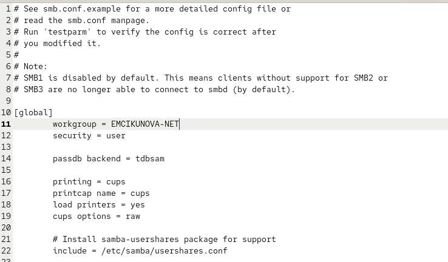{ #fig:002 width=70% height=70% }

## Настраиваю разделяемый ресурс Samba

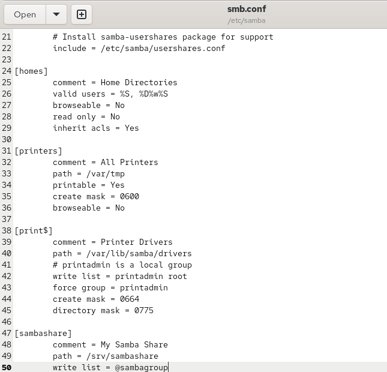{ #fig:003 width=70% height=70% }

## Проверяю конфигурацию Samba

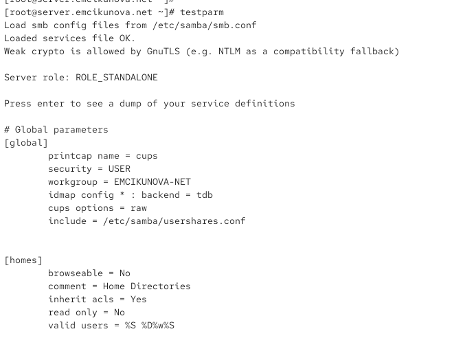{ #fig:004 width=70% height=70% }

## Запускаю Samba и проверяю доступность ресурсов

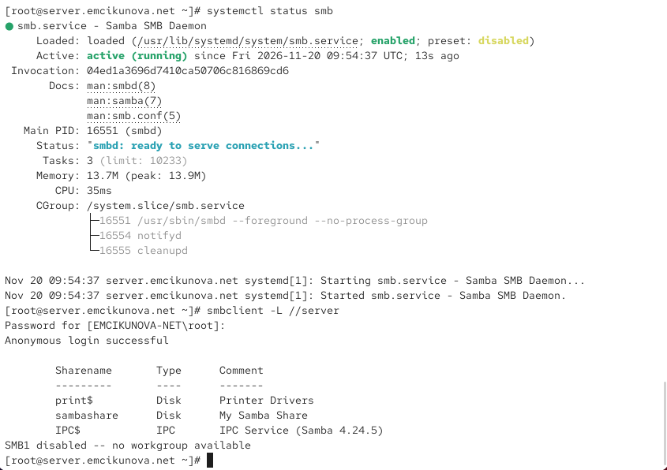{ #fig:005 width=70% height=70% }

## Проверяю параметры межсетевого экрана Samba

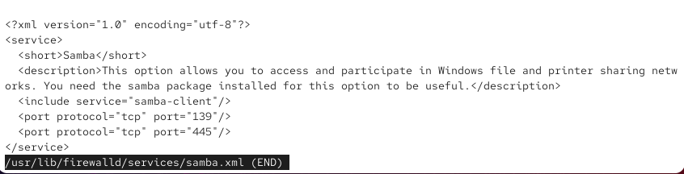{ #fig:006 width=70% height=70% }

## Настраиваю межсетевой экран и SELinux

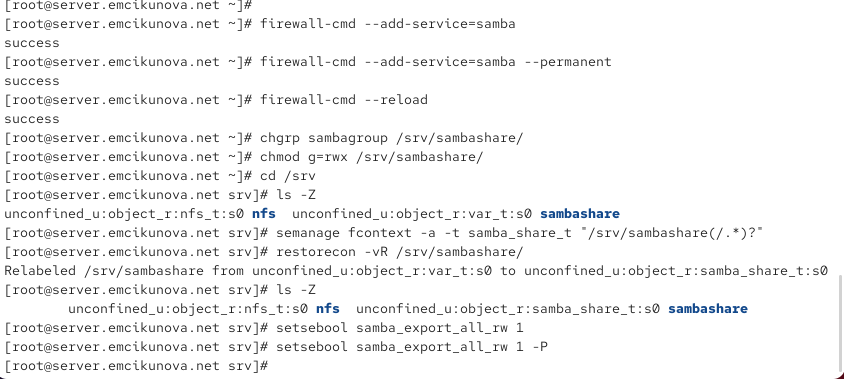{ #fig:007 width=70% height=70% }

## Проверяю запись в общий каталог и создаю пользователя Samba

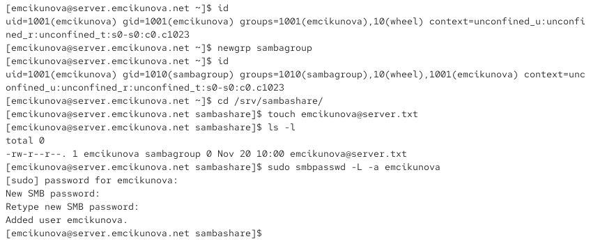{ #fig:008 width=70% height=70% }

## Устанавливаю Samba на клиенте

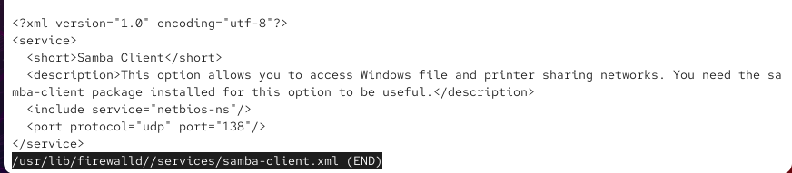{ #fig:009 width=70% height=70% }

## Настраиваю межсетевой экран и группу пользователей клиента

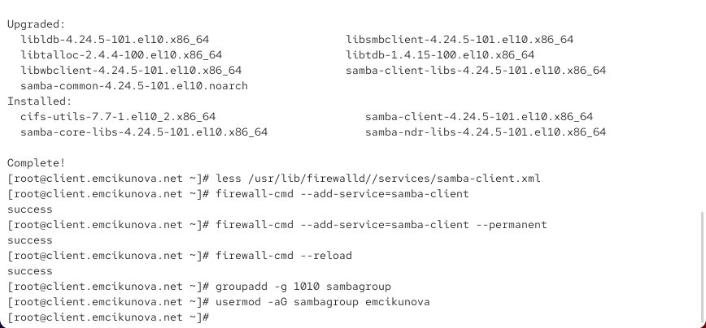{ #fig:010 width=70% height=70% }

## Настраиваю рабочую группу Samba на клиенте

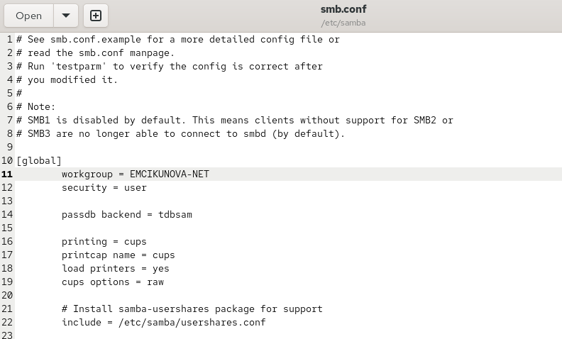{ #fig:011 width=70% height=70% }

## Проверяю подключение к Samba-серверу

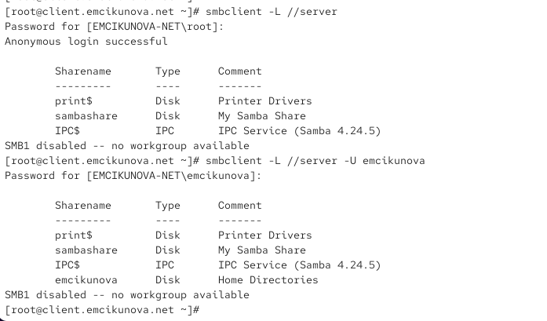{ #fig:012 width=70% height=70% }

## Монтирую разделяемый ресурс Samba на клиенте

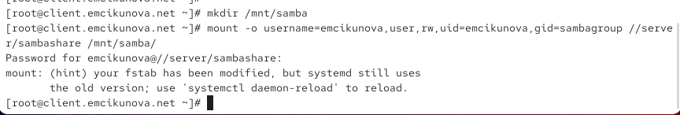{ #fig:013 width=70% height=70% }

## Проверяю чтение и запись файлов в общем каталоге

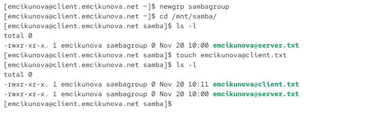{ #fig:014 width=70% height=70% }

## Создаю файл учётных данных Samba

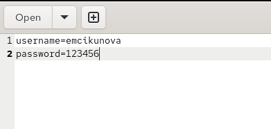{ #fig:015 width=70% height=70% }

## Настраиваю автоматическое монтирование Samba

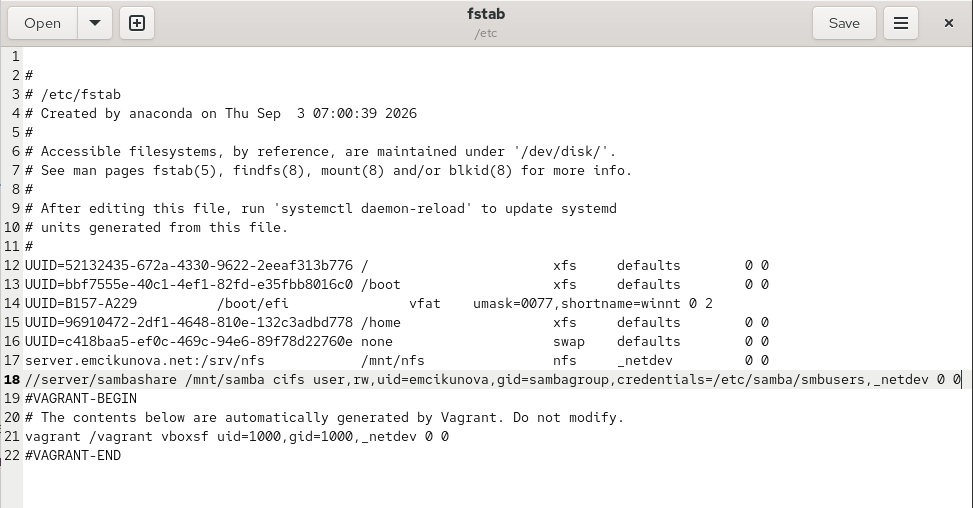{ #fig:016 width=70% height=70% }

## Проверяю автоматическое подключение разделяемого ресурса

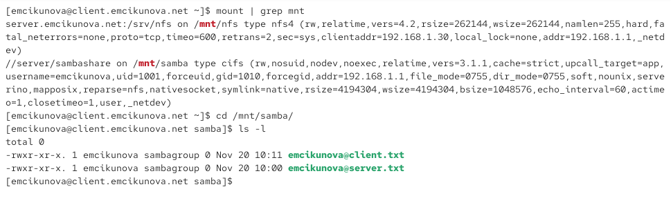{ #fig:017 width=70% height=70% }

## Подготавливаю конфигурацию Samba-сервера для Vagrant

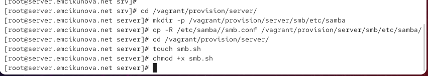{ #fig:018 width=70% height=70% }

## Создаю скрипт автоматической настройки Samba-сервера

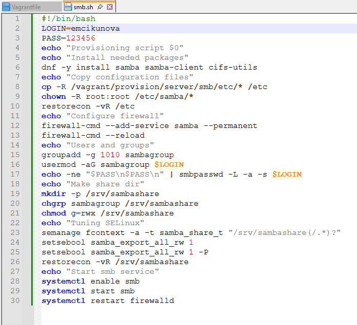{ #fig:019 width=70% height=70% }

## Подготавливаю конфигурацию Samba-клиента для Vagrant

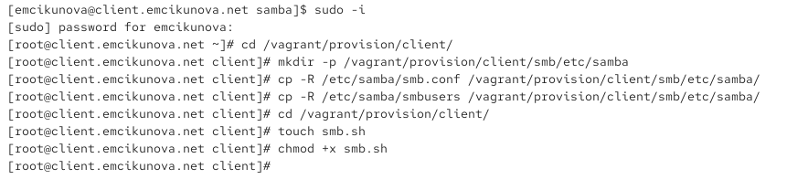{ #fig:020 width=70% height=70% }

## Создаю скрипт автоматической настройки Samba-клиента

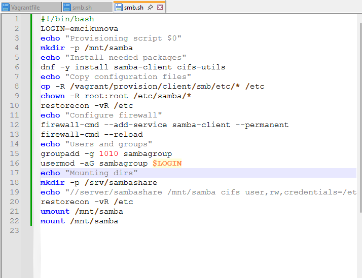{ #fig:021 width=70% height=70% }

# Результаты лабораторной работы

## Вывод

В ходе лабораторной работы я установила и настроила сервер Samba на виртуальной машине `server.emcikunova.net`. Создала общий каталог `/srv/sambashare`, настроила рабочую группу `EMCIKUNOVA-NET`, права доступа пользователей, контексты SELinux и правила межсетевого экрана.

На виртуальной машине `client.emcikunova.net` установила клиентские пакеты Samba и подключила разделяемый ресурс по протоколу CIFS. Настроила автоматическое монтирование через `/etc/fstab` с использованием файла учётных данных.

Проверила доступность общих ресурсов и возможность создания файлов с сервера и клиента. Успешное создание файлов `emcikunova@server.txt` и `emcikunova@client.txt` подтвердило работу общего каталога.
