---
## Author
author:
  name: Цыкунова Екатерина Михайловна
  email: 1132246732@rudn.ru
  affiliation:
    - name: Российский университет дружбы народов
      country: Российская Федерация
      postal-code: 117198
      city: Москва
      address: ул. Миклухо-Маклая, д. 6

## Title
title: "Отчёт по лабораторной работе №14"
subtitle: "Настройка файловых служб Samba"
license: "CC BY"
---

# Цель работы

Приобретение навыков настройки доступа групп пользователей к общим ресурсам по протоколу SMB.

# Выполнение лабораторной работы

## Настройка сервера Samba

На виртуальной машине `server.emcikunova.net` устанавливаю необходимые пакеты, создаю группу `sambagroup`, добавляю пользователя `emcikunova` и создаю общий каталог:

```bash
sudo -i
dnf -y install samba samba-client cifs-utils
groupadd -g 1010 sambagroup
usermod -aG sambagroup emcikunova
mkdir -p /srv/sambashare
```

Установка пакетов и создание каталога завершаются успешно (см. рис. [@fig-001]).

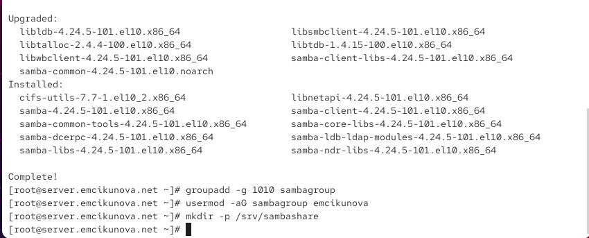{ #fig-001 width=70% }

В файле `/etc/samba/smb.conf` изменяю рабочую группу:

```ini
[global]
workgroup = EMCIKUNOVA-NET
security = user
```

Рабочая группа Samba получает имя `EMCIKUNOVA-NET` (см. рис. [@fig-002]).

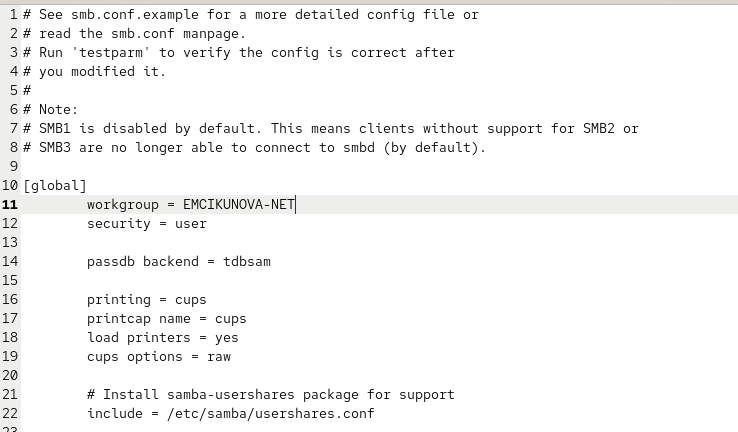{ #fig-002 width=70% }

В конце конфигурационного файла добавляю описание разделяемого ресурса:

```ini
[sambashare]
comment = My Samba Share
path = /srv/sambashare
write list = @sambagroup
```

Пользователям группы `sambagroup` предоставляется право записи в общий каталог (см. рис. [@fig-003]).

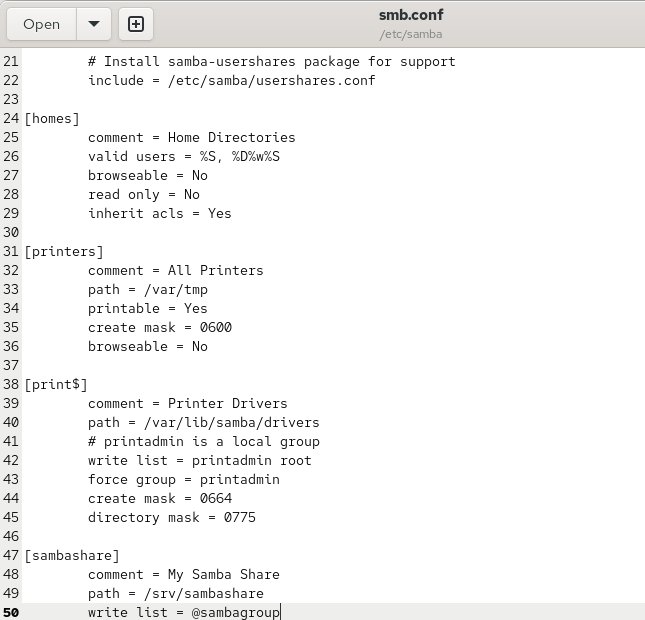{ #fig-003 width=70% }

Проверяю правильность конфигурации:

```bash
testparm
```

Команда выводит сообщение `Loaded services file OK`, подтверждающее отсутствие синтаксических ошибок (см. рис. [@fig-004]).

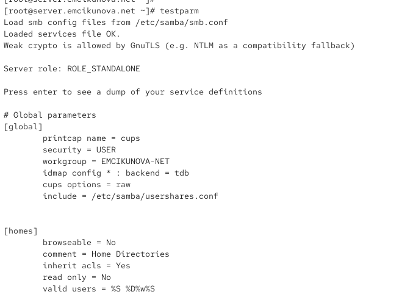{ #fig-004 width=70% }

Запускаю службу Samba и проверяю доступность ресурсов:

```bash
systemctl start smb
systemctl enable smb
systemctl status smb
smbclient -L //server
```

Служба находится в состоянии `active (running)`. При анонимном подключении отображаются ресурсы `print$`, `sambashare` и `IPC$` (см. рис. [@fig-005]).

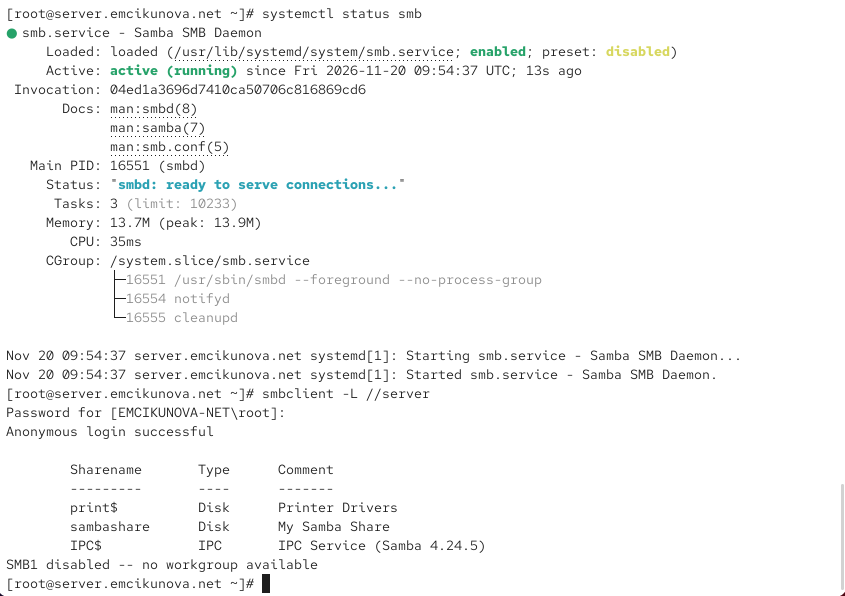{ #fig-005 width=70% }

Просматриваю конфигурацию межсетевого экрана:

```bash
less /usr/lib/firewalld/services/samba.xml
```

В файле указаны TCP-порты `139` и `445`, используемые Samba (см. рис. [@fig-006]).

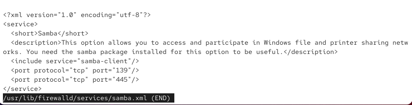{ #fig-006 width=70% }

Разрешаю работу Samba через межсетевой экран, назначаю права на каталог и настраиваю SELinux:

```bash
firewall-cmd --add-service=samba
firewall-cmd --add-service=samba --permanent
firewall-cmd --reload
chgrp sambagroup /srv/sambashare
chmod g=rwx /srv/sambashare
cd /srv
ls -Z
semanage fcontext -a -t samba_share_t "/srv/sambashare(/.*)?"
restorecon -vR /srv/sambashare
ls -Z
setsebool samba_export_all_rw 1
setsebool samba_export_all_rw 1 -P
```

Настройки межсетевого экрана успешно применяются. Каталог получает контекст `samba_share_t`, а Samba разрешается доступ на чтение и запись (см. рис. [@fig-007]).

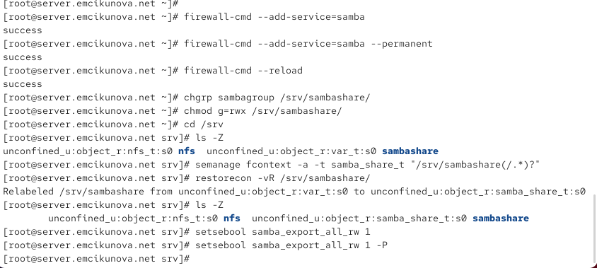{ #fig-007 width=70% }

Проверяю группы пользователя и возможность записи в общий каталог:

```bash
id
newgrp sambagroup
cd /srv/sambashare
touch emcikunova@server.txt
ls -l
```

Файл успешно создаётся. Затем добавляю пользователя в базу Samba:

```bash
sudo smbpasswd -L -a emcikunova
```

После ввода пароля появляется сообщение `Added user emcikunova` (см. рис. [@fig-008]).

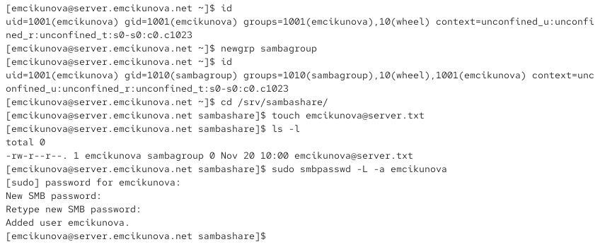{ #fig-008 width=70% }

## Монтирование файловой системы Samba на клиенте

На виртуальной машине `client.emcikunova.net` устанавливаю клиентские пакеты и просматриваю конфигурацию службы `samba-client`:

```bash
sudo -i
dnf -y install samba-client cifs-utils
less /usr/lib/firewalld/services/samba-client.xml
```

В конфигурации указаны сетевые параметры, используемые клиентом Samba (см. рис. [@fig-009]).

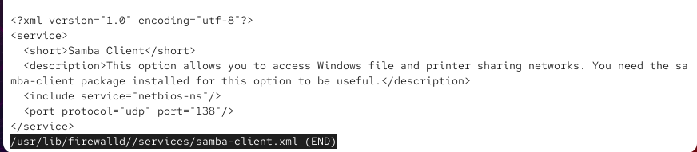{ #fig-009 width=70% }

Настраиваю межсетевой экран и добавляю пользователя в группу `sambagroup`:

```bash
firewall-cmd --add-service=samba-client
firewall-cmd --add-service=samba-client --permanent
firewall-cmd --reload
groupadd -g 1010 sambagroup
usermod -aG sambagroup emcikunova
```

Команды выполняются успешно, правила межсетевого экрана применяются (см. рис. [@fig-010]).

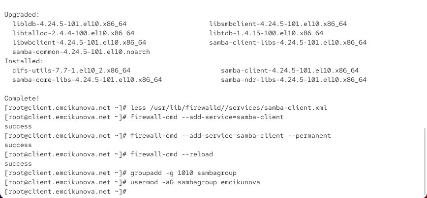{ #fig-010 width=70% }

В файле `/etc/samba/smb.conf` клиента указываю рабочую группу:

```ini
[global]
workgroup = EMCIKUNOVA-NET
security = user
```

Рабочая группа клиента совпадает с рабочей группой сервера (см. рис. [@fig-011]).

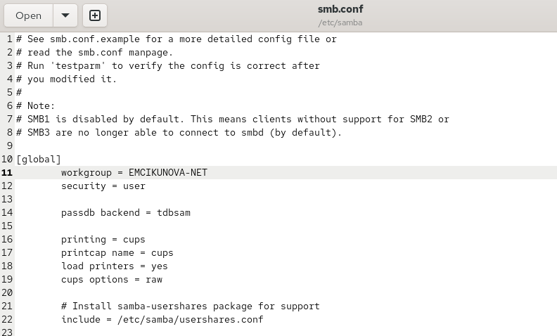{ #fig-011 width=70% }

Проверяю доступность ресурсов сервера сначала анонимно, затем под учётной записью `emcikunova`:

```bash
smbclient -L //server
smbclient -L //server -U emcikunova
```

В первом случае отображаются общедоступные ресурсы, во втором после ввода SMB-пароля дополнительно доступен домашний ресурс пользователя `emcikunova` (см. рис. [@fig-012]).

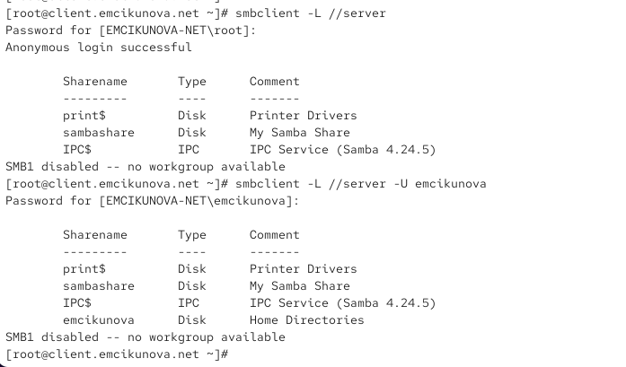{ #fig-012 width=70% }

Создаю точку монтирования и подключаю разделяемый ресурс:

```bash
mkdir /mnt/samba
mount -o username=emcikunova,user,rw,uid=emcikunova,gid=sambagroup //server/sambashare /mnt/samba
```

После ввода пароля ресурс подключается. Появляется предупреждение о необходимости обновить конфигурацию systemd с помощью `systemctl daemon-reload` (см. рис. [@fig-013]).

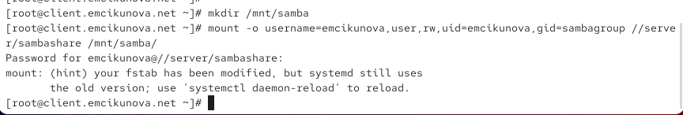{ #fig-013 width=70% }

Проверяю содержимое каталога и создаю файл со стороны клиента:

```bash
newgrp sambagroup
cd /mnt/samba
ls -l
touch emcikunova@client.txt
ls -l
```

В каталоге отображаются файлы `emcikunova@server.txt` и `emcikunova@client.txt`. Создание второго файла подтверждает возможность записи с клиента (см. рис. [@fig-014]).

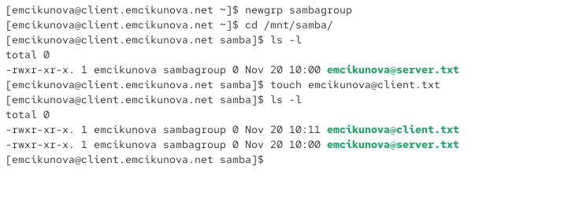{ #fig-014 width=70% }

Для автоматического подключения создаю файл учётных данных:

```bash
umount /mnt/samba
touch /etc/samba/smbusers
chmod 600 /etc/samba/smbusers
```

В файл `/etc/samba/smbusers` записываю имя пользователя и SMB-пароль. Права `600` ограничивают доступ к учётным данным (см. рис. [@fig-015]).

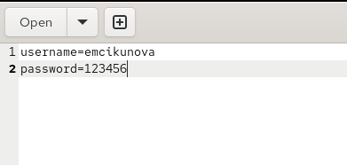{ #fig-015 width=70% }

В `/etc/fstab` добавляю запись для автоматического монтирования:

```fstab
//server/sambashare /mnt/samba cifs user,rw,uid=emcikunova,gid=sambagroup,credentials=/etc/samba/smbusers,_netdev 0 0
```

Параметр `credentials` указывает файл учётных данных, а `_netdev` учитывает необходимость сетевого подключения (см. рис. [@fig-016]).

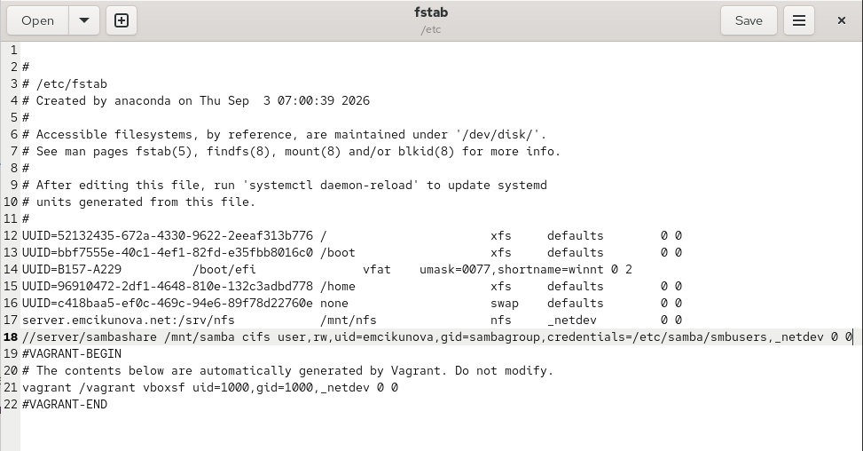{ #fig-016 width=70% }

Применяю настройки и проверяю монтирование:

```bash
systemctl daemon-reload
mount -a
mount | grep mnt
cd /mnt/samba
ls -l
```

Ресурс `//server/sambashare` успешно подключён к `/mnt/samba` по протоколу CIFS. Оба созданных файла доступны на клиенте (см. рис. [@fig-017]).

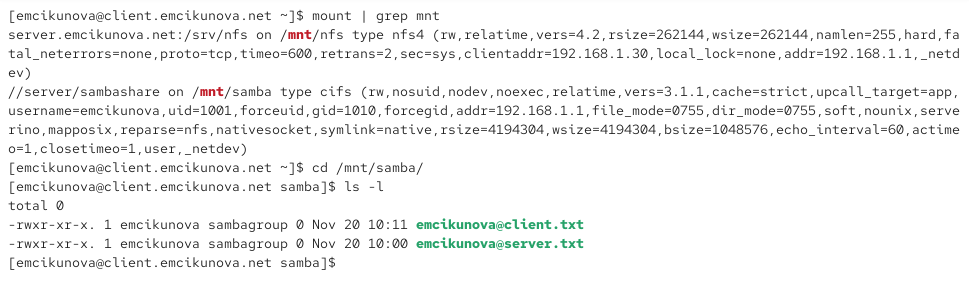{ #fig-017 width=70% }

## Внесение изменений в настройки внутреннего окружения виртуальных машин

На сервере создаю каталог `/vagrant/provision/server/smb` для хранения конфигурации Samba и исполняемый скрипт `smb.sh`, содержащий команды автоматической установки и настройки сервера (см. рис. [@fig-018], [@fig-019]).

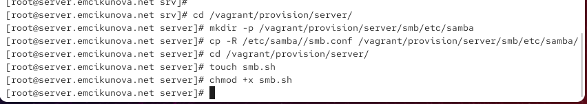{ #fig-018 width=70% }

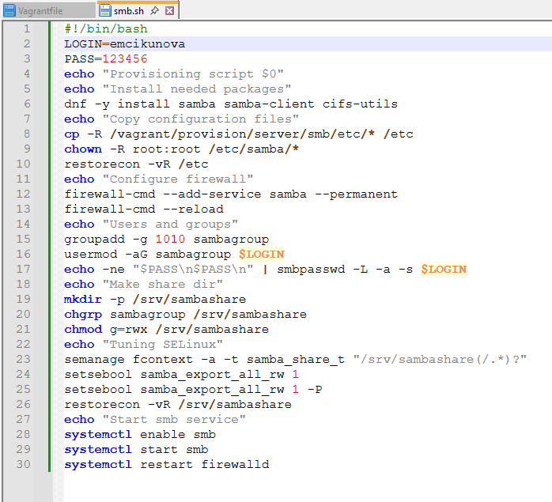{ #fig-019 width=70% }

На клиенте аналогично создаю каталог `/vagrant/provision/client/smb`, сохраняю конфигурационные файлы и подготавливаю скрипт `smb.sh` для автоматического подключения к разделяемому ресурсу (см. рис. [@fig-020], [@fig-021]).

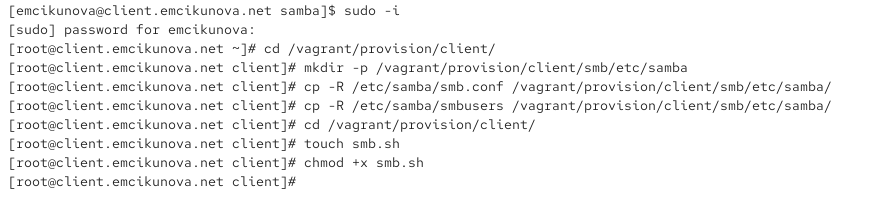{ #fig-020 width=70% }

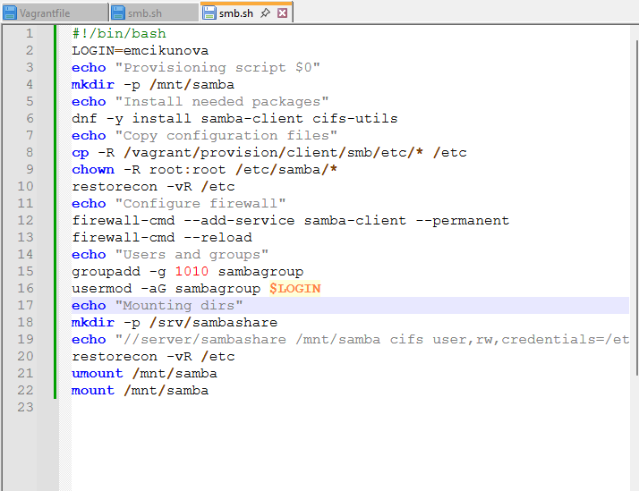{ #fig-021 width=70% }

# Вывод

В ходе лабораторной работы изучены принципы настройки и использования сетевых ресурсов Samba. На виртуальной машине `server.emcikunova.net` установлен и настроен Samba-сервер, создан общий каталог `/srv/sambashare`, настроены права доступа, контексты SELinux и правила межсетевого экрана. Создана группа `sambagroup`, а пользователь `emcikunova` добавлен в базу пользователей Samba.

На виртуальной машине `client.emcikunova.net` выполнено подключение разделяемого ресурса по протоколу CIFS и настроено его автоматическое монтирование через `/etc/fstab`. Проверены доступность общих ресурсов, авторизация пользователей и возможность создания файлов с сервера и клиента.

Созданы скрипты `smb.sh` для автоматизации установки и настройки Samba-сервера и клиента средствами Vagrant.

# Контрольные вопросы

*1. Какова минимальная конфигурация для smb.conf для создания общего ресурса, который предоставляет доступ к каталогу /data?*

Для создания общего ресурса достаточно добавить в файл `/etc/samba/smb.conf` следующий раздел:

```ini
[data]
path = /data
```

Параметр `path` указывает путь к разделяемому каталогу. По умолчанию ресурс доступен только для чтения, а фактический доступ зависит от прав файловой системы и настроек аутентификации Samba.

*2. Как настроить общий ресурс, который даёт доступ на запись всем пользователям, имеющим права на запись в файловой системе Linux?*

В конфигурации общего ресурса необходимо указать параметр `read only = no`:

```ini
[data]
path = /data
read only = no
```

Этот параметр разрешает запись через Samba, но пользователь должен также обладать соответствующими правами на каталог `/data` в файловой системе Linux.

*3. Как ограничить доступ на запись к ресурсу только членам определённой группы?*

Для ограничения доступа на запись используется параметр `write list`, в котором указывается группа пользователей с символом `@`:

```ini
[data]
path = /data
read only = yes
write list = @sambagroup
```

В этом случае право записи через Samba предоставляется только членам группы `sambagroup`, если это также разрешено правами файловой системы Linux.

*4. Какой переключатель SELinux нужно использовать, чтобы позволить пользователям получать доступ к домашним каталогам на сервере через SMB?*

Для разрешения доступа Samba к домашним каталогам пользователей используется переключатель SELinux `samba_enable_home_dirs`.

Для постоянного включения выполняется команда:

```bash
setsebool -P samba_enable_home_dirs on
```

Параметр `-P` обеспечивает сохранение настройки после перезагрузки системы.

*5. Как ограничить доступ к определённому ресурсу только узлам из сети 192.168.10.0/24?*

В конфигурации соответствующего ресурса необходимо указать параметр `hosts allow`:

```ini
[data]
path = /data
hosts allow = 192.168.10.0/24
```

Этот параметр разрешает подключения к ресурсу только клиентам из сети `192.168.10.0/24`. Подключения с других адресов будут отклоняться.

*6. Какую команду можно использовать, чтобы отобразить список всех пользователей Samba на сервере?*

Для просмотра списка зарегистрированных пользователей Samba используется команда:

```bash
pdbedit -L
```

Для получения подробной информации о пользователях можно использовать команду `pdbedit -L -v`.

*7. Что нужно сделать пользователю для доступа к ресурсу, который настроен как многопользовательский ресурс?*

При использовании многопользовательского монтирования Samba пользователь должен добавить свои учётные данные SMB в связку ключей ядра Linux с помощью команды:

```bash
cifscreds add -u username server
```

После ввода пароля пользователь получает доступ к ресурсу под собственной учётной записью. При этом общий ресурс должен быть предварительно смонтирован с параметром `multiuser`.

*8. Как установить общий ресурс Samba в качестве многопользовательской учётной записи, где пользователь alice используется как минимальная учётная запись пользователя?*

Необходимо создать защищённый файл учётных данных `/root/smb.cred`, содержащий имя пользователя `alice` и его SMB-пароль, и установить права `600`.

Затем добавить в `/etc/fstab` следующую запись:

```fstab
//server/share /mnt/samba cifs multiuser,sec=ntlmssp,credentials=/root/smb.cred,_netdev 0 0
```

После выполнения `mount -a` ресурс монтируется с использованием учётной записи `alice`, имеющей минимальные права доступа. Остальные пользователи могут подключаться со своими учётными данными через `cifscreds`.

*9. Как можно запретить пользователям просматривать учётные данные монтирования Samba в файле /etc/fstab?*

Для защиты учётных данных необходимо хранить имя пользователя и пароль в отдельном файле, например `/etc/samba/smbusers`, и ограничить доступ к нему:

```bash
chmod 600 /etc/samba/smbusers
```

В файле `/etc/fstab` вместо пароля указывается параметр:

```text
credentials=/etc/samba/smbusers
```

Это позволяет скрыть пароль от обычных пользователей и использовать его для автоматического подключения ресурса.

*10. Какая команда позволяет перечислить все экспортируемые ресурсы Samba, доступные на определённом сервере?*

Для просмотра списка доступных ресурсов Samba используется команда:

```bash
smbclient -L //server
```

Для подключения под определённой учётной записью применяется параметр `-U`:

```bash
smbclient -L //server -U emcikunova
```

После успешной авторизации команда выводит список ресурсов, доступных указанному пользователю, включая общие каталоги и принтеры.

# Список литературы

1. [Red Hat. Using Samba as a Server — официальное руководство по установке и настройке Samba-сервера, созданию общих каталогов, управлению пользователями и настройке прав доступа](https://docs.redhat.com/en/documentation/red_hat_enterprise_linux/9/html/configuring_and_using_network_file_services/assembly_using-samba-as-a-server_configuring-and-using-network-file-services).

2. [Samba Team. smb.conf — официальная документация по конфигурационному файлу Samba, параметрам разделяемых ресурсов, настройке рабочих групп и ограничению доступа пользователей](https://www.samba.org/samba/docs/current/man-html/smb.conf.5.html).

3. [Red Hat. Mounting an SMB Share — руководство по подключению разделяемых ресурсов Samba на клиенте, использованию CIFS и настройке автоматического монтирования через /etc/fstab](https://docs.redhat.com/en/documentation/red_hat_enterprise_linux/9/html/managing_file_systems/mounting-an-smb-share-on-red-hat-enterprise-linux_managing-file-systems).

4. [Red Hat. Configuring and Using Network File Services — документация по настройке сетевых файловых систем, управлению разрешениями Samba, проверке конфигурации и настройке безопасности SELinux](https://docs.redhat.com/en/documentation/red_hat_enterprise_linux/9/html-single/configuring_and_using_network_file_services/index).

5. [Samba Team. Samba Documentation — официальная документация Samba по работе протокола SMB, настройке сервера, аутентификации пользователей и управлению разделяемыми ресурсами](https://www.samba.org/samba/docs/).

6. [HashiCorp. Vagrant Shell Provisioning — официальное руководство по автоматизации установки программного обеспечения и настройки виртуальных машин с помощью shell-скриптов и Vagrantfile](https://developer.hashicorp.com/vagrant/docs/provisioning/shell).