---
## Author
author:
  name: Цыкунова Екатерина Михайловна
  email: 1132246732@rudn.ru
  affiliation:
    - name: Российский университет дружбы народов
      country: Российская Федерация
      postal-code: 117198
      city: Москва
      address: ул. Миклухо-Маклая, д. 6

## Title
title: Лабораторная работа №15
subtitle: Настройка сетевого журналирования
license: CC BY
date: today
date-format: "YYYY-MM-DD"
---

# Цели и задачи работы

## Цель лабораторной работы

Целью данной работы является приобретение практических навыков настройки централизованного сетевого журналирования системных событий с помощью `rsyslog`, организации передачи сообщений между сервером и клиентом по протоколу TCP, просмотра и анализа системных журналов, а также автоматизации настройки виртуальных машин средствами Vagrant.

## Задачи лабораторной работы

- настроить сервер сетевого журналирования для приёма сообщений по TCP-порту `514`;
- настроить клиент для передачи системных сообщений на сервер;
- проверить работу сетевого журналирования и просмотреть системные журналы;
- изучить инструменты анализа системных событий;

# Процесс выполнения лабораторной работы

## Настраиваю приём сетевых журналов на сервере

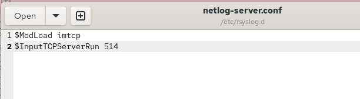{ #fig:001 width=70% height=70% }

## Проверяю TCP-порты и настраиваю межсетевой экран

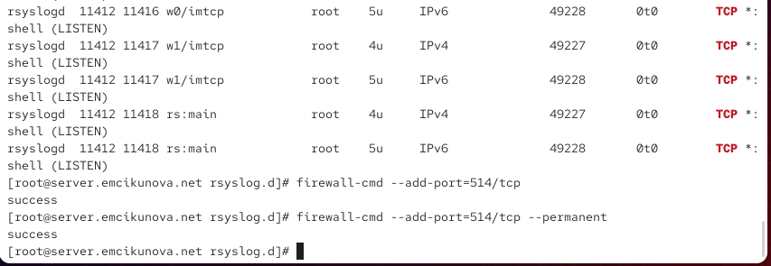{ #fig:002 width=70% height=70% }

## Настраиваю передачу системных сообщений на клиенте

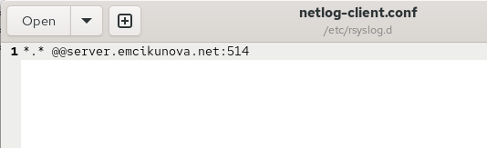{ #fig:003 width=70% height=70% }

## Проверяю поступление системных сообщений на сервер

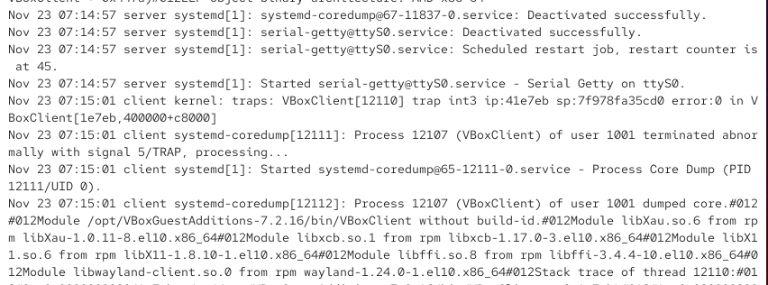{ #fig:004 width=70% height=70% }

## Просматриваю работающие процессы в GNOME System Monitor

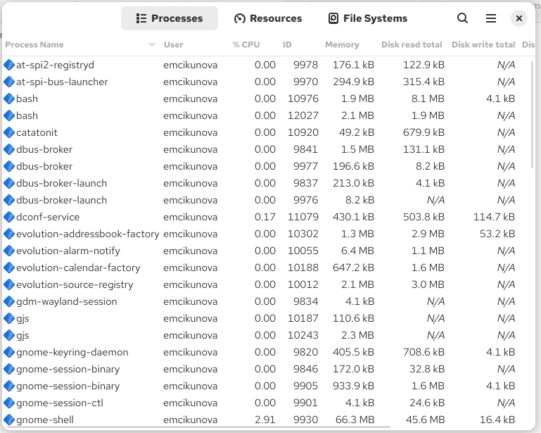{ #fig:005 width=70% height=70% }

## Анализирую использование системных ресурсов

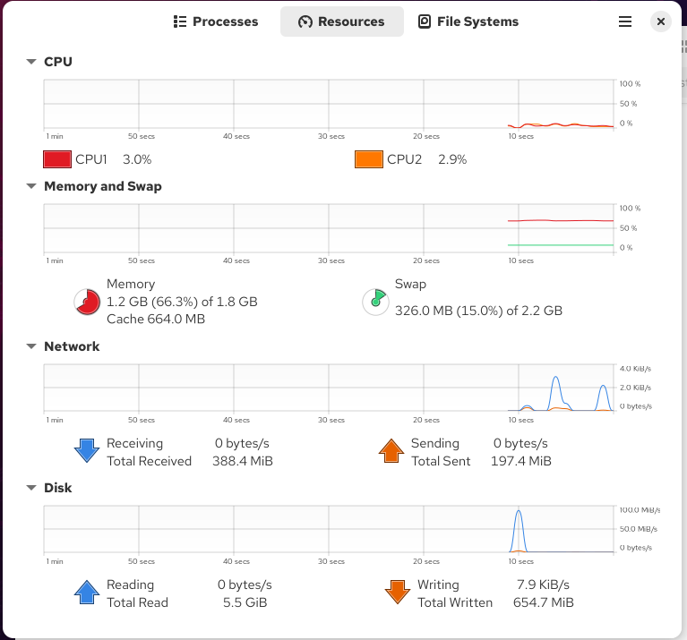{ #fig:006 width=70% height=70% }

## Проверяю состояние файловых систем

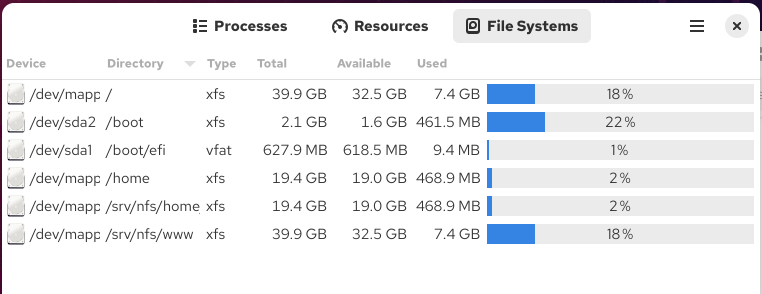{ #fig:007 width=70% height=70% }

## Просматриваю системные журналы с помощью lnav

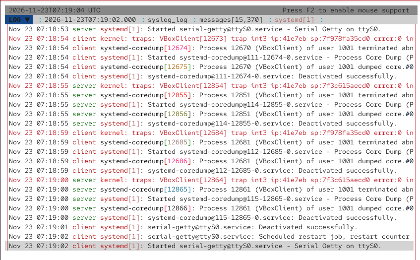{ #fig:008 width=70% height=70% }

## Подготавливаю конфигурацию сервера для Vagrant

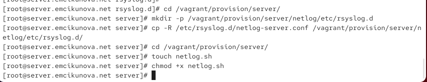{ #fig:009 width=70% height=70% }

## Создаю скрипт автоматической настройки сервера

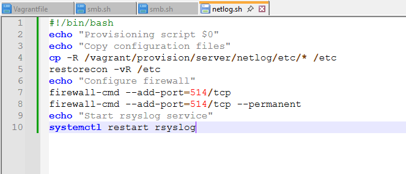{ #fig:010 width=70% height=70% }

## Подготавливаю конфигурацию клиента для Vagrant

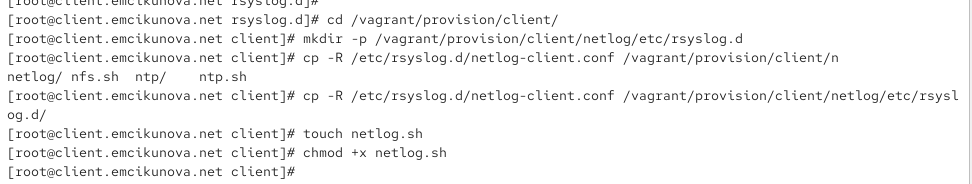{ #fig:011 width=70% height=70% }

## Создаю скрипт автоматической настройки клиента

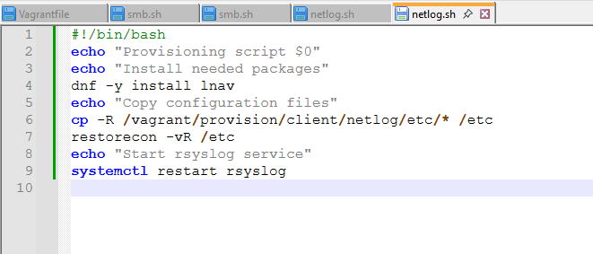{ #fig:012 width=70% height=70% }

# Результаты лабораторной работы

## Вывод

В ходе лабораторной работы я настроила сервер сетевого журналирования на виртуальной машине `server.emcikunova.net`. Создала конфигурационный файл `netlog-server.conf`, включила приём сообщений по протоколу TCP через порт `514` и настроила правила межсетевого экрана.

На виртуальной машине `client.emcikunova.net` настроила пересылку системных сообщений на сервер с помощью службы `rsyslog`. Проверила поступление записей от обеих виртуальных машин в файл `/var/log/messages`.

Просмотрела системные журналы с помощью `tail` и `lnav`, а также изучила процессы и использование системных ресурсов в `gnome-system-monitor`.
