---
## Author
author:
  name: Цыкунова Екатерина Михайловна
  email: 1132246732@rudn.ru
  affiliation:
    - name: Российский университет дружбы народов
      country: Российская Федерация
      postal-code: 117198
      city: Москва
      address: ул. Миклухо-Маклая, д. 6

## Title
title: "Отчёт по лабораторной работе №15"
subtitle: "Настройка сетевого журналирования"
license: "CC BY"
---

# Цель работы

Получение навыков по работе с журналами системных событий.

# Выполнение лабораторной работы

## Настройка сервера сетевого журнала

На виртуальной машине `server.emcikunova.net` перехожу в каталог конфигурации `rsyslog` и создаю файл для настройки сетевого журналирования:

```bash
sudo -i
cd /etc/rsyslog.d
touch netlog-server.conf
```

В файле `/etc/rsyslog.d/netlog-server.conf` добавляю параметры для приёма сообщений системного журнала по протоколу TCP через порт `514`:

```ini
$ModLoad imtcp
$InputTCPServerRun 514
```

Параметр `$ModLoad imtcp` загружает модуль приёма сообщений по TCP, а `$InputTCPServerRun 514` включает прослушивание порта `514` (см. рис. [@fig-001]).

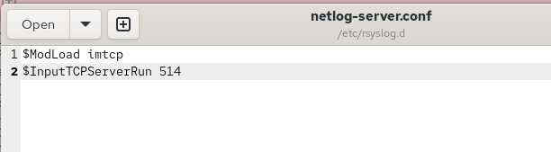{ #fig-001 width=70% }

После изменения конфигурации перезапускаю службу `rsyslog` и проверяю прослушиваемые TCP-порты:

```bash
systemctl restart rsyslog
lsof | grep TCP
```

В выводе команды `lsof` присутствуют записи процесса `rsyslogd` с TCP-сокетами в состоянии `LISTEN`, что подтверждает работу сетевого приёма сообщений.

Для разрешения входящих подключений на порт `514` настраиваю межсетевой экран:

```bash
firewall-cmd --add-port=514/tcp
firewall-cmd --add-port=514/tcp --permanent
```

Обе команды завершаются сообщением `success`, подтверждающим успешное добавление правила в текущую и постоянную конфигурации межсетевого экрана (см. рис. [@fig-002]).

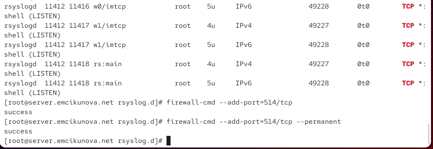{ #fig-002 width=70% }

## Настройка клиента сетевого журнала

На виртуальной машине `client.emcikunova.net` создаю отдельный конфигурационный файл для передачи системных сообщений на сервер:

```bash
sudo -i
cd /etc/rsyslog.d
touch netlog-client.conf
```

В файле `/etc/rsyslog.d/netlog-client.conf` указываю правило перенаправления всех сообщений системного журнала на сервер `server.emcikunova.net` через TCP-порт `514`:

```ini
*.* @@server.emcikunova.net:514
```

Выражение `*.*` задаёт передачу сообщений всех категорий и уровней важности, а символы `@@` обозначают использование протокола TCP (см. рис. [@fig-003]).

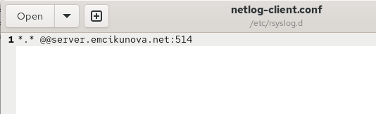{ #fig-003 width=70% }

После изменения конфигурационного файла перезапускаю службу `rsyslog` для применения настроек:

```bash
systemctl restart rsyslog
```

Клиент настроен для отправки системных сообщений на сервер сетевого журналирования.

## Просмотр журналов системных событий

На сервере `server.emcikunova.net` открываю файл системного журнала `/var/log/messages` для просмотра сообщений в режиме реального времени:

```bash
tail -f /var/log/messages
```

В выводе команды наблюдаю записи с именами хостов `server` и `client`, что подтверждает поступление сообщений от обеих виртуальных машин.

В журнале присутствуют сообщения служб `systemd`, `kernel` и `systemd-coredump`. Также обнаруживаются сообщения о завершении процесса `VBoxClient` с сигналом `TRAP` и создании дампов памяти (см. рис. [@fig-004]).

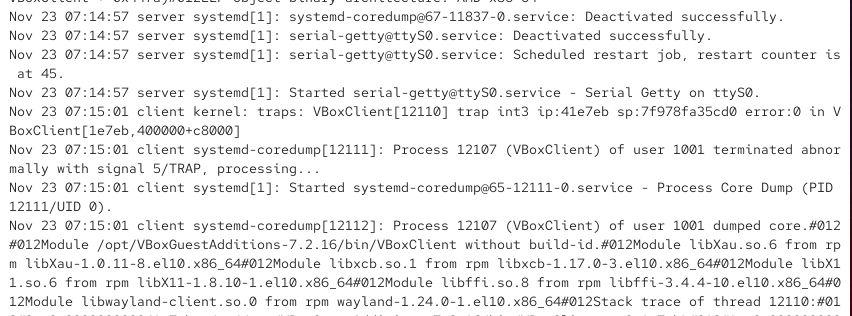{ #fig-004 width=70% }

Для графического просмотра состояния системы на сервере под пользователем `emcikunova` запускаю программу GNOME System Monitor:

```bash
gnome-system-monitor
```

На вкладке `Processes` просматриваю список работающих процессов, включая имя пользователя, идентификатор процесса, потребление процессорного времени и оперативной памяти.

В списке отображаются процессы пользователя `emcikunova`, в том числе `bash`, `dbus-broker`, `gnome-shell` и другие системные компоненты (см. рис. [@fig-005]).

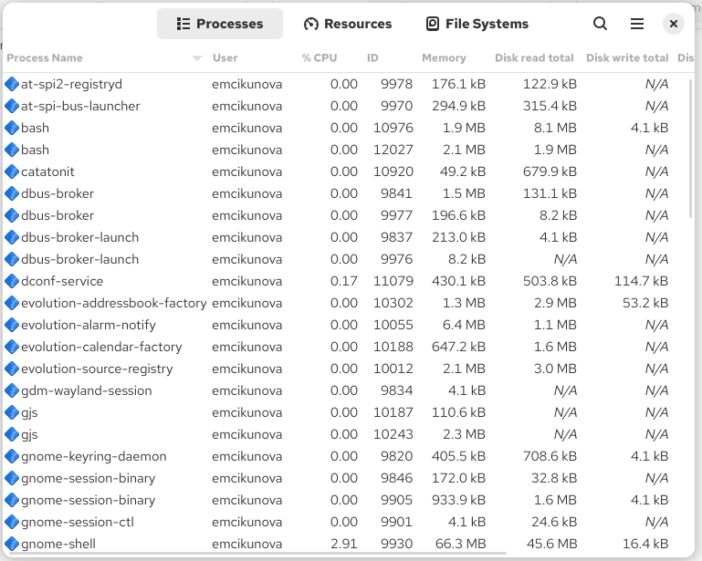{ #fig-005 width=70% }

Перехожу на вкладку `Resources` для просмотра загрузки процессоров, оперативной памяти, раздела подкачки, сетевой активности и операций с диском.

В момент наблюдения загрузка процессоров составляет около `3%`, использование оперативной памяти — `1.2 GiB` из `1.8 GiB`, а раздела подкачки — `326.0 MiB` из `2.2 GiB` (см. рис. [@fig-006]).

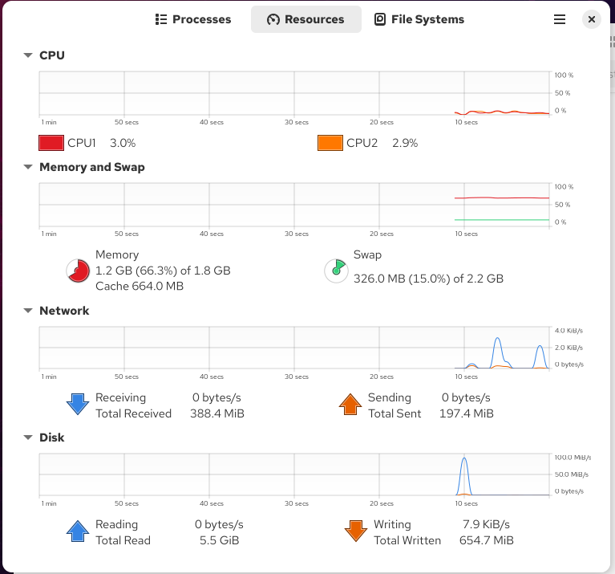{ #fig-006 width=70% }

На вкладке `File Systems` просматриваю подключённые файловые системы и степень заполнения разделов.

В списке отображаются разделы `/`, `/boot`, `/boot/efi`, `/home`, а также каталоги `/srv/nfs/home` и `/srv/nfs/www`. Для каждого раздела указываются файловая система, общий объём, свободное пространство и процент использования (см. рис. [@fig-007]).

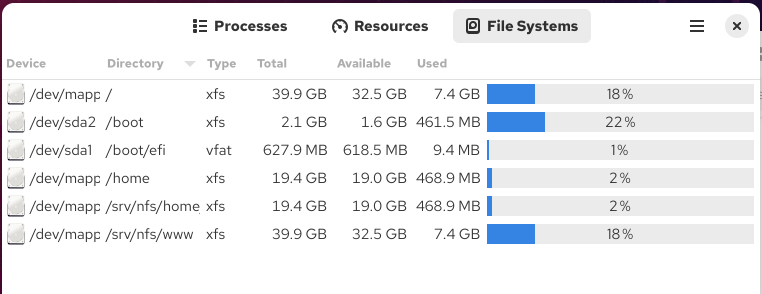{ #fig-007 width=70% }

Для просмотра и анализа системных журналов в терминале устанавливаю программу `lnav`:

```bash
sudo dnf -y install lnav
```

После установки запускаю просмотрщик:

```bash
lnav
```

В интерфейсе `lnav` просматриваю записи системного журнала с отметками времени, именами хостов и названиями служб.

В журнале отображаются сообщения от `server` и `client`, в том числе записи `kernel`, `systemd` и `systemd-coredump`. Сообщения о сбоях `VBoxClient` выделяются цветом, что облегчает обнаружение ошибок (см. рис. [@fig-008]).

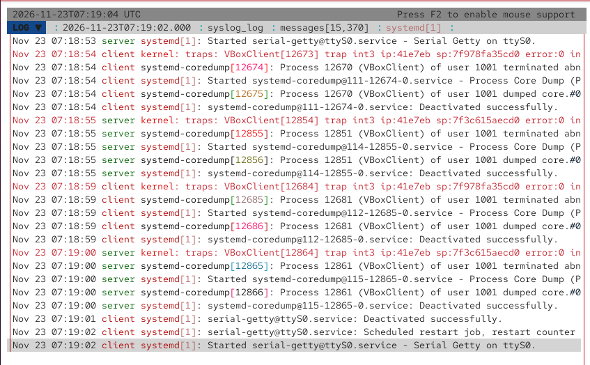{ #fig-008 width=70% }

Наличие записей от обеих виртуальных машин подтверждает работоспособность передачи системных сообщений с клиента на сервер по сети. При этом в журналах обнаруживаются сообщения о сбоях компонентов VirtualBox Guest Additions, устранение которых в представленных результатах не зафиксировано.

## Внесение изменений в настройки внутреннего окружения виртуальных машин

На виртуальной машине `server.emcikunova.net` создаю необходимые каталоги, копирую конфигурационные файлы и подготавливаю исполняемый скрипт `netlog.sh` для автоматической настройки сервера сетевого журналирования (см. рис. [@fig-009] и [@fig-010]).

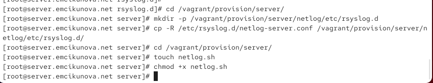{ #fig-009 width=70% }

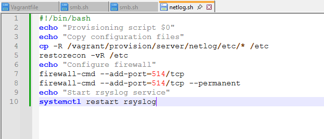{ #fig-010 width=70% }

На виртуальной машине `client.emcikunova.net` выполняю аналогичные действия, создаю скрипт `netlog.sh` для настройки клиента и предусматриваю запуск скриптов через конфигурационный файл `Vagrantfile` (см. рис. [@fig-011] и [@fig-012]).

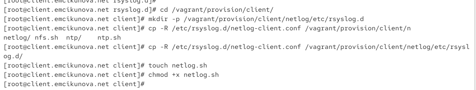{ #fig-011 width=70% }

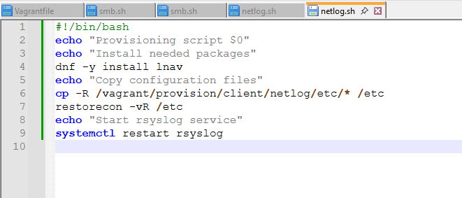{ #fig-012 width=70% }

# Вывод

В ходе лабораторной работы изучены принципы настройки и использования сетевого журналирования системных событий с помощью `rsyslog`. На виртуальной машине `server.emcikunova.net` настроен приём сообщений по протоколу TCP через порт `514`, создан конфигурационный файл `/etc/rsyslog.d/netlog-server.conf` и добавлены необходимые правила межсетевого экрана.

На виртуальной машине `client.emcikunova.net` настроена передача системных сообщений на сервер через файл `/etc/rsyslog.d/netlog-client.conf`. Выполнен просмотр журналов с помощью команд `tail`, программы `lnav` и графического приложения `gnome-system-monitor`. Подтверждено поступление сообщений от сервера и клиента в общий системный журнал.

Созданы скрипты `netlog.sh` для автоматизации настройки сервера и клиента сетевого журналирования средствами Vagrant.

# Контрольные вопросы

*1. Какой модуль rsyslog вы должны использовать для приёма сообщений от journald?*

Для приёма сообщений из системного журнала `systemd-journald` используется модуль `imjournal`. Он позволяет `rsyslog` читать сообщения непосредственно из журнала `journald`, включая дополнительные метаданные.

Для подключения модуля в файле `/etc/rsyslog.conf` используется директива:

```ini
module(load="imjournal")
```

*2. Как называется устаревший модуль, который можно использовать для включения приёма сообщений журнала в rsyslog?*

Для приёма сообщений через традиционный механизм системного журналирования используется модуль `imuxsock`. Он обеспечивает получение сообщений через локальный Unix-сокет, в том числе сообщений, пересылаемых службой `journald`.

Для подключения модуля используется директива:

```ini
$ModLoad imuxsock
```

Модуль `imuxsock` продолжает поддерживаться, однако в рассматриваемой конфигурации он представляет альтернативный, более старый способ получения сообщений по сравнению с непосредственным чтением журнала через `imjournal`.

*3. Чтобы убедиться, что устаревший метод приёма сообщений из journald в rsyslog не используется, какой дополнительный параметр следует использовать?*

Для отключения приёма сообщений через локальный системный сокет в файле `/etc/rsyslog.conf` используется параметр:

```ini
$OmitLocalLogging on
```

Этот параметр отключает традиционный механизм получения локальных сообщений через `imuxsock`. При использовании `imjournal` сообщения продолжают поступать непосредственно из журнала `journald`.

В современном синтаксисе аналогичную настройку можно задать с помощью параметра `SysSock.Use="off"`.

*4. В каком конфигурационном файле содержатся настройки, которые позволяют вам настраивать работу журнала?*

Основные настройки службы `systemd-journald` находятся в файле `/etc/systemd/journald.conf`.

В этом файле определяются параметры хранения, ограничения размера журнала и правила пересылки системных сообщений.

Дополнительные настройки могут размещаться в каталоге `/etc/systemd/journald.conf.d/`.

*5. Каким параметром управляется пересылка сообщений из journald в rsyslog?*

За пересылку сообщений из `journald` в традиционную службу системного журналирования отвечает параметр `ForwardToSyslog` в файле `/etc/systemd/journald.conf`.

Для включения пересылки указывается:

```ini
[Journal]
ForwardToSyslog=yes
```

Значение `yes` включает пересылку сообщений через системный сокет, а `no` отключает её. Этот параметр относится к механизму пересылки через сокет и не требуется для непосредственного чтения журнала модулем `imjournal`.

*6. Какой модуль rsyslog вы можете использовать для включения сообщений из файла журнала, не созданного rsyslog?*

Для чтения сообщений из сторонних текстовых файлов журналов используется модуль `imfile`.

Он позволяет отслеживать изменения в указанных файлах и передавать новые записи в систему журналирования `rsyslog`.

Для подключения модуля используется директива:

```ini
module(load="imfile")
```

Модуль может применяться для централизованного сбора журналов приложений, которые записывают сообщения в собственные файлы.

*7. Какой модуль rsyslog вам нужно использовать для пересылки сообщений в базу данных MariaDB?*

Для записи системных сообщений в базу данных MariaDB используется модуль `ommysql`.

Он обеспечивает подключение к базе данных MySQL или MariaDB и сохранение записей системного журнала в таблицах базы данных.

Для подключения модуля используется директива:

```ini
module(load="ommysql")
```

Для работы модуля необходимо установить соответствующий пакет `rsyslog-mysql` и настроить параметры подключения к базе данных.

*8. Какие две строки вам нужно включить в rsyslog.conf, чтобы позволить текущему журнальному серверу получать сообщения через TCP?*

Для включения приёма сетевых сообщений через TCP-порт `514` в конфигурационный файл `/etc/rsyslog.conf` необходимо добавить две строки:

```ini
$ModLoad imtcp
$InputTCPServerRun 514
```

Первая строка загружает модуль `imtcp`, обеспечивающий приём сообщений по протоколу TCP.

Вторая строка запускает TCP-сервер на порту `514`, через который могут поступать сообщения от удалённых клиентов.

После изменения конфигурации необходимо перезапустить службу:

```bash
systemctl restart rsyslog
```

*9. Как настроить локальный брандмауэр, чтобы разрешить приём сообщений журнала через порт TCP 514?*

Для разрешения входящих TCP-соединений на порт `514` необходимо добавить соответствующее правило в межсетевой экран `firewalld`:

```bash
firewall-cmd --add-port=514/tcp
firewall-cmd --add-port=514/tcp --permanent
```

Первая команда открывает порт `514` в текущей конфигурации межсетевого экрана.

Вторая команда сохраняет правило в постоянной конфигурации, обеспечивая его применение после перезагрузки системы.

Для проверки настройки используется команда:

```bash
firewall-cmd --list-ports
```

В выводе должен присутствовать порт `514/tcp`, подтверждающий разрешение входящих соединений для службы сетевого журналирования.

# Список литературы

1. [Red Hat. Configuring a Remote Logging Solution — официальное руководство по настройке централизованного журналирования с помощью rsyslog, организации приёма и передачи системных сообщений по TCP, настройке сервера и клиента сетевого журнала](https://docs.redhat.com/en/documentation/red_hat_enterprise_linux/9/html/security_hardening/assembly_configuring-a-remote-logging-solution_security-hardening).

2. [Rsyslog Project. TCP Syslog Input Module (imtcp) — официальная документация по настройке модуля imtcp, приёму системных сообщений через TCP-порт 514 и конфигурированию сетевого сервера журналирования](https://docs.rsyslog.com/doc/configuration/modules/imtcp.html).

3. [systemd. journald.conf — официальная документация по настройке службы systemd-journald, управлению хранением системных журналов и пересылкой сообщений в rsyslog с помощью параметра ForwardToSyslog](https://www.freedesktop.org/software/systemd/man/latest/journald.conf.html).

4. [HashiCorp. Shell Scripts — Provisioning — официальное руководство по автоматизации настройки виртуальных машин с помощью Vagrant, созданию shell-скриптов и подключению сценариев автоматической настройки через Vagrantfile](https://developer.hashicorp.com/vagrant/docs/provisioning/shell).